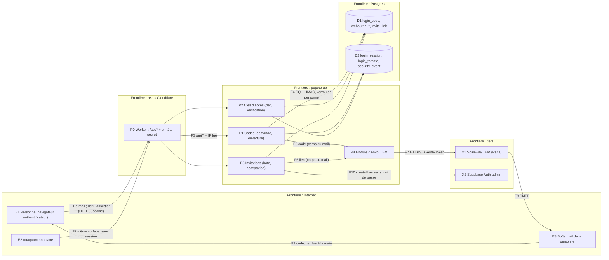

# Socle 0.4bis : la connexion sans mot de passe

> **For agentic workers:** REQUIRED SUB-SKILL: Use superpowers:subagent-driven-development (recommended) or
> superpowers:executing-plans to implement this plan task-by-task. Steps use checkbox (`- [ ]`) syntax for
> tracking.

**Goal :** remplacer, dans `popote-api`, la connexion par mot de passe de l'étape 0.4 par une connexion **sans
mot de passe** : un code à 6 chiffres reçu par mail la première fois sur un appareil, puis une clé d'accès
(passkey WebAuthn) ; le code par mail reste le secours partout. L'invitation part par mail. L'envoi réel passe par
Scaleway Transactional Email. Rien ne change pour Kamil : la nouvelle appli n'est pas en ligne.

**Architecture :** référence : la spec du socle (`2026-11-12-socle-design.md`, « la spec »), § 3, § 4, § 7, § 9,
§ 12, **amendée par la section suivante**, et le plan 0.4 (`2026-11-12-socle-0-4.md`, ses amendements B1 à B27)
dont tout ce qui est fusionné (T1 à T14, T15a) est la base : sessions par cookie (`login_session`), deux pools et
`base.connexion()` / `base.personne()` / `base.service()`, `login_throttle` et `prend_les_creneaux`, journal de
sécurité et clés HMAC (`Empreintes`), idempotence, garde d'origine, `exige_reauth`, `EnvoiMail`. Principe : l'API ne
détient et ne vérifie plus aucun mot de passe ; elle prouve la possession d'une **clé d'accès** (signature) ou de la
**boîte mail** (code), puis ouvre une session. Le navigateur ne détient qu'un cookie. Une preuve et la session qu'elle
ouvre se font **sous le même verrou de personne** et dans **la même transaction** (leçon 1 de T15b).

**Tech Stack :** Python 3.13, FastAPI, Pydantic v2, psycopg 3 + `psycopg_pool`, `httpx` (Scaleway TEM, Auth admin),
**`webauthn` 3.0.1 (py_webauthn, BSD-3-Clause)** : seule dépendance ajoutée (avec ses 5 dépendances directes :
`cryptography`, `pyOpenSSL`, `cbor2`, `pyasn1`, `pyasn1-modules`), pgcrypto retiré de la connexion, `pg_cron`,
pytest, ruff (règles `S`), mypy strict ; Supabase CLI ; Schemathesis et `oasdiff` (0.3 T9) ; Playwright et le
protocole CDP de Chromium côté `popote-web` (S16). Aucune bibliothèque de session ni de jeton.

**Hors périmètre :** les écrans (connexion, code, clés, invitation : front, 0.5 et session design) et les gabarits
HTML des mails (texte clair ici) ; le changement d'e-mail d'un compte (aucun écran ne l'utilise ; il exigera les
deux boîtes, voir OWASP Authentication Cheat Sheet) ; des codes de secours imprimés (la boîte mail est le secours,
voir D3) ; l'appel du « signal API » WebAuthn côté navigateur (0.5) ; les clés d'accès sur les aperçus de fusion
`*.workers.dev` (le RP ID ne peut pas y être celui de l'essai : ces aperçus n'offrent que le code) ; l'effacement des hachages de mots de passe de
`auth.users` et de la colonne `password_set` (contraction à J+2, étape 0.8 : l'appli actuelle en dépend pendant la
fenêtre de retour) ; le verrouillage de Supabase Auth et la coupure des clés historiques (0.7).

---

## Amendements à la spec § 4 (décision D3 du 13/11/2026)

Ce que Kamil a tranché le 13/11 : **plus aucun mot de passe dans la nouvelle appli** ; un code à 6 chiffres reçu par
mail la première fois sur un appareil, puis une clé d'accès (Face ID, empreinte, Windows Hello, ou QR code scanné avec
le téléphone) ; le code par mail reste le secours partout ; l'**invitation part par mail** (l'hôte saisit le
prénom et l'e-mail, statuts envoyée / ouverte / acceptée, « Renvoyer » limité, lien à copier en secours,
acceptation en un geste, puis proposition de créer la clé). Le domaine `notre-popote.fr` est vérifié chez Scaleway TEM
(SPF, DKIM, DMARC). Ce plan écrit ce que cela change dans la spec ; la tâche S17 reporte ces lignes dans la spec.

### Ce qui change

| Spec | Avant (0.4) | Après (0.4bis) |
|---|---|---|
| § 4 « Comptes » | comptes et hachages restent dans Supabase Auth | les comptes restent dans Supabase Auth ; **plus aucun mot de passe n'est vérifié ni écrit** par l'API. Un compte neuf est créé sans mot de passe (GoTrue en tire un de 64 caractères que personne ne connaît, S1) ; un compte repris reçoit un mot de passe aléatoire jeté. Les hachages existants restent en base jusqu'à J+2 pour l'appli actuelle |
| § 4 « Vérifier un mot de passe », « Comptes sans mot de passe », « Mots de passe » (NIST 800-63B-4), « Réinitialisation » | `crypt()` en base, règles de 15 caractères, liste de fuites, lien de réinitialisation | **supprimés** (S3, S11, S15). Pwned Passwords sort de la liste des sous-traitants. Le code par mail **est** la récupération |
| § 4 « Session », « Durée », « CSRF » | cookie `__Host-popote_session`, 30 jours glissants, 90 au plus | **inchangés**. Une colonne `opened_with` (`code`, `cle`, `invitation`) dit comment la session est née (liste des appareils, fermeture des sessions d'une clé supprimée) |
| § 4 « Gestes sensibles » | le mot de passe saisi depuis moins de 5 minutes | une **clé d'accès** ou un **code par mail** saisi depuis moins de 5 minutes (300 s, inchangé) : supprimer son compte, ajouter ou supprimer une clé |
| § 4 « Invitation » | lien sans e-mail ; l'invitée saisit e-mail et mot de passe | l'hôte saisit **prénom et e-mail** ; le lien part par mail ; **l'e-mail du compte est celui de l'invitation** (liaison stricte) ; l'acceptation est un geste ; compte et session naissent dans une transaction |
| § 4 « Appareils » | sessions | sessions **et clés d'accès** (lister, renommer, supprimer) |
| § 4 « Journal de sécurité » | événements de mot de passe | huit types ajoutés (`code_demande`, `connexion_par_code`, `connexion_par_cle`, `cle_ajoutee`, `cle_supprimee`, `cle_suspecte`, `invitation_envoyee`, `invitation_renvoyee`) ; on n'enlève jamais un type : l'historique garde son sens |
| § 3.6 limites | connexion 5 essais par compte et 20 par IP en 15 min, plafond 60 min ; réinitialisation 3 par heure | demande de code : 10 par IP et 3 par (e-mail, IP) par 15 min, 6 par e-mail par heure, coupe-circuit de 60 mails par heure compté à l'envoi ; essais de code : 5 par code, 5 par compte et 20 par IP en 15 min, **plafond d'attente 24 h** ; connexion par clé : 20 par IP en 15 min ; renvoi d'une invitation : 3 au plus, 10 min d'écart |
| § 3.10 routes publiques | connexion, invitation, réinitialisation | **demande de code, défi de clé d'accès, ouverture de session**, lecture et acceptation d'invitation ; plus de réinitialisation |
| § 5.3 tables | `session`, `password_reset`… | `login_code`, `webauthn_credential`, `webauthn_user`, `webauthn_challenge` ; `password_reset` part (S15) |
| § 7.1 API2, § 7.7 RGPD | mots de passe NIST, Pwned Passwords | codes à usage unique, clés d'accès ; sous-traitant **Scaleway TEM** (adresse du destinataire, objet et adresse IP émettrice gardés tant que le domaine est actif ; contenu effacé à l'acceptation par le serveur du destinataire, au premier rebond dur ou après 36 h, sauvegardes chiffrées 7 jours : vérifié, voir Sources) ; données de l'invité (prénom, e-mail) sur `invite_link` |
| § 12 D3, D6 | à poser | **D3 décidée** (passkey + code, sans mot de passe) ; **D6 : Scaleway TEM**, domaine vérifié ; l'expéditeur `bonjour@notre-popote.fr` reste à confirmer (question 1) |

### Risques acceptés (écrits dans `docs/securite.md` § 4 par S17)

1. **Qui contrôle la boîte mail contrôle le compte.** Le code par mail est un secours « partout » (D3) : il ouvre une
   session sur un appareil neuf même si le compte a une clé d'accès. La force du compte est donc celle de la boîte
   mail de la personne. Parades : code court de vie (10 min), à usage unique, essais bornés, plafond d'attente de
   24 h, clé d'accès pour le quotidien, la liste des appareils montre comment chaque session est née, et **un avis par
   mail** (S10b : connexion par code sur un compte qui a une clé, clé ajoutée ou retirée) ; il part vers la même boîte :
   il ne sert que si la boîte n'est pas volée (un attaquant en relais, qui hameçonne le code, est vu ; un voleur de boîte,
   non). Un faux site qui relaie le code obtient une session malgré la clé : **le code par mail n'est pas résistant au
   hameçonnage, la clé l'est** (FIDO) ; c'est le prix de D3.
2. **Écart assumé avec NIST SP 800-63B-4.** Le texte dit : « Email SHALL NOT be used for out-of-band
   authentication » (§ 3.1.3.1) ; il exempte les codes « sent to validate email addresses or issued as recovery
   codes ». Le code de Popote est traité comme un **code de récupération émis** (§ 4.2.1.2 : au moins 6 chiffres,
   valable au plus 24 h par e-mail, soumis aux limites du § 3.2.2) ; nous le bornons à 10 minutes, comme le § 3.1.3.2
   borne un secret hors bande. NIST demande aussi qu'une récupération déclenche une notification (§ 4.6) : c'est
   l'objet de la question 3. **Popote ne revendique aucun niveau d'assurance NIST (AAL).**
3. **Écarts avec OWASP ASVS 5.0.0 niveau 2** (le niveau visé, spec § 7.6) : 6.3.3 (un facteur au moins deux, ou
   une combinaison) n'est pas tenu pour la connexion **par code seul** (un seul facteur, la boîte) ; 6.4.3 (la
   récupération ne contourne pas un facteur actif) et 6.4.4 (preuve d'identité équivalente à l'inscription) ne sont pas
   tenus puisque le code ouvre un appareil neuf malgré une clé ; l'exigence 6.3.6 (« email is not used as either a
   single-factor or multi-factor authentication mechanism ») est de niveau 3, **hors cible** : elle est le principal
   obstacle à un futur niveau 3. Parades écrites au risque 1 ; la clé d'accès, avec vérification utilisateur exigée,
   réunit détention de l'appareil et empreinte, visage ou code de l'appareil (W3C § 6.2.3).
4. **Les clés synchronisées sont exportables** (NIST § 3.2.13 : « inherently exportable » ; seules les clés non
   exportables sont admises à l'AAL3) : qui prend le compte iCloud ou Google d'une personne prend ses clés d'accès.
   Accepté pour un foyer ; les clés non synchronisées (un appareil, une clé matérielle) restent possibles.
5. **Six chiffres devinables** : 10⁶ valeurs (19,9 bits ; ASVS 6.5.4 : « 6 random digits is sufficient »). Un code vivant
   se devine en 5 essais au plus, soit 5·10⁻⁶ ; avec le plafond de 24 h, un attaquant qui insiste toute l'année
   n'atteint qu'environ 5 essais par jour après une montée de 56 heures (≈ 0,2 % par an) ; **à condition que les crans ne
   retombent pas au sommet : la fonction de 0138 les remet à zéro 24 h après le début du dernier blocage, donc dès la fin d'un
   blocage de 24 h ; S7 la corrige (mesure depuis la fin du blocage)** ; NIST § 3.2.2 borne à 100 échecs consécutifs et laisse des
   limites plus basses.
6. **Blocage par un tiers** (déjà accepté, B5) : qui connaît l'adresse peut user les créneaux de **code** de cette
   personne (jusqu'à 24 h) ou révoquer le code qu'elle vient de recevoir (une demande révoque la précédente). La
   clé d'accès, elle, n'est pas touchée : c'est un gain de ce plan sur le mot de passe.
7. **Fournisseur de mail** : un retard de remise (la FAQ de Scaleway : « le temps d'envoi dépend de la réputation de votre
   domaine et de l'adresse IP utilisée » ; un domaine neuf est le plus lent, plusieurs minutes) peut dépasser les 10 minutes ;
   « accepté par Scaleway » n'est pas « remis » (un rebond dur ne se voit pas) ; l'objet du mail ne porte jamais le code (Scaleway
   garde l'objet) ; en cas de panne, la demande reste `202`, le code n'arrive pas, la clé d'accès fonctionne.
8. **« Ouverte » d'une invitation est indicatif** : un antivirus de messagerie qui exécute la page peut la marquer
   ouverte ; jamais une preuve.
9. **Le lien d'invitation prouve la boîte, tant que l'hôte ne le voit pas.** Le lien envoyé par mail prouve la boîte
   (qui le détient, message transféré ou boîte volée, rejoint le foyer avec **l'e-mail de l'invitation** : même risque que le
   1). **Le lien de secours donne le jeton à l'hôte** : il ne prouve alors plus rien, et l'acceptation exige un code envoyé
   à l'adresse de l'invitation (S13). Sans cela, l'hôte aurait pu créer un compte confirmé à l'adresse de l'invité, y mettre sa
   propre clé, et apprendre par le `409` si l'adresse a un compte.

### Ce que disent les sources (vérifiées le 13/11/2026, voir « Sources »)

- **W3C WebAuthn niveau 3**, Recommandation du 25/08/2026 : défi aléatoire, côté serveur, à usage unique, **d'au moins
  16 octets** et valable à peu près autant que la borne haute du délai recommandé (§ 13.4.3 ; délai de cérémonie
  recommandé de 5 à 10 minutes, 5 par défaut, § 15.1) ; l'origine du client est validée, jamais acceptée « par défaut »
  (§ 13.4.9) ; l'identifiant d'utilisateur est opaque, jusqu'à 64 octets, **sans donnée personnelle**, recommandé en 64
  octets aléatoires (§ 14.6.1) ; le compteur de signature qui ne croît pas (si l'un des deux est non nul) est « a
  signal, but not proof » de clonage, la suite est « Relying Party-specific » (§ 7.2, § 6.1.1) ; les indicateurs de
  sauvegarde BE/BS se contrôlent (BE ne change jamais, § 7.2) ; la vérification utilisateur se demande avec
  `userVerification` ; le § 14.6.2 décrit l'énumération de comptes quand la cérémonie commence par un nom d'utilisateur :
  avec un identifiant découvrable, elle commence sans (lecture du plan, pas une phrase du texte).
- **FIDO Alliance** (Passkey Central) : connexion avec **remplissage automatique**
  (`autocomplete="webauthn"`), « autofill ensures the highest success » ; page de gestion avec **une carte par clé** et
  suppression avec confirmation ; informer de la méthode de repli quand on retire la dernière clé ; proposer de créer
  une clé **après** une récupération de compte ; communiquer quand une clé est créée ou retirée.
- **OWASP ASVS 5.0.0** : 6.5.1 usage unique, 6.5.3 CSPRNG, 6.5.4 20 bits au moins (« 6 random digits is sufficient »),
  **6.5.5 vie de 10 minutes au plus**, 6.6.2 code **lié à la demande** qui l'a produit, 6.6.3 limitation contre la force
  brute.
- **NIST SP 800-63B-4** : § 3.1.3.2 secret d'au moins 6 chiffres, **invalide au-delà de 10 minutes**, accepté **une
  seule fois**, limitation obligatoire sous 64 bits, et « Generating a new authentication secret SHALL NOT reset the
  failed authentication count » ; § 3.2.2 au plus 100 échecs consécutifs, borne haute, « agencies MAY impose lower
  limits », attentes croissantes admises ; § 4.2.1.2 code de récupération par e-mail valable au plus 24 h ; § 4.6
  notification obligatoire après une récupération.
- **CNIL**, recommandation relative à l'authentification multifacteur (délibération du 20/03/2025, publiée le 01/04/2025)
  : destinée aux **professionnels** ; **ne s'applique pas à Popote à titre obligatoire** (foyer de deux personnes).
  Nous en retenons trois lectures : « un lien ou un code OTP transmis par courrier électronique ne peut être considéré
  comme un facteur de possession » (donc notre connexion par code est, au mieux, une vérification, pas un
  multifacteur) ; une clé d'accès logicielle est une « authentification cryptographiquement robuste » sans être
  forcément multifacteur ; l'usage d'un facteur d'inhérence appelle une alternative (le code par mail en est une). Le
  Face ID ou l'empreinte sont vérifiés **sur l'appareil** : Popote ne reçoit que l'indicateur « vérification
  faite » (UV) de WebAuthn, jamais un gabarit biométrique (lecture de WebAuthn § 6.1, à valider avec Kamil si un
  doute subsiste sur l'application de l'article 9 du RGPD).

---

## Cadre : risque, hypothèses, décisions

**Risque : élevé** (authentification, données personnelles, nouvelle donnée d'un tiers, fournisseur externe,
rupture de contrat). Conséquences, selon `planning-a-change` : plan approuvé par Kamil **en conversation, en une
phrase**, avant tout code ; menaces ci-dessous ; retour arrière écrit pour chaque migration ; revue adverse de
chaque tâche S5 à S15 ; preuve sur l'essai (S16).

### Décisions déjà prises (13/11/2026)

D3 (sans mot de passe : code puis clé d'accès, code en secours partout) ; l'invitation part par mail (statuts,
renvoi limité, lien de secours, acceptation en un geste, proposition de créer la clé) ; domaine d'envoi vérifié chez
Scaleway TEM ; la nouvelle appli n'est pas en ligne, donc le contrat peut se rompre.

### Valeurs proposées par ce plan (justifiées, à relire avec le plan)

| Valeur | Choix | Pourquoi (source) |
|---|---|---|
| Code | 6 chiffres tirés par `secrets.randbelow(10**6)` | décidé (D3) ; NIST § 3.1.3.2 (≥ 6 chiffres) ; ASVS 6.5.3, 6.5.4 |
| Vie d'un code | **10 minutes** | borne haute NIST § 3.1.3.2 et ASVS 6.5.5 ; plus court n'est pas tenable avec un domaine neuf (FAQ TEM : plusieurs minutes) |
| Essais par code | **5**, puis le code meurt | spec § 3.6 (5 essais) ; 5·10⁻⁶ de chance de succès par code |
| Essais par compte | 5 par 15 min, attente 15 min, 30, 60… **plafond 24 h** (les crans ne retombent que 24 h après la **fin** du blocage : S7), **une nouvelle demande ne remet rien à zéro** | NIST § 3.1.3.2 et § 3.2.2 (« lower limits », attentes croissantes) ; le plafond de 24 h ramène l'attaque soutenue à ≈ 0,2 % par an (risque 5) |
| Demandes de code | 10 par IP et 3 par (e-mail, IP) par 15 min ; 6 par e-mail par heure ; **plus un coupe-circuit global de 60 mails par heure compté à l'envoi réel** (pas à la demande) ; un code de moins de 60 s n'est pas remplacé | OWASP Forgot Password Cheat Sheet (limiter par compte pour ne pas inonder la boîte). Les lignes factices n'envoient rien ; seuls les comptes réels (deux personnes) envoient, donc au plus 6 par heure et par compte ; le coupe-circuit protège le quota de Scaleway (10 000 par mois par défaut, 300 gratuits par mois d'après la FAQ) sans qu'un anonyme puisse l'épuiser (revue adverse : un créneau global compté à la demande aurait été un déni de service à coût nul, et une ligne chaude qui tient une des 5 connexions du pool) |
| Stockage du code | HMAC-SHA256 (poivre dérivé, étiquette `login-code/v1`) de (identifiant de demande, clé du compte, code) | un code de 10⁶ valeurs ne se protège pas par un hachage sans secret ; ASVS 6.5.2 ne vise que les « lookup secrets » ; le poivre vit hors base |
| Liaison à la demande | la réponse de `POST /login-codes` rend un `code_request_id` ; l'ouverture de session le redemande | ASVS 6.6.2 : le code est lié à **sa** demande ; un tiers qui n'a pas initié la demande ne peut pas deviner le code que vous venez de recevoir (un attaquant qui demande lui-même en reçoit un : la liaison n'est pas un secret) |
| Clé d'accès | `userVerification` **required**, `residentKey` **required**, attestation `none`, algorithmes de la bibliothèque (3.0 : EdDSA préféré, ES256 et RS256 admis), délai 300 000 ms, défi de 32 octets valable 10 min, 10 clés au plus par personne | sans mot de passe, une clé sans vérification serait un facteur unique sans garde (W3C § 7.2 : UV se demande si la politique l'exige) ; `none` : Popote ne filtre pas les modèles d'authentificateur ; W3C § 13.4.3 et § 15.1 |
| Compteur de signature | non croissant (un des deux non nul) : **refus + événement `cle_suspecte`**, compteur inchangé ; les deux à 0 (clés synchronisées) : accepté | W3C § 7.2 laisse le choix ; la bibliothèque refuse déjà ; le code par mail reste le repli |
| Réauthentification | 300 s (inchangé) | spec § 4 |
| Invitation | 7 jours (inchangé), 10 par 24 h (inchangé), renvoi **3 au plus et 10 min d'écart**, un seul envoi en attente par (foyer, e-mail) | choix interne : borne le courrier qu'un hôte fait envoyer à un tiers (4 mails au plus par invitation, 40 par jour et par foyer) |
| Envoi de mail | délai de connexion 3 s, de lecture 5 s, **une reprise** sur coupure, délai ou `5xx`, aucune sur `4xx` ; `send_before` posé à +10 min sur un code | brief ; deux mails identiques au pire, jamais deux codes différents ; un code expiré n'est jamais livré |

### À poser à Kamil (en chat, en mots simples ; la valeur du plan vaut tant qu'il n'a pas répondu)

1. L'expéditeur des mails est-il bien `bonjour@notre-popote.fr` ? (valeur du plan : oui)
2. Peux-tu créer la clé d'envoi Scaleway ? (geste de Kamil, S4 ; les cinq étapes sont écrites dans `docs/exploitation.md`)
3. Veux-tu un mail d'avis quand quelqu'un se connecte par code sur un appareil neuf, et quand une clé d'accès est
   ajoutée ou retirée ? Il part vers la même boîte que le code : il avertit si la boîte n'est pas volée, pas sinon.
   (valeur du plan : **fait**, S10b, sans migration ; NIST § 4.6 le demande pour une récupération ; je le retire sur ta
   demande)
4. Après 5 codes faux, le blocage grimpe jusqu'à 24 h (1 h avec l'ancien mot de passe) : c'est le prix pour qu'un
   code de 6 chiffres tienne ; un tiers qui connaît ton adresse peut te priver du code (pas de la clé) jusqu'à 24 h.
   OK ? (valeur du plan : oui)
5. Le prénom que l'hôte tape pour inviter devient-il le prénom affiché de la personne invitée, qu'elle peut changer ?
   (valeur du plan : oui ; aujourd'hui le prénom d'un compte né d'une invitation est vide)
6. Quand l'hôte copie lui-même le lien de secours, l'invité doit taper en plus un code reçu par mail (un geste de plus ;
   sans lui, l'hôte pourrait accepter à la place de l'invité). Le lien envoyé par mail reste en un geste. OK ?
   (valeur du plan : oui)

### Hypothèses non vérifiées (à confirmer à la source avant la tâche concernée)

- **Hébergé :** GoTrue accepte `createUser` sans mot de passe et en tire un de 64 caractères (code lu dans le dépôt
  `supabase/auth`, `internal/api/admin.go` ; le service hébergé n'est pas essayé) : S1.
- **Scaleway TEM :** un message **sans `html`** (le SDK et l'exemple de la documentation portent `text` et `html`)
  est accepté ; l'objet doit avoir **10 caractères au moins** (commentaire de la documentation) ; l'expéditeur
  `bonjour@…` est accepté pour un domaine vérifié (« Must be from a checked domain declared in the Project ») ; le nom
  exact de l'ensemble de permissions d'envoi (la documentation liste `TransactionalEmailEmailFullAccess`, « emails »
  sans la configuration des domaines : à confirmer dans la console IAM) ; le délai de remise réel du domaine neuf : S4
  et S16.
- **Navigateurs :** le comportement des clés d'accès dans une PWA ajoutée à l'écran d'accueil de l'iPhone, et
  l'interface conditionnelle (`mediation: "conditional"`) avec un authentificateur virtuel de Chromium : à prouver en
  S16 ; ce qui ne se prouve pas sans écran réel (le téléphone de Kamil) est reporté, regroupé (S16, geste de Kamil).
- **`oasdiff`** accepte une ligne `--err-ignore` produite par `--format singleline` (la documentation le dit :
  « each line … method and path … description », texte additionnel admis) : S2 le prouve avec la version figée.
- `uv` résout `webauthn` 3.0.1 sous `exclude-newer = 2026-10-29` : toutes ses dépendances minimales existent avant
  cette date (`cryptography` 49.0.0 le 12/06, `pyOpenSSL` 26.3.0 le 12/06, `cbor2` 6.1.2 le 02/06, `pyasn1` 0.6.2,
  `pyasn1-modules` 0.4.2 : vérifié le 13/11) ; `uv add` le confirme.

## Critères d'acceptation (preuve : S16, sauf mention)

1. *Étant donné* un compte avec profil, *quand* la personne demande un code puis le saisit dans les 10 minutes avec
   l'identifiant de sa demande, *alors* elle reçoit un cookie `__Host-`, `HttpOnly`, `Secure`, `SameSite=Lax`, le code
   ne sert plus, et la base ne garde que son HMAC.
2. *Étant donné* une adresse connue et une adresse inconnue, *quand* chacune demande un code, *alors* la réponse est
   la même (statut, corps, en-têtes, médiane de durée à tolérance près), aucun mail ne part pour l'inconnue, et le
   quota de demandes se consomme de la même façon.
3. *Quand* 5 codes faux sont saisis pour un compte en 15 minutes, *alors* le suivant est refusé en `429` avec
   `Retry-After`, même avec le bon code, **une nouvelle demande de code ne remet pas le compte à zéro**, et un code
   meurt à son 5e essai faux.
4. *Étant donné* une session ouverte avec une preuve de moins de 5 minutes, *quand* la personne enregistre une clé
   d'accès puis se connecte avec elle sans taper d'adresse (identifiant découvrable), *alors* elle reçoit un cookie ;
   un compteur de signature qui régresse est refusé et journalisé.
5. *Étant donné* une connexion en vol (code ou clé) et la fermeture de toutes les sessions, la suppression d'une clé
   ou la suppression du compte, *quand* les deux se croisent (course déterministe), *alors* aucune session ne survit
   dont la preuve précède la fermeture.
6. *Quand* un hôte saisit prénom et e-mail, *alors* le mail part (statut visible), l'ouverture du lien le fait
   passer à « ouverte », et dix acceptations simultanées du même lien créent **un** compte, lié à **cet** e-mail, et un
   seul membre de plus ; « Renvoyer » est refusé au-delà de 3 envois ou à moins de 10 minutes.
7. *Négatif* : aucune route n'accepte ni ne vérifie un mot de passe ; une erreur de base **après** la preuve rend
   `503` avec le code ou le lien encore valables (jamais `500`, jamais « brûlé ») ; supprimer son compte révoque ses
   codes, ses clés et ses liens en attente ; sans session ou avec celle d'un autre foyer, chaque route protégée
   répond `401` ou `404` (matrice d'autorisation).

**Cibles non fonctionnelles** (mesure S16, essai, instance chaude) : demande de code p95 < 250 ms (le mail part après la
réponse) ; ouverture par code p95 < 300 ms ; ouverture par clé p95 < 400 ms (la vérification de signature coûte
quelques millisecondes ; elle se fait pendant que le verrou de personne est tenu, mesurée < 10 ms) ; création
d'invitation p95 < 250 ms (l'envoi suit la réponse : délai de 5 s et une reprise au plus, hors de la requête) ; **aucun** code, jeton,
identifiant de demande, adresse, IP ni clé secrète dans les journaux (`caplog` et lignes de base balayés par un test) ;
chaque migration compatible avec l'appli en prod, dite explicitement. ASVS niveau 2 (spec § 7.6) avec les écarts
écrits plus haut.

## Modèle de menaces

| Menace (STRIDE) | Flux | Parade | Tâche |
|---|---|---|---|
| **S** Énumération des comptes par la demande (statut, corps, durée, limite) | F1, F2 | `202` et corps constants ; ligne de code **factice** pour une adresse inconnue (même insertion, aucun mail) ; compteurs sur la clé de l'e-mail même inconnu ; envoi **après** la réponse ; test de médianes | S5 |
| **S** Énumération par l'ouverture de session | F1 | une seule réponse `401 code_incorrect` ; chemin SQL identique pour demande factice, fausse, expirée, utilisée ; l'identifiant de demande lie le code à **sa** demande (un attaquant qui demande lui-même en reçoit un : ce n'est pas un secret) | S7 |
| **S** Force brute du code de 6 chiffres | F2 | 5 essais par code, 5 par compte (plafond 24 h), 20 par IP, aucune remise à zéro par une nouvelle demande | S5, S7 |
| **S** Contournement des limites (IP changeantes, IPv6, relais absent) | F2 | /64 pour l'IPv6, clé commune `sans-ip`, **clés indépendantes de l'IP** (par compte, par e-mail), l'IP d'abord pour qu'une IP bloquée n'use rien d'autre (B6) | S5, S7 |
| **T** Course sur un code (même code soumis 20 fois) | F1 | consommation par un seul ordre atomique sous le verrou de personne ; test parallèle | S7 |
| **T** Course sur un lien d'invitation (dix acceptations) | F1 | consommation atomique **dans la même transaction** que le profil et la session ; un seul gagnant ; liaison stricte à l'e-mail | S13 |
| **T** Session qui survit à une fermeture (leçon 1) | F1 | preuve et session sous **le même verrou de personne** ; toutes les fonctions qui ferment des sessions, révoquent un code ou suppriment une clé prennent le même verrou en premier ; courses déterministes | S6, S7, S9, S10, S14 |
| **T** Rejeu d'une assertion ou d'un défi | F1 | défi à usage unique (`delete … returning`) lié à son but et, s'il y a lieu, à la session ; compteur de signature | S8, S9 |
| **T** Assertion pour un autre site ou une autre origine | F1 | RP ID et liste d'origines par environnement, comparées par la bibliothèque et par un test ; l'aperçu `workers.dev` refusé proprement | S8, S9 |
| **R** Absence de preuve d'une connexion | — | événements `connexion_par_code`, `connexion_par_cle`, `cle_*`, `code_demande` (clés HMAC, jamais l'adresse) | S5 à S10 |
| **I** Jeton ou code en clair (base, journal, idempotence, mail) | F4 à F7 | code : HMAC ; défi, lien, jeton : empreinte SHA-256 ; **le lien de secours ne passe jamais par la table d'idempotence** (`champs_secrets`) ; le mail ne porte le code que dans le corps ; balayage des journaux | S5, S12 |
| **I** Fuite de l'adresse de l'invité par l'inspection du lien | F2 | l'inspection rend des prénoms, jamais l'adresse ; l'adresse est effacée à la fin de vie du lien | S12, S13 |
| **I** Prénom piégé dans un mail (hameçonnage par l'hôte) | F6 | prénom borné et filtré (lettres, espaces, tiret, apostrophe), même règle à la lecture ; repli neutre | S3, S12 |
| **D** Inondation de la boîte d'une personne ; épuisement du quota de TEM | F5, F8 | limites par IP, par (e-mail, IP) et par e-mail, `429` pour tous, connu ou non ; coupe-circuit global **à l'envoi réel**, hors du chemin de la réponse ; code de moins de 60 s non remplacé | S5 |
| **D** Blocage de la connexion par un tiers | F2 | accepté (risque 6) ; la clé d'accès n'est pas touchée | S7 |
| **E** Clé ajoutée par une session volée (persistance) | F1 | **preuve récente exigée** à la demande de défi **et** à l'enregistrement ; **sous le verrou de personne, la session est relue en base (non fermée, preuve de moins de 300 s)** : une clé enregistrée « en vol » après la fermeture de toutes les sessions est refusée ; 10 clés au plus ; événement ; avis par mail ; liste des appareils | S8, S10b |
| **E** Reprise d'un compte existant par une invitation | F10 | seul un compte **sans profil** (et ni SSO ni autre fournisseur) se reprend ; son mot de passe est remplacé par un aléa jeté, ses sessions Auth fermées ; un compte avec profil : `409` sans toucher au lien ; e-mail du compte = e-mail du lien | S13 |
| **S** L'hôte qui détient le jeton (lien de secours) accepte à la place de l'invité | F1 | `delivered_by_host` : l'acceptation exige un code envoyé à l'adresse de l'invitation, vérifié **avant** le `409` | S12, S13 |
| Abus : un hôte fait envoyer du courrier à des tiers | F6 | 10 invitations par jour, un envoi en attente par (foyer, e-mail), 3 renvois et 10 min d'écart, coupe-circuit global à l'envoi | S12 |
| Abus : erreur de base après la preuve brûle le code ou le lien (leçon 3) | F1 | consommation et effet **dans la même transaction** : l'erreur annule tout ; `503` + `Retry-After` | S7, S9, S13 |
| Abus : suppression du compte laisse un accès (leçon 2) | F1 | `efface_mes_donnees` révoque codes, défis, clés, sessions et liens en attente de la personne, sous verrou | S14 |
| Fuite de la clé d'envoi | F7 | lue par **ce seul module** (test d'architecture), `SecretStr`, jamais journalisée ; rotation écrite | S4 |

## Données personnelles de 0.4bis

| Donnée | Finalité | Où | Conservation |
|---|---|---|---|
| Code de connexion (HMAC), identifiant de demande, clé HMAC de l'e-mail | Connexion, réauthentification | `login_code` | échéance + 1 jour, effacé avec le compte |
| Clé publique, identifiant de clé, compteur, indicateurs de sauvegarde, transports, AAGUID, nom de l'appareil | Connexion par clé | `webauthn_credential` | jusqu'à suppression par la personne, effacée avec le compte |
| Identifiant d'utilisateur WebAuthn (64 octets aléatoires, sans donnée personnelle) | Identifiants découvrables | `webauthn_user` | vie du compte |
| Défi (SHA-256), but, personne et session liées | Cérémonie WebAuthn | `webauthn_challenge` | 10 min + 1 heure |
| Prénom et e-mail de l'invité (tiers, pas encore titulaire d'un compte) | Envoyer l'invitation, lier le compte | `invite_link` | **e-mail effacé à la fin de vie du lien** (acceptation, révocation, échéance) ; prénom gardé avec la ligne (fin de vie + 30 jours) ; effacés aussi si l'hôte supprime son compte |
| Adresse du destinataire et objet du mail | Livraison | Scaleway TEM (Paris) | tant que le domaine d'envoi est actif ; contenu effacé à la remise (Sources) |
| Événements de sécurité | Détection, preuve | `security_event` | 1 an (échecs de connexion 90 jours) |

Le sous-traitant Scaleway TEM entre dans la liste de `docs/securite.md` § 7.7 (S4) ; Pwned Passwords en sort (S15).

---

## Règles d'exécution (valables pour chaque tâche)

Celles de 0.3 et de 0.4 s'appliquent telles quelles (TDD avec test négatif de chaque garde et épreuve de la
mutation ; une tâche = une branche = une demande de fusion en brouillon ≤ 400 lignes hors `uv.lock` et
`openapi.json` ; gabarit à quatre parties, `Closes #<issue>` ; commits Conventional en français, `Refs: #<issue>`,
**aucune ligne de co-auteur** ; worktree `~/PERSO/popote-api-<sujet>`, remote `github-perso`, jamais `gh` ; aucun
accès à la prod ; secrets seulement dans `~/.config/popote/secrets.env`, jamais affichés ; migrations appliquées
**une à la fois, dans l'ordre**, jamais modifiées une fois fusionnées). Ajouts :

- **Skills à charger avant de coder :** ceux de 0.4, plus `managing-dependencies-and-licenses` (S8a),
  `protecting-personal-data` (S5, S12, S13, S14), `managing-configuration-and-secrets` (S4), `researching-official-docs`
  (S1, S4, S8). Le plan nomme les sources : un agent ne cite rien de mémoire.
- **Migrer avant de déployer : expand seulement.** La CI applique les migrations sur l'essai **avant** de déployer le code
  (`AGENTS.md` de `popote-api`, job `migre-essai`) : le code déjà déployé tourne donc quelques minutes sur la base neuve, et reste
  sur l'ancien si le déploiement rate. **Aucune migration de 0.4bis ne supprime ni ne change la signature ou les colonnes de
  sortie d'un objet que le code déjà déployé appelle** (`cree_session`, `mes_invitations`, `revoque_invitation`, `etat_invitation`,
  `compte_pour_email`, `verifie_mot_de_passe*`…) ; une fonction nouvelle a un **nom nouveau** (créer une fonction à même nom et
  autre liste de paramètres rend les appels à nombre d'arguments égal ambigus). Les retraits sont tous en S15, qui vient
  après le dernier code qui s'en servait.
- **Numéros de migration :** à partir de **0147** (0.4 occupe 0136 à 0146 ; 0135 est l'idempotence). Renuméroter au
  rebase si une autre demande en a pris ; jamais deux fois le même numéro. Chaque migration : `set local lock_timeout`
  et `statement_timeout`, `grant` et `revoke` écrits, RLS activée **et forcée** sur toute table (aucune politique,
  aucun droit), fonctions `security definer` avec `set search_path = ''`, variantes à horloge (`p_now`) **dans
  `private`** seulement (B19), clés étrangères indexées, retour arrière écrit en tête, **compatibilité avec l'appli
  en prod dite** (tableau plus bas), test de surface étendu (`tests/integration/test_surface.py`).
- **Verrou de personne, règle d'ordre (S6) :** tout code SQL ou Python qui (a) ouvre une session, (b) en ferme plusieurs,
  (c) révoque ou consomme un code, (d) ajoute ou supprime une clé, (e) supprime un compte, prend d'abord
  `private.verrouille_la_personne(personne)` (la même clé que `cree_session`, 0139). Ordre des verrous, toujours : **foyer,
  puis personne, puis lignes**. Un test d'architecture cherche les fonctions qui touchent `login_session` sans le prendre.
- **Une preuve et son effet : une transaction.** La vérification d'un code, la consommation, la création de la session
  et les événements sont **un seul appel SQL** ; la vérification d'une assertion de clé se fait en Python **dans la
  transaction qui tient le verrou**, entre la lecture de la clé et la création de la session. Aucun appel réseau pendant
  que le verrou est tenu. Un **refus** est un résultat rendu (la transaction se valide : le compteur, le défi brûlé et
  l'événement restent) ; une **erreur** annule tout (le code ou le défi reste valable) et rend `503` + `Retry-After`.
- **Courses déterministes** (`tests/integration/_course.py`, posé en S6) : une connexion A prend le verrou de personne
  et ne valide pas ; B démarre ; le test attend que `pg_stat_activity` montre B en `Lock` / `advisory` ; A valide ; on
  vérifie le sort de B. Jamais de `sleep` comme preuve.
- **Mutations :** chaque tâche liste les siennes ; chacune doit casser un test, rejouée en S17.
- **Idempotency-Key :** exigée sur tout `POST` authentifié qui crée (clé, invitation, renvoi, lien) ; exemptions écrites
  dans `tests/unit/test_posts_idempotents.py` : `POST /login-codes`, `/sessions`, `/passkey-challenges`,
  `/invitations/inspections`, `/invitations/acceptances` (publiques : sans personne, et rejouer une réponse garderait un
  jeton) ; `POST /me/passkey-challenges` (défi à usage unique de 10 minutes, rejouer en crée un autre) ;
  `POST /me/reauthentication` (effet idempotent) ; `POST /me/reauthentication-codes` (compté et limité par personne).
- **Le contrat rompt, à la main de la PR qui rompt (S2) :** voir S2 ; chaque tâche marquée « rupture » ajoute son fichier
  de ruptures admises et son titre porte `!`.
- **Fini** = tests verts en local (`uv run pytest` ; `npx vitest run` pour toute migration : l'appli actuelle reste
  intacte), CI verte, revue adverse (agent Sonnet, effort high, lecture seule, et Codex CLI en lecture seule) et
  constats traités, mutations rejouées, doc à jour.

## Surface HTTP de 0.4bis

| Route | Qui | Réponses |
|---|---|---|
| `POST /api/v1/login-codes` `{email}` | publique | `202 {code_request_id, expires_in_s, resend_after_s, message}` toujours ; `422` ; `429` + `Retry-After` |
| `POST /api/v1/passkey-challenges` | publique | `200 {options}` ; `403 cle_origine_non_admise` ; `429` |
| `POST /api/v1/sessions` `{method:"email_code", email, code_request_id, code}` ou `{method:"passkey", credential}` | publique | `201` + cookie `{id}` ; `401 code_incorrect` ou `cle_refusee` ; `422` ; `429` ; `503` |
| `POST /api/v1/me/passkey-challenges` `{purpose:"registration"\|"reauthentication"}` | session | `200 {options}` ; `403 reauthentification_requise` (enregistrement) ; `409 trop_de_cles` |
| `POST /api/v1/me/passkeys` `{credential, name?}` | session + preuve récente | `201 {id, name, …}` ; `403` ; `409 cle_deja_enregistree` ; `422` |
| `GET /api/v1/me/passkeys` | session | `200 {items, next_cursor}` |
| `PATCH /api/v1/me/passkeys/{id}` (`application/merge-patch+json`) | session | `200` ; `404` ; `422` |
| `DELETE /api/v1/me/passkeys/{id}` | session + preuve récente | `204` ; `404` |
| `POST /api/v1/me/reauthentication-codes` | session | `202` ; `429` |
| `POST /api/v1/me/reauthentication` `{method:"email_code", code_request_id, code}` ou `{method:"passkey", credential}` | session | `204` ; `403 preuve_incorrecte` ; `429` |
| `POST /api/v1/me/invitations` `{first_name, email}` | session | `201 {id, first_name, email, status, mail: {state: "queued"}, expires_at}` (l'envoi suit la réponse) ; `403 aucun_foyer` ; `409 invitation_deja_en_attente` ; `422` ; `429 quota_invitations` |
| `GET /api/v1/me/invitations` | session | `200 {items, next_cursor}` (statuts : `sent`, `opened`, `accepted`) |
| `POST /api/v1/me/invitations/{id}/deliveries` (« Renvoyer ») | session | `201` (`queued`) ; `409 invitation_terminee` ; `429 renvoi_trop_proche` + `Retry-After`, `renvois_epuises` |
| `POST /api/v1/me/invitations/{id}/links` (lien de secours) | session | `201 {link}` (rendu **une fois**, remplace le lien précédent, l'invité devra taper un code) ; `409 invitation_terminee` |
| `DELETE /api/v1/me/invitations/{id}` | session | `204` ; `404` ; `409 invitation_utilisee` |
| `POST /api/v1/invitations/inspections` `{token}` | publique | `200 {host_first_name, invited_first_name, expires_at, needs_mail_code}` ; `404` ; `410` |
| `POST /api/v1/invitations/codes` `{token}` | publique | `202 {code_request_id, expires_in_s}` ; `404` ; `410` ; `429` |
| `POST /api/v1/invitations/acceptances` `{token, code_request_id?, code?}` | publique | `201` + cookie ; `401 code_incorrect` ; `409 compte_existant` ; `410` ; `429` ; `503` |
| **Retirées :** `PUT /me/password`, `POST /password-resets`, les corps à mot de passe de `/sessions`, `/me/reauthentication`, `/invitations/acceptances` | | |

`GET /me/sessions` gagne `opened_with` (ajout compatible). Le lien d'une invitation est `<public_base_url>/invitation#<jeton>` ;
le code se tape, il n'y a **aucun lien magique** (un antivirus de messagerie qui suit un lien consommerait un jeton).

## Migrations de 0.4bis : compatibilité et retour arrière

Aucune migration de 0.4 ni de 0.4bis n'est en prod avant le jour J : elles se rejouent toutes dans l'ordre, après la
sauvegarde (spec § 5.3, § 11). « Compatible » veut donc dire : **n'abîme aucun objet appelé par l'appli en ligne**.

| N° | Tâche | Objet | Compatible avec l'appli en prod parce que | Retour arrière |
|---|---|---|---|---|
| 0147 | S5 | `login_code` ; 4 scopes de `login_throttle` ; type `code_demande` ; `prend_les_creneaux_de_demande`, `demande_un_code`, `prend_un_envoi`, purge ; `purge_journal_securite` redéfinie | objets neufs ; deux CHECK de tables de 0.4 élargis | `drop` des objets ; CHECK d'avant |
| 0148 | S6 | `verrouille_la_personne` ; `ferme_les_autres_sessions` et `ferme_les_autres_appareils` reprennent le verrou et révoquent les codes | fonctions de 0.4 seulement | corps de 0141 et 0140 recopiés |
| 0149 | S7 | `login_session.opened_with` (défaut) ; **`ouvre_la_session`** (six paramètres, nom nouveau : `cree_session` reste) ; `ouvre_une_session_par_code` ; `prend_un_creneau` : les crans retombent 24 h après la **fin** du blocage ; type `connexion_par_code` | colonne avec défaut, aucun code actuel ne lit `login_session` ; `cree_session` et sa signature **intactes** pour le code déjà déployé ; la nouvelle règle de retombée ne touche que des compteurs | `drop column` ; `drop function` ; ancienne règle de retombée |
| 0150 | S8 | `webauthn_user`, `webauthn_credential`, `webauthn_challenge` ; fonctions de défi et d'enregistrement ; type `cle_ajoutee` | tables et fonctions neuves | `drop` |
| 0151 | S9 | `login_session.opened_with_credential` ; scope `cle_ip` ; `cle_pour_connexion`, `ouvre_une_session_par_cle` ; types `connexion_par_cle`, `cle_suspecte` | neuf | `drop` |
| 0152 | S10 | `mes_cles`, `renomme_ma_cle`, `supprime_ma_cle` ; type `cle_supprimee` | fonctions neuves | `drop` |
| 0153 | S11 | `login_code.purpose` et `session_id` ; `demande_un_code_de_reauth`, `consomme_un_code_de_reauth` | colonnes avec défaut | `drop` |
| 0154 | S12 | `invite_link` : prénom, e-mail, statut d'envoi, renvois, ouverture ; fonctions de création, d'envoi, de renvoi, de lien ; types `invitation_envoyee`, `invitation_renvoyee` | colonnes ajoutées sans défaut obligatoire ; la table `invitation` actuelle et les fonctions Edge ne bougent pas | `drop column`, `drop function` |
| 0155 | S13 | `accepte_invitation` (consomme, profil, session, une transaction) ; `compte_pour_invitation` (nom nouveau : `compte_pour_email` de 0144 reste) ; `login_code.purpose = invitation` | fonctions de 0.4bis ; aucune table de l'appli actuelle écrite hors `user_profile` d'un compte neuf | `drop function` |
| 0156 | S14 | `efface_mes_donnees` : l'ancien corps passe dans `private`, la nouvelle fonction publique prend les trois verrous, révoque les liens **avant** l'ancien corps puis efface codes, défis, clés ; table `compte_a_supprimer` | **seule migration qui touche un objet appelé par l'appli en ligne** (`delete_my_account` appelle `efface_mes_donnees`) : même signature, mêmes droits, même effet sur les tables de l'appli ; prouvée par `tests/db` (`rgpd`, `charges`, `budget-*`) et par le test différentiel ; sauvegarde de la prod avant | renommer l'ancien corps en `public.efface_mes_donnees` |
| 0157 | S15 | retrait : `verifie_mot_de_passe*`, `password_reset` et ses fonctions, `fait_tourner_et_ferme_les_autres`, `confirme_le_changement_de_mot_de_passe`, `cree_invitation(bytea)`, `mes_invitations`, `revoque_invitation`, `etat_invitation`, `compte_pour_email`, `cree_session` (ancienne signature), scope `reset` ; **`reprise_en_cours` reste** | tout ce qu'elle retire a été créé par 0.4 et n'est appelé que par l'API ; `password_set` reste (l'appli actuelle le lit) | recréer depuis 0137, 0141, 0142, 0146 |

## Ordre et voies

| Voie | Tâches, dans l'ordre | Dépend de |
|---|---|---|
| Dehors (sans base) | S1 preuve d'Auth · S2 contrat · S3 interface d'envoi · S4 Scaleway TEM · S8a clés : socle | S4 après S3 ; S8a après S3 |
| Base (migrations, dans l'ordre des numéros) | S5 · S6 · S7 · S8b · S9 · S10 · **S10b (sans migration)** · S11 · S12 · S13 · S14 · S15 | S5 après S3 ; S7 après S2 ; S13 après S1 |
| Clôture | S16 preuve de bout en bout · S17 clôture | toutes ; la clé d'envoi de Kamil (S4) pour le vrai mail |

Parallèle possible : S1 à S4 dès le début ; S8a pendant S6 et S7 ; S4 pendant S5. Toute tâche « rupture » ajoute son fichier de
ruptures admises (S2) ; tout `openapi.json` en conflit se régénère, jamais à la main.

---

### S1 : Prouver Auth sans mot de passe sur l'essai (preuve 1, suite)

**Pourquoi :** § 4 « Écrire un compte » ; le plan n'écrit pas S13 sur une hypothèse. Le code de GoTrue (`internal/api/admin.go`)
tire un mot de passe de 64 caractères quand `createUser` n'en reçoit pas ; le service hébergé n'est pas essayé.

**Fichiers :** `ops/preuve_auth_sans_mot_de_passe.py` (rejouable, essai seulement, aucune valeur affichée),
`docs/preuves-0.2.md`, `docs/exploitation.md`.

- [ ] Le script lit l'essai dans `~/.config/popote/secrets.env`, **refuse** de tourner hors essai, a `--a-blanc`, nettoie
  dans un `finally`.
- [ ] `createUser` avec l'e-mail, `email_confirm` et `app_metadata.cree_par`, **sans** `password` : réponse, hachage écrit
  (préfixe, coût, par la base de l'essai), e-mail confirmé, aucun mail parti (`confirmation_sent_at` vide).
- [ ] La connexion publique de GoTrue (`/auth/v1/token`, mot de passe vide ou deviné) est refusée pour ce compte.
- [ ] `updateUserById` avec un mot de passe aléatoire de 64 caractères **contenant minuscules, majuscules, chiffres et symboles**
  (la politique de mot de passe de l'Auth hébergé peut en exiger ; la revue adverse a noté que celle de l'essai peut différer de
  celle de la prod : la **répétition de la bascule** relit les deux et l'écrit dans la fiche) : le hachage change (la **reprise** de S13) ;
  une deuxième création de la même adresse (autre casse comprise) rend `email_exists`.
- [ ] Écrire la date, le résultat et ce qui reste à la doc.
- Cas de test (le script s'auto-vérifie, code de sortie non nul au premier écart) : compte créé sans mot de passe → hachage
  non vide, refus de connexion ; mot de passe remplacé → hachage différent ; `email_exists` aux deux casses ; zéro compte
  marqué à la fin, même après un échec provoqué au milieu ; deuxième exécution identique. Si GoTrue hébergé refuse
  `createUser` sans mot de passe : S13 envoie un mot de passe aléatoire de 64 caractères (jeté), noté dans la doc.
- **Retour arrière :** supprimer le script.

### S2 : Le contrôle du contrat accepte une rupture, une fois par PR

**Pourquoi :** spec § 3.9 (« Une rupture ouvre `/v2` ») et 0.3 T9 : la nouvelle appli n'est pas en ligne, personne ne consomme
encore le contrat ; plusieurs tâches de ce plan le rompent (S3, S7, S11, S12, S13). Il faut que la CI l'accepte **sans
s'affaiblir**.

**Fichiers :** `.github/workflows/ci.yml` (job `contrat`), `scripts/ruptures_admises.py`, `docs/ruptures-admises/LISEZMOI.md`,
`tests/unit/test_ruptures_admises.py`, `docs/normes-api.md` § 3.9.

- [ ] Règle : `oasdiff breaking … --fail-on ERR` reste la garde. Une PR qui rompt **ajoute** un fichier
  `docs/ruptures-admises/<AAAAMMJJ>-<sujet>.txt` dont chaque ligne (hors lignes de commentaire) est produite par
  `oasdiff breaking --format singleline`, la **raison** en en-tête, son titre porte `!` (Conventional Commits). `oasdiff` ne
  reçoit en `--err-ignore` que les fichiers **ajoutés par la PR** (`git diff --diff-filter=A origin/main...HEAD`) : après la
  fusion, le fichier est de l'histoire (il documente), il ne s'applique plus jamais. **C'est ce qui la rend unique.**
- [ ] **Chemins relatifs (essayé avec `oasdiff` 1.35.0 pendant la revue)** : `--format singleline` écrit `error at <fichier>, in API …` ;
  avec le chemin absolu du job (`$RUNNER_TEMP/openapi-main.json`) les ruptures « supprimé » ne correspondent pas à la ligne
  d'`--err-ignore` (la documentation prend pour chemin le premier champ qui commence par `/`) et seules les ruptures « ajouté » passent.
  Donc le script lance `oasdiff` **dans un répertoire temporaire avec deux noms relatifs constants** (`base.json`, `revision.json`),
  et `scripts/ruptures_admises.py --genere` produit les lignes **dans ce format exact** : l'auteur de la PR ne les écrit jamais à la main.
- [ ] Garde-fous : (1) une ligne d'un fichier qui ne correspond à aucune rupture réelle fait échouer (acceptation périmée) ;
  (2) une rupture non listée fait échouer ; (3) la variable de dépôt `CONTRAT_RUPTURES_ADMISES` doit valoir `oui` pour qu'une
  PR ajoute un fichier : l'orchestrateur la passe à `non` le jour J (bascule), après quoi toute rupture exige `/v2` ou
  `Deprecation` et `Sunset` (spec § 3.9) ; (4) la variable, la branche et le titre passent par l'environnement, jamais
  interpolés dans un script (le job `workflows` le contrôle).
- Cas de test (pytest, avec l'`oasdiff` figé de la CI) : **rupture « supprimé » (route retirée) et rupture « ajouté » (champ requis) → les deux passent avec le fichier généré** (cas du chemin absolu : échoue sans la normalisation) ; fichier ajouté qui couvre la rupture → passe ; fichier **déjà sur
  `main`** → ne s'applique pas ; ligne périmée → échec ; rupture non listée → échec ; commentaire seul → ignoré ; variable à
  `non` → échec ; deux fichiers ajoutés → les deux s'appliquent ; ligne avec texte additionnel (date) → reconnue.
- Mutations : appliquer les fichiers déjà sur `main`, ignorer les lignes périmées, ignorer la variable.
- **Retour arrière :** revenir à la commande d'avant ; aucun fichier de ruptures n'existe encore.

### S3 : L'interface d'envoi : codes et invitations (la réinitialisation s'en va) (rupture)

**Pourquoi :** § 4 (D3 : plus de réinitialisation). T15a a posé `EnvoiMail`, `BoiteDeTest`, `MailAbsent` ; ils servent
désormais le code et l'invitation. La demande de lien de réinitialisation (T15a) n'a plus de sens (T15b est abandonnée :
aucun lien n'a jamais été utilisable).

**Dépend de :** S2. **Fichiers :** `src/popote_api/infra/mails.py`, `infra/mails_textes.py` (textes purs),
`api/reinitialisation.py`, `security/reinitialisation.py`, `schemas/reinitialisation.py`, `routes_publiques.py`, `main.py`,
`config.py` (`mail_provider` accepte déjà `aucun` et `local` ; `scaleway` arrive en S4), `docs/ruptures-admises/…-reinitialisation.txt`,
tests (`tests/unit/test_mails.py` ; les tests de T15a sortent), `docs/securite.md` § 4.12.

- [ ] `MessageCode(destinataire, code, validite_min)` et `MessageInvitation(destinataire, prenom_invite, prenom_hote,
  lien, expire_le)` ; `EnvoiMail.envoie_le_code` et `envoie_l_invitation` lèvent `MailIndisponible` ; `__repr__` masque tout ;
  `BoiteDeTest` garde les deux listes ; `MailAbsent` échoue proprement.
- [ ] Textes en français, **texte clair**, courts : code (« Ton code Popote est 123456. Il est valable 10 minutes. Si tu n'as
  rien demandé, ignore ce message. »), objet « Ton code de connexion Popote » (10 caractères au moins, exigence de TEM) ; invitation
  (« <hôte> t'invite à rejoindre son foyer sur Popote… », lien, 7 jours, « ce lien remplace le précédent »). **Le code n'est
  jamais dans l'objet.**
- [ ] `prenom_affichable(texte)` : lettres Unicode, espaces, tiret, apostrophe, 30 caractères au plus ; sinon un repli neutre
  (« Un membre de ton foyer ») : un prénom n'entre jamais dans un mail sans ce filtre (même règle à la saisie, S12).
- [ ] Retirer la route `POST /password-resets`, `lien_de_reinitialisation`, `MessageReinitialisation`, leurs tests et la ligne de
  `ROUTES_PUBLIQUES` ; les objets de base de T15a (`password_reset`, `cree_reinitialisation`) restent jusqu'à S15.
- [ ] Le fichier de ruptures admises liste la route retirée ; le titre de la PR porte `!`.
- Cas de test : texte exact du code et de l'invitation ; objet ≥ 10 caractères ; **aucun code dans l'objet** ; prénom avec `<`,
  `@`, `:`, `/`, chiffres, retour à la ligne, 31 caractères, vide → repli ; accents, apostrophe typographique, tiret → conservés ;
  `repr` des messages ne porte ni adresse, ni code, ni lien ; la route retirée répond `401` (fermée par défaut) ; test d'architecture
  des routes publiques à jour ; contrat régénéré.
- Mutations : mettre le code dans l'objet ; ne pas filtrer le prénom.
- **Retour arrière :** rétablir les fichiers retirés (aucune migration).

### S4 : L'envoi réel par Scaleway Transactional Email

**Pourquoi :** § 4 et § 12 D6 (Scaleway TEM, domaine vérifié) ; ancienne T16 de 0.4. L'API de TEM : `POST
https://api.scaleway.com/transactional-email/v1alpha1/regions/fr-par/emails`, en-tête `X-Auth-Token`, corps `from`, `to`,
`subject`, `text`, `project_id` ; réponse `{"emails":[{"id", "status":"new", …}]}` (états `new`, `sending`, `sent`, `failed`,
`canceled`) (SDK Go officiel et documentation « Sending an email using the API »).

**Dépend de :** S3. **Fichiers :** `src/popote_api/infra/mail_scaleway.py`, `config.py` (`mail_provider=scaleway`,
`scaleway_tem_secret_key: SecretStr`, `scaleway_tem_project_id`, `mail_from_address`, `mail_from_name`), `main.py`,
`tests/unit/test_mail_scaleway.py`, `tests/unit/test_architecture.py`, `docs/exploitation.md`, `docs/securite.md`.

- [ ] Réalisation d'`EnvoiMail` : `httpx.AsyncClient`, délai de connexion 3 s et de lecture 5 s, **une reprise** sur coupure,
  délai ou `5xx`, **aucune** sur `4xx` ; réponse bornée en lecture ; succès si le premier `emails[]` est `new`, `sending` ou
  `sent`, `MailIndisponible` sinon ; l'identifiant du mail renvoyé n'est pas gardé.
- [ ] **Le secret est lu par ce seul module** : test d'architecture (aucun autre fichier de `src/` n'appelle
  `get_secret_value` sur lui) ; `repr(settings)` et traces d'exception ne le portent pas ; aucune adresse, objet, texte ni corps de
  réponse dans les journaux : seulement le type d'erreur et la classe de statut HTTP.
- [ ] **Le refus de démarrer sans fournisseur `scaleway` complet (`essai`, `prod`) n'est armé qu'en S7**, quand la connexion par mot de
  passe disparaît : avant, la clé de Kamil (un geste qui ne bloque pas le code) manquerait et l'essai tomberait dès la fusion de S4.
  En S4 : un avertissement au démarrage et `readyz` inchangé. En S7 : refus (code par mail = seule première connexion). `local` garde `local`.
- [ ] `MessageCode` porte `send_before` (+10 minutes, champ `send_before` de l'API) : **un code expiré n'est jamais livré**. L'état
  « accepté par le fournisseur » (`new`, `sending`, `sent`) n'est pas « remis » : l'identifiant du mail n'est pas gardé (limite dite dans la
  doc : un rebond dur ne se voit pas ; lire le statut chez TEM par `GET …/emails/{id}` est hors périmètre).
- [ ] `docs/exploitation.md` : les cinq gestes de Kamil (application IAM dédiée au projet, ensemble de permissions d'envoi
  seulement, clé d'API, dépôt dans les secrets de l'hébergeur et de `secrets.env`, adresse d'expédition), la rotation (nouvelle clé,
  déploiement, révocation de l'ancienne), le quota (10 000 par mois par défaut, 300 gratuits d'après la FAQ), où voir un mail dans
  la console TEM ; `docs/securite.md` § 7.7 : Scaleway TEM, ce qu'il garde.
- Cas de test (`httpx.MockTransport`) : charge utile exacte (de, à, objet, texte, projet, en-tête) ; `503` puis `200` → un seul mail
  compté, deux appels ; `503` deux fois → `MailIndisponible` ; `400` → aucune reprise ; coupure de connexion, délai de lecture →
  reprise puis erreur ; `status: failed` → erreur ; réponse mal formée ou trop grosse → erreur typée ; annulation de la tâche
  propre ; la clé, l'adresse et le code absents de `caplog` et de `repr` ; l'objet de moins de 10 caractères refusé avant l'appel ;
  démarrage refusé sans clé en `essai` et `prod`.
- Mutations : reprendre sur `4xx` ; journaliser le corps de réponse ; lire le secret ailleurs (le test d'architecture casse).
- **Preuve sur l'essai (dépend de Kamil, hors PR) :** un mail réel vers son adresse, en-têtes SPF, DKIM, DMARC lus (S16).
- **Retour arrière :** `POPOTE_MAIL_PROVIDER=aucun` (à partir de S7, l'appli refuse alors de démarrer en `essai` et `prod` : revenir à la version précédente).

### S5 : Code par mail : la demande (migration 0147)

**Pourquoi :** § 4 (D3), § 3.6, § 7.1 (API2, API6) ; OWASP Forgot Password Cheat Sheet (réponse et durée constantes, limite par
compte) ; ASVS 6.5, 6.6 ; NIST § 3.1.3.2. **Compatible :** objets neufs ; deux CHECK de tables de 0.4 élargis.

**Dépend de :** S3. **Fichiers :** `supabase/migrations/0147_codes_de_connexion.sql`, `src/popote_api/security/codes.py`,
`security/code_de_connexion.py`, `security/empreintes.py` (`empreinte_du_code`, clé de limite de demande), `api/codes.py`,
`schemas/codes.py`, `routes_publiques.py`, `main.py`, `config.py` (valeurs du tableau), `security/journal_securite.py`
(`code_demande`), tests `tests/integration/test_demande_de_code.py`, `tests/unit/test_codes.py`, `tests/integration/test_surface.py`,
`docs/securite.md`.

- [ ] Table `login_code` : `id uuid` (l'identifiant de demande, tiré par l'API, **pas un secret** : sans le code il ne sert à rien
  et le code est protégé par le poivre), `account_key bytea(32)`, `person_id` (clé étrangère `on delete cascade`, **nul pour une
  ligne factice**), `code_hash bytea(32)`, `attempts smallint` (0 à 5), `created_at`, `expires_at` (CHECK : 10 minutes au plus),
  `used_at`, `revoked_at`. **Un seul code actif par clé de compte** (index unique partiel). RLS forcée, aucun droit.
- [ ] `public.prend_les_creneaux_de_demande(p_ip, p_paire, p_compte)` : **un seul ordre**, dans cet ordre (IP, paire, compte),
  **un refus n'use pas les suivants** (B6) ; rend 0 ou l'attente ; scopes `code_ip`, `code_paire`, `code_compte`, **`mail_global`** ajoutés
  au CHECK. **Il n'y a pas de créneau global à la demande** (revue adverse : 10 adresses bidon par 15 min depuis une IP auraient épuisé 30
  par heure pour tout le monde, et une ligne chaude aurait tenu une des 5 connexions du pool) ; le **coupe-circuit global** (60 mails par
  heure, sans escalade) se prend **dans la tâche d'envoi, après la réponse**, pour un compte réel seulement (`public.prend_un_envoi`,
  `popote_api`) ; au-delà, le mail est jeté et l'erreur journalisée (type seul), la réponse est déjà partie.
- [ ] `public.demande_un_code(p_email, p_account_key, p_code_request_id, p_code_hash, p_ip_hash)` : **le même travail pour une adresse
  connue et inconnue** : cherche le compte par adresse normalisée (**avec profil**, ni banni ni supprimé ; le foyer n'est pas exigé :
  une personne sortie d'un foyer doit pouvoir se connecter pour en rejoindre un), prend un verrou sur la clé du compte, **révoque le
  code actif**, insère la ligne (réelle ou factice), écrit `code_demande` **pour un compte réel seulement** (sinon une IP remplirait
  la base) ; **un code actif de moins de 60 secondes n'est pas remplacé** (même `code_request_id` rendu, pas de nouveau code, pas de mail :
  un double clic ne tue pas le code déjà parti) ; rend la personne (ou `null`), le `code_request_id` effectif et un drapeau « nouveau ».
  Purge `private.purge_login_code` (échéance + 1 jour), `pg_cron` ; **`private.purge_journal_securite` est redéfinie** : `code_demande`
  part à 90 jours comme les échecs de connexion (6 lignes par heure et par compte réel). `popote_api` seul.
- [ ] Python : code par `secrets.randbelow(10**6)` sur six chiffres ; HMAC (poivre dérivé `login-code/v1`) de (identifiant de
  demande, clé du compte, code) ; `POST /api/v1/login-codes` : validation (e-mail ≤ 254, `extra="forbid"`) → clés → créneaux
  (`429` + `Retry-After`) → `demande_un_code` ; réponse **toujours** `202 {code_request_id, expires_in_s: 600, resend_after_s: 60, message}` ; le mail part
  **après la réponse** (`BackgroundTasks`) et **seulement pour une personne réelle** ; un échec d'envoi se journalise par son
  type seul. Sans poivre : `503`.
- Cas de test : connu et inconnu → même statut, corps (hors `code_request_id`), en-têtes et **médiane de durée à tolérance près**
  (30 essais) ; aucun mail pour inconnu, banni, supprimé, sans profil ; mail pour un compte sans foyer ; chaque limite (IP 10, paire
  3, e-mail 6 par heure) : le suivant `429` pour **connu et inconnu** ; **10 adresses inconnues depuis une IP ne privent personne de code** ; le coupe-circuit global (60 par heure) jette le mail sans changer la réponse ; une demande à moins de 60 s du code actif rend le même identifiant et n'envoie rien ; la liste des scopes Python égale le CHECK (test de dérive étendu aux scopes) ; l'ordre : une IP bloquée n'use ni la paire ni le
  compte ; une nouvelle demande révoque la précédente (l'ancienne ligne `revoked_at`) ; **50 demandes parallèles du même e-mail →
  une seule ligne active** ; le code n'est dans aucune colonne, aucun `caplog`, aucun événement, aucune table d'idempotence ;
  deux demandes ont deux HMAC différents pour le même code ; une erreur de base → `503` (jamais `500`) ; `Origin` étranger →
  `403` sans créneau consommé ; poivre absent → `503` ; purge : un jour moins une seconde reste, plus une seconde part, idempotente ;
  la liste `Evenement` Python égale le CHECK SQL ; surface : `anon`, `authenticated` sans droit sur la table et les fonctions.
- Mutations : envoyer pour une adresse inconnue ; stocker le code en clair ; ne pas révoquer l'ancien ; compter les créneaux seulement
  pour un compte connu ; inverser l'ordre des créneaux ; retirer l'index unique.
- **Retour arrière :** `cron.unschedule('login-code-purge')`, `drop` des fonctions et de la table, CHECK d'avant.
- **Coupe prévue si > 400 lignes :** migration et tests de base (S5a), puis route, mail et tests HTTP (S5b).

### S6 : Le verrou de personne et la fermeture des sessions (migration 0148) — leçon 1

**Pourquoi :** la revue de T15b a trouvé qu'une connexion en vol survit à la fermeture de toutes les sessions parce que la
vérification et la création de la session sont deux instructions sans verrou commun (même défaut dans `PUT /me/password`, 0141).
Ici on pose le verrou une fois ; S7, S9, S10 et S14 s'en servent.

**Dépend de :** S5. **Fichiers :** `supabase/migrations/0148_verrou_de_personne.sql`, `tests/integration/_course.py`,
`tests/integration/test_verrou_de_personne.py`, `tests/unit/test_architecture.py`, `docs/securite.md`.

- [ ] `private.verrouille_la_personne(p_person)` = le verrou consultatif de transaction de `cree_session` (même clé
  `hashtextextended(p_person::text, 0)`) ; `public.verrouille_la_personne` pour `popote_api` et `service_role` (le chemin Python des clés).
- [ ] `private.ferme_les_autres_sessions` (0141) et `public.ferme_les_autres_appareils` (0140) : `create or replace`, **le verrou en premier**,
  et elles **révoquent aussi les codes en attente** de la personne (`login_code`). L'ordre « foyer, personne, lignes » est écrit dans la
  migration.
- [ ] **Ordre des verrous sous `base.session` (relevé en revue).** La lecture de session (`private.session_valide`, 0139) met à jour `last_seen_at`
  quand elle a plus de 5 minutes et **tient le verrou de cette ligne jusqu'à la fin de la requête**, donc **avant** que la route prenne le verrou de
  personne ; or `cree_session` prend le verrou de personne puis révoque la session présentée ou les plus anciennes : deux onglets du même navigateur
  s'interbloquent (`40P01`, un `503`). Correction : `session_valide` **prend le verrou de personne avant** sa mise à jour d'activité (la lecture sans
  mise à jour n'en prend aucun) : toute transaction prend la personne **avant** toute ligne de session. De même `private.fait_tourner_et_ferme_les_autres`
  (0141, retirée en S15) est redéfinie avec le verrou **en premier** tant qu'elle existe.
- [ ] Le harnais de course déterministe (`_course.py`) : prend le verrou dans A sans valider, démarre B, attend l'état d'attente
  de B dans `pg_stat_activity`, valide A, rend le sort de B.
- [ ] Test d'architecture : toute fonction SQL de `supabase/migrations` qui écrit `login_session.revoked_at` ou supprime des lignes de
  `login_session` appelle `verrouille_la_personne` (les exceptions — `ferme_un_appareil` d'une seule session, la purge — sont listées avec
  leur raison ; `efface_mes_donnees` y entre en S14).
- Cas de test : `ferme_les_autres_sessions` **attend** quand une autre transaction tient le verrou de la même personne, et pas pour une
  autre personne ; après la fermeture, une session créée **ensuite** survit, celle créée **avant** est fermée ; **200 entrelacements** de
  `cree_session`, `ferme_les_autres_appareils`, `ferme_les_autres_sessions` pour une personne, aucun `40P01` ; **le même entrelacement par le chemin `base.session` avec une activité périmée (`last_seen_at` à plus de 5 minutes) :
  une requête qui touche sa session pendant qu'un autre onglet se reconnecte avec le même cookie, ferme les autres appareils ou supprime une
  clé : aucun `40P01`** ; `fait_tourner_et_ferme_les_autres` contre `cree_session` : idem ; un code en attente est révoqué par la fermeture ;
  `tests/db` vert.
- Mutations : retirer l'appel du verrou de `ferme_les_autres_sessions` (le test d'attente casse) ; le déplacer après la mise à jour ; retirer le
  verrou de `session_valide` (le test d'interblocage casse).
- **Retour arrière :** corps de 0141 et 0140 recopiés en tête ; `drop function` des deux verrous.

### S7 : Code par mail : la vérification et la session (migration 0149) (rupture)

**Pourquoi :** § 4 « Session » ; ASVS 6.5.1, 6.5.5, 6.6.2, 6.6.3 ; NIST § 3.1.3.2. **Compatible :** colonne avec défaut ; fonctions neuves ;
**`cree_session` garde sa signature** (le code déjà déployé sur l'essai l'appelle pendant le déploiement) : la fonction à six paramètres
a un **nom nouveau**, `ouvre_la_session` ; `cree_session` part en S15.

**Dépend de :** S2, S5, S6. **Fichiers :** `supabase/migrations/0149_ouverture_par_code.sql`, `src/popote_api/security/code_de_connexion.py`,
`security/connexion.py` (la connexion par mot de passe sort), `api/connexion.py`, `schemas/connexion.py`, `security/sessions_base.py`,
`security/journal_securite.py` (`connexion_par_code`), `docs/ruptures-admises/…-sessions.txt`, tests
`tests/integration/test_ouverture_par_code.py`, `tests/integration/test_course_code.py`, `docs/securite.md` § 4.5, `docs/normes-api.md`.

- [ ] `login_session.opened_with` (`code`, `cle`, `invitation`, `autre`, défaut `autre`) ; `public.ouvre_la_session(..., p_opened_with)` (nom nouveau ;
  `cree_session` reste, sans changement) ; `GET /me/sessions` rend `opened_with`.
- [ ] **Les crans retombent trop tôt au sommet (relevé en revue).** `private.prend_un_creneau` (0138) remet les crans à zéro quand `last_block_at <= now - 24 h` ;
  `last_block_at` est le **début** du dernier blocage : après un blocage de 24 h, la condition est vraie dès sa fin et l'escalade recommence à 15 minutes
  (≈ 17 essais par jour au lieu de 5). S7 la redéfinit (`create or replace`, même signature) : retombée mesurée depuis `greatest(last_block_at, blocked_until)`.
  Test : après le blocage de 24 h, un essai immédiat est permis (5), puis un blocage de **24 h** de nouveau, jamais 15 minutes.
- [ ] **Compte banni, supprimé ou sans profil : un refus, jamais une exception.** `cree_session` lève pour une personne bannie ou supprimée (0139) : sur le chemin
  d'une connexion cela rendrait `503` et annulerait le décompte des essais. `ouvre_une_session_par_code` (et S9) **testent `banned_until`, `deleted_at` et
  l'existence du profil avant de consommer**, rendent `refusee` (même `401` uniforme) ; la levée de `cree_session` reste la garde de dernier recours.
- [ ] `public.ouvre_une_session_par_code(p_code_request_id, p_account_key, p_code_hash, p_hash, p_browser, p_os, p_old_hash)` : **un seul appel** ;
  cherche la ligne de la demande, **prend le verrou de la personne**, relit la ligne `for update`, puis : liée à la clé du compte, non
  utilisée ni révoquée, non échue, `attempts < 5` ; mauvais code → `attempts + 1` (le 5e **tue** le code), **résultat rendu** (rien ne
  s'annule) ; bon code → `used_at`, `ouvre_la_session` (qui révoque la session présentée, B22), événement `connexion_par_code`. Une ligne
  factice (personne nulle) ne réussit **jamais**, même par chance. Variante à horloge dans `private`. `popote_api` seul.
- [ ] `POST /api/v1/sessions` `{method:"email_code", email, code_request_id, code}` (code : exactement six chiffres) : clés → **créneaux**
  (`prend_les_creneaux`, attente maximale **24 h**) → un refus rend `429`, **aucune vérification** ; sinon `ouvre_une_session_par_code` ;
  refus : `401 code_incorrect` « Code incorrect ou expiré. » (identique pour demande inconnue, fausse, expirée, utilisée, mauvaise adresse) +
  `connexion_ratee` ; succès : `libere_compte` (le compte seul), cookie, `201 {id}`. **Une seule transaction** `base.connexion()`.
- [ ] Le fichier de ruptures admises liste le corps de `POST /sessions` ; la connexion par mot de passe (`tente_la_connexion`) est retirée
  (la réauthentification par mot de passe reste jusqu'à S11). **Le refus de démarrer sans fournisseur de mail complet (`essai`, `prod`) est armé ici** (voir S4).
- Cas de test : parcours complet ; **cinq faux, puis le bon → `429`** (créneau) et la ligne est morte ; le code ne sert qu'une fois ;
  échu à 10 min (variante à horloge) ; code d'une autre adresse ou d'une autre demande → `401` et un essai compté ; demande révoquée par
  une plus récente → `401` ; **20 soumissions parallèles du bon code → un `201`, une session** ; **50 faux en parallèle → exactement 5
  vérifications** ; réponses **identiques** (statut, corps, en-têtes, aucun `Set-Cookie`) pour inconnu, faux, expiré, utilisé, factice,
  médiane de durée comparable ; **compte banni, supprimé ou sans profil avec le bon code → `401` uniforme (pas `503`), essai compté** ; `422` : code de 5 ou 7 chiffres, lettres, champ en trop ; `Origin` étranger → `403` sans créneau ; cookie
  valide présenté → révoqué (B22) ; **course (S6)** : B (ouverture par code) attend le verrou tenu par A (fermeture de toutes les sessions) ; A
  valide → B **refusé** (le code a été révoqué), aucune session ; **erreur de base injectée** (déclencheur qui lève sur `login_session`) →
  `503` + `Retry-After`, **code encore valable, `attempts` inchangé, aucun cookie** (leçon 3) ; `caplog` sans code, adresse, `code_request_id`,
  jeton ; surface ; `tests/db` vert.
- Mutations : valider le code après avoir créé la session ; retirer le verrou ; accepter un code échu ; ne pas compter l'essai ; rendre un
  `401` différent pour l'inconnu ; ne pas lier à la demande ; `random` au lieu de `secrets` (ruff `S311`).
- **Retour arrière :** `drop column opened_with` ; `drop function ouvre_la_session`, `ouvre_une_session_par_code` ; ancienne règle de retombée de `prend_un_creneau` (0138).
- **Coupe prévue :** migration et tests SQL (S7a), puis route, rupture et tests HTTP (S7b).

### S8 : Clés d'accès : le socle et l'enregistrement (migration 0150)

**Pourquoi :** § 4 (D3) ; W3C § 7.1 (enregistrement), § 13.4.3, § 14.6.1 ; FIDO (créer, voir, gérer). **Choix de la bibliothèque serveur : `webauthn`
3.0.1** (py_webauthn). Vérifié le 13/11/2026 : licence **BSD-3-Clause** (PyPI et dépôt) ; dernière version stable **3.0.1** du 25/09/2026
(classifieur « Production/Stable », Python ≥ 3.10) ; dépôt actif (dernier envoi le 08/10/2026, non archivé) ; typée (`py.typed`) ; API de
serveur seule (`generate_*_options`, `verify_*_response`, `options_to_json_dict`) ; dépendances `cryptography`, `pyOpenSSL`, `cbor2`, `pyasn1`,
`pyasn1-modules`. Écartée : **`fido2` 2.2.1** (Yubico, 29/06/2026) : BSD-2-Clause **mais** avec des parties Apache 2.0 (`hid`) et MPL 2.0 (liste
des suffixes publics embarquée), une seule dépendance mais une API tournée vers le client ; **les clés d'accès de Supabase Auth** : la page
dit « Passkey support is experimental. The API may change without notice » et elles émettent des sessions Supabase, que ce socle bannit du navigateur.

**Dépend de :** S3 pour 8a ; S7 pour 8b. **Fichiers :** (8a) `pyproject.toml` et `uv.lock` (`webauthn==3.0.1`), `src/popote_api/infra/webauthn.py`,
`config.py` (`webauthn_rp_id`, `webauthn_origins`, `webauthn_rp_name`), `tests/unit/_authentificateur.py`, `tests/unit/test_webauthn.py` ;
(8b) `supabase/migrations/0150_cles_d_acces.sql`, `security/cles_d_acces.py`, `api/cles.py`, `schemas/cles.py`, `security/journal_securite.py`
(`cle_ajoutee`), tests `tests/integration/test_enregistrement_de_cle.py`, `docs/securite.md`.

- [ ] **8a.** Dépendance ajoutée avec sa licence relue dans `docs/securite.md` § 7.5 ; `RP ID` par environnement : prod `notre-popote.fr`, essai
  `essai.notre-popote.fr`, local `localhost`, origines `https://notre-popote.fr`, `https://essai.notre-popote.fr`, `http://localhost:5173` (pas
  `127.0.0.1` : une adresse IP n'est pas un RP ID valide) ; démarrage refusé en prod ou en essai avec une origine non `https` ou un RP ID qui
  n'est pas le suffixe de l'origine. Les aperçus `*.workers.dev` ne sont **pas** dans la liste : `POST …/passkey-challenges` y rend
  `403 cle_origine_non_admise` (le code reste possible).
- [ ] **8a.** `infra/webauthn.py` : `options_d_enregistrement(…)` (`userVerification: required`, `residentKey: required`, attestation `none`, délai
  300 000 ms, défi de 32 octets, `excludeCredentials`), `options_de_connexion(…)` (`allowCredentials` vide, UV `required`), `verifie_l_enregistrement(…)`
  et `verifie_la_connexion(…)` qui appellent la bibliothèque **avec la liste d'origines**, `require_user_verification=True`, et **ajoutent** ce qu'elle
  ne fait pas : `userHandle` égal à celui de la personne, indicateur BE inchangé (W3C § 7.2), refus d'un compteur qui ne croît pas **avant** la
  bibliothèque (événement `cle_suspecte`) ; les options sortent par `options_to_json_dict` (forme JSON de WebAuthn L3, lue par
  `parseCreationOptionsFromJSON`).
- [ ] **8a.** Authentificateur logiciel de test (`_authentificateur.py`, ES256, `cryptography`) : fabrique une réponse d'enregistrement et des assertions
  (drapeaux UP, UV, BE, BS réglables, compteur réglable, `userHandle`, origine et RP ID réglables) ; **il sert à tous les tests de S8 à S16**.
- [ ] **8b.** `webauthn_user` (identifiant de 64 octets aléatoires par personne, **sans donnée personnelle**), `webauthn_credential` (`credential_id`
  16 à 1023 octets unique, `public_key`, `sign_count`, `transports` borné, `backup_eligible`, `backup_state`, `uv_initialized`, `aaguid`, `name`
  1 à 40 caractères, dates), `webauthn_challenge` (SHA-256 du défi unique, but, personne et session liées, échéance 10 min), RLS forcée ; fonctions
  `cree_un_defi`, `consomme_un_defi` (`delete … returning`), `enregistre_une_cle` (verrou de personne, **10 clés au plus**, identifiant unique).
  **Sous le verrou, `enregistre_une_cle` relit la session `p_session` en base** : non fermée, et sa preuve de moins de 300 s **d'après l'horloge de la base** ;
  sinon refus. Sans cela, une session volée qui lance l'enregistrement, puis une fermeture de toutes les sessions, laisseraient la clé de l'attaquant :
  c'est la leçon 1 appliquée à la persistance. L'identifiant d'utilisateur se crée par `insert … on conflict do nothing` puis `select`, **sous le
  verrou de personne, avant de bâtir les options** (deux onglets pour la première clé ne doivent pas partir avec deux identifiants différents : la clé
  serait ensuite refusée sur `userHandle`). **Fermer toutes les sessions ne retire pas les clés** : dit dans la doc, et S10 les montre.
- [ ] **8b.** `POST /me/passkey-challenges` (`registration` : **preuve de moins de 5 minutes** exigée) et `POST /me/passkeys` `{credential, name?}`
  (preuve exigée **de nouveau**, défi consommé, vérification, enregistrement, événement `cle_ajoutee`, `Idempotency-Key`) ; nom par défaut « Clé du
  JJ/MM/AAAA » ; l'AAGUID est gardé, pas traduit en nom (aucune liste externe).
- Cas de test : options (RP ID de l'environnement, défi de 32 octets au moins, `excludeCredentials` des clés existantes, `user.id` de 64 octets
  stable par personne, différent d'une personne à l'autre et sans lien avec l'e-mail ou l'identifiant) ; enregistrement valide (indicateurs, AAGUID,
  transports gardés) ; mauvaise origine, mauvais RP ID, mauvais défi, défi réutilisé, défi d'une autre personne ou d'une autre session, défi échu
  (variante à horloge), UV absent, UP absent → refus ; identifiant de clé déjà enregistré → `409` ; **11e clé → `409 trop_de_cles`, 15 enregistrements
  parallèles → exactement 10** ; preuve à 299 s passe, à 301 s `403`, aux **deux** étapes ; origine d'aperçu → `403` ; aucune clé publique ni identifiant
  de clé dans les journaux ; surface ; contrat.
- Cas de test ajoutés : **course : A = fermeture de toutes les sessions, B = enregistrement avec la session fermée → B refusé, aucune clé** ; deux premières demandes de défi
  parallèles pour une personne → un seul identifiant d'utilisateur, les deux enregistrements s'ouvrent.
- Mutations : ne pas exiger UV ; accepter toute origine ; ne pas consommer le défi ; autoriser plus de 10 clés ; ne pas exiger la preuve à
  l'enregistrement ; ne pas relire la session sous le verrou.
- **Retour arrière :** `drop` des trois tables et des fonctions ; retirer la dépendance.
- **Coupe prévue :** 8a (dépendance, enveloppe, authentificateur de test) puis 8b (migration, routes).

### S9 : Clés d'accès : la connexion (migration 0151)

**Pourquoi :** § 4 (D3) ; W3C § 7.2 ; FIDO (connexion avec remplissage automatique, identifiants découvrables) ; OWASP et W3C § 14.6.2 (aucun nom
d'utilisateur, donc pas d'énumération).

**Dépend de :** S6, S7, S8. **Fichiers :** `supabase/migrations/0151_ouverture_par_cle.sql`, `security/cles_d_acces.py`, `api/cles_publiques.py`, `api/connexion.py`,
`schemas/connexion.py`, `security/journal_securite.py` (`connexion_par_cle`, `cle_suspecte`), tests `tests/integration/test_connexion_par_cle.py`,
`tests/integration/test_course_cle.py`, `docs/securite.md`, `docs/normes-api.md`.

- [ ] `login_session.opened_with_credential` ; scope `cle_ip` (20 par 15 min, attente jusqu'à 1 h) ; `public.cle_pour_connexion(p_credential_id)` (personne, clé,
  compteur, indicateurs, identifiant d'utilisateur) et `public.ouvre_une_session_par_cle(...)` (met à jour compteur, `backup_state`, `uv_initialized`,
  `last_used_at`, crée la session `opened_with='cle'` et écrit l'événement) ; `popote_api` seul.
- [ ] `POST /api/v1/passkey-challenges` (publique, `200 {options}`, créneau `cle_ip`) : un défi sans personne, valable 10 minutes. `POST /api/v1/sessions`
  `{method:"passkey", credential}` (le corps ne dépasse pas 16 Kio) : dans **une** transaction `base.connexion()` : créneau → **consomme le défi**
  (trouvé par l'empreinte du défi que le client renvoie, donc forcément un défi émis par nous) → clé par identifiant → `userHandle` → **verrou de
  personne** → relecture `for update` → **vérification** → mise à jour du compteur et **création de la session** → événement. Tout refus rend le
  même `401 cle_refusee` (clé inconnue, signature fausse, origine, défi, UV, `userHandle`, compteur, BE) ; le défi brûlé et l'événement restent.
- [ ] **`cle_suspecte` ne s'écrit qu'après le contrôle du `userHandle` et une signature valide** (la bibliothèque contrôle le compteur **avant** la signature : une
  assertion non signée ne doit pas pouvoir faire naître une alerte) : sur un compteur qui régresse, le code **vérifie la signature à part** (la bibliothèque appelée avec
  un compteur courant à 0, qui n'a plus de règle de compteur à appliquer) et n'écrit l'événement que si elle est bonne.
- [ ] **Défis anonymes bornés :** `POST /passkey-challenges` écrit une ligne par appel : plafond par IP (`cle_ip`) **et** plafond global de défis anonymes vivants
  (5 000 ; au-delà `429`), purge des défis échus toutes les heures (la table ne gonfle pas, même avec des /64 IPv6 qui tournent).
- [ ] Compteur non croissant (un des deux non nul) : refus, `cle_suspecte`, compteur **inchangé** ; les deux à zéro : accepté ; BE différent de
  l'enregistrement : refus, `cle_suspecte`.
- Cas de test : connexion valide sans taper d'adresse ; réponses **identiques** (statut, corps, en-têtes) pour clé inconnue et signature fausse,
  durée comparable ; défi réutilisé, échu, d'un autre but → refus ; mauvaise origine, mauvais RP ID, UP ou UV absent, `userHandle` d'une autre
  personne ou absent → refus ; compteur : croissant passe, égal refusé, **régression refusée avec événement**, zéro et zéro accepté ; BE modifié →
  refus ; 20 par IP puis `429` ; **deux soumissions parallèles de la même assertion → un `201`** ; **course (S6)** : B (connexion par clé) attend le
  verrou tenu par A (fermeture de toutes les sessions), A valide → B ouvre une session **légitimement postérieure** (la preuve est faite après le
  verrou) ; compte banni, supprimé ou sans profil → `401` uniforme (pas `503`) ; **plus de 5 000 défis anonymes vivants → `429`** ; **erreur de base injectée** à la création de la session → `503`, **défi encore valable**, compteur
  inchangé ; la vérification de signature coûte < 10 ms (mesure) ; `caplog` sans défi, assertion, clé ; surface.
- Mutations : ne pas prendre le verrou ; ne pas exiger UV ; ne pas contrôler le compteur ; ignorer `userHandle` ; ne pas consommer le défi ; accepter
  toute origine ; vérifier hors de la transaction qui tient le verrou.
- **Retour arrière :** `drop column opened_with_credential`, `drop function`, scope retiré.
- **Coupe prévue :** migration et tests SQL (S9a), puis routes, vérification Python et courses (S9b).

### S10 : Clés d'accès : la gestion et les sessions de la clé (migration 0152)

**Pourquoi :** § 4 « Appareils » ; FIDO (une carte par clé, renommer, supprimer avec confirmation, informer du repli) ; NIST § 4.2 (une clé compromise
s'invalide aussitôt) : **supprimer une clé ferme les sessions qu'elle a ouvertes**.

**Dépend de :** S9. **Fichiers :** `supabase/migrations/0152_gestion_des_cles.sql`, `api/cles.py`, `schemas/cles.py`, `api/appareils.py`,
`security/journal_securite.py` (`cle_supprimee`), tests `tests/integration/test_gestion_des_cles.py`, `tests/integration/test_course_suppression_de_cle.py`,
`tests/authz/`, `docs/normes-api.md`.

- [ ] Contexte « personne » (`authenticated`, `auth.uid()`, comme 0140) : `mes_cles` (champs exacts : `id`, `name`, `created_at`, `last_used_at`,
  `device_type` multi ou mono-appareil, `backed_up`, `transports` ; **jamais** de clé publique, d'identifiant ni d'AAGUID), `renomme_ma_cle`, `supprime_ma_cle`
  (verrou de personne, **fermeture des sessions de `opened_with_credential` AVANT la suppression de la clé** : `opened_with_credential` est un simple identifiant, **sans clé
  étrangère**, car un `on delete set null` perdrait le lien et laisserait les sessions de la clé vivre ; événements `cle_supprimee` et `session_fermee`).
- [ ] `GET /me/passkeys` (`{items, next_cursor: null}`), `PATCH /me/passkeys/{id}` (`application/merge-patch+json`, nom 1 à 40, sans caractère de contrôle),
  `DELETE /me/passkeys/{id}` (preuve de moins de 5 minutes ; supprimer la dernière clé est permis : le code reste) ; ni `If-Match` ni `ETag`
  (une personne édite ses clés), dit dans la doc.
- Cas de test : la liste ne montre que les clés **de la personne** (deux personnes) ; champs exacts ; renommer une clé d'une autre personne → `404`, inchangée ;
  nom vide, 41 caractères, caractère de contrôle → `422` ; supprimer : `204`, sessions de cette clé fermées, **autres sessions gardées**, événements ; supprimer
  à 301 s → `403` ; **course** : B (connexion par cette clé) attend le verrou tenu par A (suppression de la clé), A valide → **B refusé, aucune session** ;
  suppression de la dernière clé, puis connexion par code → possible ; **une clé supprimée par `efface_mes_donnees` (S14) ferme aussi ses sessions** ; ligne de la matrice d'autorisation ;
  surface. La liste des clés montre, pour chacune, `last_used_at` : après une fermeture de toutes les sessions, on y revoit les clés (dit dans la doc).
- Mutations : oublier la fermeture des sessions de la clé ; oublier le verrou ; ne pas filtrer par personne.
- **Retour arrière :** `drop function` ; `opened_with_credential` reste (inoffensif).
- **Coupe prévue :** migration et fonctions (S10, partie SQL), puis routes et course (S10, partie routes) ; **S10b** désigne les avis par mail, pas une moitié de S10.

### S10b : Avis de sécurité par mail

**Pourquoi :** risque 1 et NIST § 4.6 (une récupération de compte déclenche une notification ; FIDO « User Communications » : prévenir quand une clé est créée ou retirée) ; ASVS 6.3.5 et 6.3.7 sont de niveau 3 mais disent la même chose. C'est la seule parade qui voit un attaquant **en relais** (faux site) obtenir une session par code malgré la clé. Elle part vers la même boîte que le code : elle avertit si la boîte n'est pas volée, pas sinon (dit dans la doc). Sans migration.

**Dépend de :** S3, S7, S8, S10. **Fichiers :** `infra/mails.py` (`MessageAvis`), `infra/mails_textes.py`, `api/connexion.py`, `api/cles.py`, `tests/unit/test_avis.py`, `tests/integration/test_avis.py`, `docs/securite.md`.

- [ ] `MessageAvis(destinataire, genre, appareil, quand)` : trois genres (`connexion_par_code` **seulement si le compte a au moins une clé d'accès** ; `cle_ajoutee` ; `cle_supprimee`) ; texte clair court avec la famille de navigateur et de système (jamais l'IP ni le texte d'agent), l'heure à Paris, et la marche à suivre (« ce n'est pas toi : ferme tes sessions et change l'accès à ta boîte mail »). Envoi **après la réponse**, après la validation de la transaction ; un échec se journalise par son type seul et ne change pas la réponse.
- Cas de test : connexion par code sur un compte **sans** clé → aucun avis ; **avec** une clé → un avis, texte exact ; clé ajoutée, supprimée → un avis chacune ; aucun avis si la transaction est annulée ; l'échec d'envoi ne change ni le statut ni le cookie ; pas d'IP, de jeton ni de code dans le texte ni dans les journaux.
- Mutations : envoyer l'avis avant la validation ; mettre l'IP dans le texte.
- **Retour arrière :** retirer les appels (aucune migration).
### S11 : Réauthentification par clé ou par code (migration 0153) (rupture)

**Pourquoi :** § 4 « Gestes sensibles » ; T10. Le mot de passe saisi depuis moins de 5 minutes devient **une clé d'accès ou un code** saisi depuis moins de 5 minutes.
`PUT /me/password` perd sa garde : il s'en va avec.

**Dépend de :** S7, S9, S10. **Fichiers :** `supabase/migrations/0153_reauthentification_par_code.sql`, `security/connexion.py` (la réauthentification
par mot de passe sort), `security/reauth.py`, `api/reauthentification.py`, `api/moi.py` (la route `PUT /me/password` sort), `schemas/reauthentification.py`,
`schemas/moi.py`, `docs/ruptures-admises/…-reauthentification.txt`, tests `tests/integration/test_reauthentification.py`, `docs/securite.md` § 4.7.

- [ ] `login_code.purpose` (`login`, `reauth`) et `session_id` ; **l'index unique du code actif est par (clé, `purpose`)** (sans cela, un voleur de session sans la boîte
  qui demande un code de réauthentification révoquerait le code de connexion du propriétaire) ; scope `code_reauth` (3 par 15 min par personne, ajouté au CHECK) ; `public.demande_un_code_de_reauth(p_person, p_session, …)` et
  `public.consomme_un_code_de_reauth(…)` (verrou de personne, **liés à la session qui a demandé**, mêmes essais et même HMAC) ; `popote_api` seul.
- [ ] `POST /me/reauthentication-codes` (`202`, mail à **l'adresse de la session**, créneaux `code_reauth` par personne, coupe-circuit à l'envoi, `Retry-After`) ; `POST /me/passkey-challenges`
  `{purpose:"reauthentication"}` (`allowCredentials` = les clés **de la personne**) ; `POST /me/reauthentication` `{method:"email_code", code_request_id, code}` ou
  `{method:"passkey", credential}` : mêmes créneaux **de compte** que la connexion (5 par 15 min, plafond 24 h, **la même ligne**) ; succès → `marque_reauth`
  de **sa** session, événement `reauthentification_reussie`, `204` ; échec → `403 preuve_incorrecte`.
- [ ] Retirer `PUT /me/password` et `change_password` ; le fichier de ruptures admises liste le corps de `/me/reauthentication` et la route retirée.
- Cas de test : code de la session A inutilisable depuis la session B de la même personne → `403` ; clé d'une autre personne → refus ; clé de la personne →
  `204` ; une session volée **sans la boîte** ne peut ni demander ni passer ; 5 faux puis le bon → `429` (aussi pour la connexion de ce compte) ; garde
  `exige_reauth` : 299 s passe, 301 s refuse ; `reauth_at` posé sur sa seule session ; limites de demande ; `PUT /me/password` répond `404` ou `405` ; événements ;
  course avec la fermeture de toutes les sessions (S6) ; contrat.
- Mutations : ne pas lier le code à la session ; ne pas compter l'échec sur le compte de connexion ; accepter une clé d'une autre personne.
- **Retour arrière :** `drop` des deux fonctions et des colonnes ; la réauthentification par mot de passe ne revient pas (code supprimé).

### S12 : Invitation par mail : envoi, statuts, renvoi, lien de secours (migration 0154) (rupture)

**Pourquoi :** § 4 « Invitation » ; décision du 13/11 : prénom et e-mail saisis, mail envoyé, statuts, « Renvoyer » avec limite, lien à copier. **Compatible :** colonnes ajoutées sur une table de 0.4 ; `invitation` actuelle et fonctions Edge intactes. **Les fonctions de 0142, 0143 et 0144 (`cree_invitation`, `mes_invitations`, `revoque_invitation`, `etat_invitation`) restent telles quelles jusqu'à S15** : une migration qui change leur signature ou leurs colonnes de sortie casserait l'API déjà déployée sur l'essai (règle « migrer avant de déployer », plus haut) ; S12 écrit des fonctions de **noms nouveaux**.

**Dépend de :** S3, S4 (la preuve réelle plus tard), S11. **Fichiers :** `supabase/migrations/0154_invitations_par_mail.sql`, `api/invitations_hote.py`, `schemas/invitations.py`, `security/idempotence.py` (un routeur par route qui a ses propres champs secrets), `security/invitations.py`, `security/journal_securite.py` (`invitation_envoyee`, `invitation_renvoyee`), `docs/ruptures-admises/…-invitations.txt`, tests `tests/integration/test_invitations_par_mail.py`, `docs/schema.md`, `docs/securite.md`, `docs/normes-api.md`.

- [ ] `invite_link` : `invited_first_name` (30 au plus, CHECK sans chiffre, `<`, `>`, `@`, `/`, `:`, `\` ni caractère de contrôle), `invited_email` (adresse normalisée, 254 au plus), `mail_state` (`queued`, `accepted_by_provider`, `failed` : « accepté par Scaleway », jamais « remis »), `mail_sent_at`, `last_sent_at`, `resend_count` (0 à 3), `opened_at`, **`delivered_by_host`** (vrai quand le jeton a été montré à l'hôte par le lien de secours ; remis à faux quand un envoi par mail remplace le jeton) ; **un seul lien en attente par (foyer, e-mail)** (index unique partiel ; un lien échu se révoque sous le verrou du foyer avant l'insertion) ; **l'e-mail est effacé** à l'acceptation, à la révocation et, par la purge nocturne, à l'échéance.
- [ ] Fonctions de **noms nouveaux** (contexte « personne », `authenticated`) : `cree_invitation_par_mail(p_hash, p_first_name, p_email)` (verrou d'invitation du foyer, **10 par 24 h glissantes, révoquées comprises**, comme 0142), `note_l_envoi(p_id, p_state)`, `renvoie_une_invitation(p_id, p_new_hash)` (verrou de la ligne ; **3 renvois au plus, 10 minutes d'écart**, remplace le jeton, `delivered_by_host` à faux), `donne_un_lien(p_id, p_new_hash)` (remplace le jeton, `delivered_by_host` à vrai, ne compte pas comme un renvoi), `liste_les_invitations` (en attente, plus les acceptées des 30 derniers jours ; statut calculé `sent` / `opened` / `accepted` ; un envoi `queued` de plus de 5 minutes se lit `failed`), `retire_une_invitation` (révoque, efface l'e-mail). `public.ouvre_une_invitation(p_hash)` (`popote_api`) : état, prénoms, `delivered_by_host`, et pose `opened_at` au premier passage valide.
- [ ] **Envoi : jamais dans la transaction de la requête.** `PersonneDeLaSession` garde sa transaction jusqu'à la fin de la route et l'idempotence y écrit sa ligne : valider la transaction avant l'envoi couperait l'effet et son `Idempotency-Key`, l'envoyer dedans tiendrait une des 5 connexions du pool pendant 3 + 5 + 3 + 5 s (et le délai `idle_in_transaction_session_timeout` est de 15 s). Donc : la route crée la ligne en `queued` et rend `201 {…, mail: {state: "queued"}}` ; **l'envoi se fait après la réponse** (`BackgroundTasks`, comme les codes) puis une transaction courte `note_l_envoi` pose `accepted_by_provider` ou `failed` ; le front relit la liste. Même schéma pour « Renvoyer » (`201`, `queued`). Il n'y a **plus de cible « p95 < 3 s »**.
- [ ] Routes : `POST /me/invitations` `{first_name, email}` (adresse par `adresse_valide` après `email_normalise`, prénom par la règle de S3 ; **aucune vérification qu'un compte existe** : l'hôte n'apprend rien sur les comptes) ; `POST /me/invitations/{id}/deliveries` (« Renvoyer ») ; `POST /me/invitations/{id}/links` (lien de secours : `201 {link}` rendu **une fois**, remplace le jeton, **le lien envoyé par mail meurt** et l'invité devra prouver sa boîte par un code, voir S13) ; `GET` ; `DELETE`. **Chaque route qui a ses champs secrets a son propre routeur idempotent** (`link` pour `/links` ; `email` et `first_name` pour la création : la ligne d'idempotence garde la réponse 24 h, donc **sans** l'adresse ni le prénom, que le rejeu rend à `null`) ; la liste ne les met jamais en cache. `POST /invitations/inspections` rend les deux prénoms et `needs_mail_code`, jamais l'adresse.
- [ ] Rupture : corps et réponse de `POST /me/invitations` ; fichier de ruptures admises ; titre en `!`.
- Cas de test : validation du prénom (chiffre, `@`, URL, 31 caractères, vide, accents, apostrophe, forme décomposée NFD normalisée en NFC) et de l'adresse (invalide, trop longue, casse, pleine largeur → normalisée) ; création : une ligne, le jeton en clair **absent** de toute colonne, journal et `idempotency_key`, **adresse et prénom absents de `idempotency_key.body`**, mail dans `BoiteDeTest` (une fois, après la réponse) ; rejeu avec la même `Idempotency-Key` → même réponse (`email: null`), **un seul mail** ; **10 par 24 h, le 11e `429`** ; 15 créations parallèles → 10 ; un second lien pour le même (foyer, e-mail) → `409` ; un lien échu pour le même e-mail se remplace ; envoi qui échoue → la liste lit `failed` et le lien de secours reste utilisable ; process « mort » avant `note_l_envoi` → `queued` ancien lu `failed` ; statut `opened` après une inspection valide, **pas** après une inspection d'un lien expiré ; renvoi : 3 passent, le 4e `429 renvois_epuises` ; moins de 10 minutes → `429 renvoi_trop_proche` + `Retry-After` ; deux renvois simultanés → un seul ; l'ancien lien répond `404` après un renvoi ou un lien de secours (jeton remplacé, dit dans la doc) ; `delivered_by_host` vrai après `/links`, faux après un renvoi ; le lien de secours n'est dans aucun journal ni table d'idempotence ; liste : champs exacts, e-mail présent seulement en attente ; révoquer efface l'e-mail ; l'échéance l'efface (purge) ; un hôte ne voit pas les liens d'un autre foyer (`404`) ; texte du mail exact avec prénom filtré ; `caplog` sans adresse, jeton, lien ; `tests/db/invitation.test.ts` vert ; les anciennes fonctions de 0142 à 0144 répondent encore comme avant.
- Mutations : compter sans les révoquées ; renvoyer sans plafond ; garder l'ancien jeton ; stocker le jeton ; journaliser l'adresse ; vérifier l'existence d'un compte ; envoyer dans la transaction ; oublier `delivered_by_host`.
- **Retour arrière :** `drop column`, `drop function` des noms nouveaux, purge d'avant.
- **Coupe prévue :** création, envoi, inspection (S12a) puis liste, renvoi, lien, révocation (S12b).

### S13 : Invitation : l'acceptation sans mot de passe (migration 0155) (rupture)

**Pourquoi :** § 4 « Invitation », § 5.1 ; leçon 3 de T15b ; décision du 13/11 (acceptation en un geste, e-mail prouvé par le lien, liaison stricte). **La revue adverse a montré que « le lien prouve la boîte » est faux dès que l'hôte détient le jeton** (lien de secours) : l'hôte pourrait accepter lui-même, créer un compte **confirmé** à l'adresse de l'invité, y enregistrer sa propre clé et apprendre par le `409` si l'adresse a un compte. Donc : **quand le jeton a été montré à l'hôte (`delivered_by_host`), l'acceptation exige en plus un code envoyé à l'adresse de l'invitation** ; quand le jeton n'est que dans le mail, un geste suffit (décision du 13/11 tenue). **Compatible :** fonctions de noms nouveaux (voir S12).

**Dépend de :** S1, S5, S12. **Fichiers :** `supabase/migrations/0155_acceptation_sans_mot_de_passe.sql`, `security/acceptation_invitation.py` (réécrit : plus de mot de passe ni de liste de fuites), `api/invitations_publiques.py` (+ `POST /invitations/codes`), `schemas/invitations.py`, `infra/auth_admin.py` (`cree_compte(email)`, `neutralise_le_mot_de_passe(id)`), `infra/comptes.py`, `docs/ruptures-admises/…-acceptation.txt`, tests `tests/integration/test_acceptation_sans_mot_de_passe.py`, `docs/securite.md` § 4.10.

- [ ] `login_code.purpose` accepte `invitation` (liée à **l'identifiant du lien**) ; `POST /api/v1/invitations/codes` `{token}` (publique, `202 {code_request_id, expires_in_s}` ; limites `invitation_ip` et `invitation_link` ; le code part à `invited_email`, **jamais** à une adresse du client ; réponse constante pour un lien valide ou non : `404` ou `410` seulement pour inconnu, échu, utilisé, révoqué, comme l'inspection).
- [ ] Ordre de `POST /api/v1/invitations/acceptances` `{token, code_request_id?, code?}` : (1) créneau `invitation_ip` ; (2) lecture **sans effet** du lien : inconnu ou mal formé → `404`, échu, utilisé, révoqué → `410`, **avant** tout appel externe ; (3) créneau `invitation_link` ; (4) si `delivered_by_host` : **le code est vérifié ici**, avant tout le reste (essais bornés comme S7) ; un code absent ou faux → `401 code_incorrect` ; (5) adresse **lue en base** (jamais du client) ; (6) `compte_pour_invitation(adresse)` (nouvelle fonction, `service_role` seul : `id`, `a_un_profil`, `externe` pour un compte SSO, anonyme ou d'un autre fournisseur que l'e-mail) : un compte **avec profil** ou **externe** → `409 compte_existant`, **lien non consommé**, aucun appel à Auth ; **le `409` ne se rend qu'après la preuve de boîte (4)** quand l'hôte détient le jeton, donc il n'apprend rien ; (7) Auth : **compte neuf** (`cree_compte(email)`, e-mail confirmé, sans mot de passe) ou **reprise** d'un compte **sans profil** (`neutralise_le_mot_de_passe` : un aléa de 64 caractères contenant toutes les classes de caractères, jeté ; les sessions et jetons de renouvellement de GoTrue sont **fermés** à la reprise, `private.ferme_les_sessions_auth`) ; `email_exists` en réponse à la création = un autre acceptant est passé avant : **relire** `compte_pour_invitation` puis reprendre ou `409`, jamais une erreur sèche ; la réservation `reprise_en_cours` de T13 (0144, `reserve_reprise`) **reste** et sérialise deux liens visant la même adresse ; (8) **une seule transaction de service** : `public.accepte_invitation(p_hash, p_person, …)` consomme le lien (**un seul `update` atomique**), **vérifie que l'e-mail du compte est celui du lien**, insère le profil (`display_name` = le prénom de l'invitation si la réponse à la question 5 est oui, `entre_le` au 1er du mois prochain à Paris, `password_set` vrai : l'appli actuelle le lit), crée la session par la fonction à six paramètres de S7 (`opened_with='invitation'`, `reauth_at` frais : le front peut proposer la clé aussitôt), efface l'e-mail du lien, événement `invitation_acceptee`. Verrou du foyer **avant** celui de la personne.
- [ ] **Leçon 3 :** l'appel à Auth se fait **avant** la transaction ; si la transaction échoue, **rien n'est consommé** : le lien reste valable, le compte créé est un orphelin sans profil que la tentative suivante **reprend** ; Auth en panne : `503` + `Retry-After`, lien intact ; un orphelin qui ne se laisse pas reprendre est repérable par une requête de contrôle (`docs/exploitation.md`). `compte_orphelin_a_nettoyer` disparaît (il n'y a plus de compensation).
- [ ] Rupture : corps de `POST /invitations/acceptances` ; fichier de ruptures admises ; titre en `!`.
- Cas de test : succès par le lien du mail seul (compte, profil **dans le foyer du lien**, e-mail **du lien**, session et cookie, membre + 1, e-mail du lien effacé, prénom pré-rempli) ; **lien de secours : sans code → `401`, avec le code reçu à l'adresse de l'invitation → `201`, et un code demandé par l'hôte n'arrive pas à l'hôte** (le mail va à l'invité) ; **l'hôte avec le jeton ne peut ni créer le compte ni apprendre si l'adresse a un compte** (le `409` n'est jamais rendu avant le code) ; **dix acceptations simultanées → un `201`, neuf `410`, un seul compte, un seul membre de plus** ; compte existant avec profil (même foyer, autre foyer, autre casse), compte SSO ou d'un autre fournisseur → `409`, lien valide, **aucun appel à Auth** (espion) ; orphelin sans profil **avec** ou **sans** hachage → repris, mot de passe remplacé (espion : un aléa de 64 caractères à toutes les classes), sessions Auth fermées, profil créé ; `email_exists` provoqué par une course → relu, repris ou `409`, jamais `500` ; jeton inconnu + adresse qui a un compte → `404`, jamais `409` ; jeton inconnu, échu, révoqué → **aucun appel externe** ; **liaison stricte** : appel direct de `accepte_invitation` avec une personne dont l'e-mail diffère → refus, lien intact ; **Auth en panne** → `503`, lien valable, retry → `201` ; **erreur de base injectée** à l'insertion du profil → `503`, lien **valable**, orphelin repris à la tentative suivante ; hôte supprimé entre-temps (lien révoqué) → `410` ; limites `invitation_ip` et `invitation_link` ; `caplog` sans jeton, adresse, code ; `Origin` étranger → `403` ; `execute` : `service_role` seul.
- Mutations : consommer avant de lire l'état ; ne pas vérifier l'e-mail ; reprendre un compte avec profil ; consommer hors de la transaction du profil ; lire l'adresse du corps de la requête ; sauter le code quand `delivered_by_host` est vrai ; rendre le `409` avant le code.
- **Retour arrière :** `drop function accepte_invitation`, `compte_pour_invitation` ; l'ancienne acceptation (T13 de 0.4) ne revient pas.
- **Coupe prévue :** fonction SQL et tests (S13a) puis routes et Auth (S13b).

### S14 : Supprimer son compte : codes, clés, liens (migration 0156) — leçons 2 et 3

**Pourquoi :** § 4, § 7.7 ; leçon 2 de T15b : `efface_mes_donnees` (0145) ne révoque pas les liens en attente. **Piège relevé en revue :** `invite_link.created_by` est `on delete set null` (0142) : l'ancien corps supprime `user_profile`, donc `created_by` devient nul, et un « révoquer les liens de la personne » écrit **après** ne trouve plus rien. Il se fait donc **avant**. Tout ce qui donne un accès (codes, défis, clés, sessions) et tout ce qui porte la donnée d'un tiers (liens de l'hôte : prénom et e-mail de l'invité) part avec la personne, **sous verrou**. **Compatible : voir le tableau (seule migration qui touche un objet appelé par l'appli en ligne).**

**Dépend de :** S6, S9, S10, S12. **Fichiers :** `supabase/migrations/0156_efface_codes_cles_liens.sql`, `api/moi.py`, `api/internes.py` (`POST /internal/accounts/deletions`, signée HMAC), `ops/finit_les_suppressions.py`, tests `tests/integration/test_suppression_compte.py`, `tests/integration/test_suppression_differentielle.py`, `tests/integration/test_course_suppression.py`, `docs/securite.md` § 4.11, `docs/schema.md`, `docs/exploitation.md`.

- [ ] Le corps de 0145 passe tel quel dans `private.efface_les_donnees_du_foyer()` (déplacement, aucun octet de logique changé) ; la nouvelle `public.efface_mes_donnees()` (mêmes signature et droits) : **verrou du foyer** (celui de `efface_mes_donnees`, `hashtext('budget')`), **verrou d'invitation du foyer** (celui de `cree_invitation`, `hashtext('invitation')`, pour qu'une création de lien en vol ne passe pas entre les deux), **verrou de personne** ; puis, **avant** l'ancien corps : **révoque** ses liens d'invitation en attente et **efface** prénom et e-mail de ses liens ; puis l'ancien corps ; puis **supprime** ses `login_code`, `webauthn_challenge`, `webauthn_credential`, `webauthn_user` ; ses sessions sont déjà fermées. `delete_my_account()` (appli actuelle) appelle toujours `efface_mes_donnees()`.
- [ ] **Leçon 3, et la fin de « reconnecte-toi et recommence » :** sans mot de passe, la personne ne peut plus se reconnecter après `efface_mes_donnees` (plus de profil, de clé ni de code). `DELETE /me` : si `supprime_compte` échoue, la route inscrit la personne dans `compte_a_supprimer` (table neuve de 0156 : identifiant, date ; RLS forcée, aucun droit ; **la ligne ne porte ni adresse ni nom**) et rend `503 suppression_incomplete` dont le texte ne dit plus de se reconnecter (« Tes données sont effacées ; la suppression de l'adresse sera terminée automatiquement. ») ; `POST /internal/accounts/deletions` (HMAC, comme les rappels) reprend chaque ligne : `supprime_compte`, puis efface la ligne (idempotent : un `404` d'Auth vaut succès) ; **tant que la planification `pg_cron` n'est pas posée (0.7), `ops/finit_les_suppressions.py` la lance à la main et `docs/exploitation.md` dit à qui** (RGPD art. 17 : sans délai injustifié). **Le compte Auth qui reste n'a aucun accès** : sans profil, une demande de code n'envoie rien (ligne factice), aucune clé, aucun lien.
- Cas de test : après suppression, aucune ligne de `login_code`, `webauthn_*` ; liens de l'hôte révoqués et sans prénom ni e-mail (un invité clique → `410`) ; **différentiel** : sur deux foyers semés à l'identique, `delete_my_account()` et la suite `efface_mes_donnees()` + suppression laissent **les mêmes lignes dans chaque table de `public`** (comptes par table, somme de contrôle), tables nouvelles comprises ; **courses** : B (connexion par code) attend le verrou tenu par A (suppression du compte), A valide → B **refusé**, aucune session ; idem B (connexion par clé), B (acceptation d'une invitation de cet hôte) et **B (création d'un lien par l'hôte pendant sa suppression) → le lien créé est révoqué ou la création échoue, jamais un lien valable avec prénom et e-mail** ; Auth en panne → `503`, ligne `compte_a_supprimer`, puis la route interne la termine → ligne et compte Auth disparus, deuxième passage sans effet ; deux suppressions du même compte → `204` puis `401` ; membre qui a accepté un lien supprime son compte → le lien reste, `accepted_by` nul ; `tests/db` (`rgpd`, `charges`, `budget-*`, `cuisine-corrections`) **vert avant et après** ; ligne de la matrice ; surface.
- Mutations : ne pas révoquer les liens (ou le faire après l'ancien corps) ; ne pas supprimer les clés ; retirer un des trois verrous ; laisser l'e-mail du lien ; ne pas inscrire la personne dans `compte_a_supprimer`.
- **Retour arrière :** renommer l'ancien corps en `public.efface_mes_donnees` (le déplacement est réversible sans perte) ; `drop table compte_a_supprimer`.
- **Coupe prévue :** déplacement du corps et nouvelle fonction avec ses tests SQL (S14a) puis route, table `compte_a_supprimer` et tâche interne (S14b).

### S15 : Retrait du mot de passe (migration 0157)

**Pourquoi :** plus rien n'appelle les fonctions, la table et les règles de mot de passe. Ce retrait **ne change pas le contrat** : les routes sont déjà parties (S3, S7, S11, S13).
Il se fait par une migration neuve (on ne modifie jamais une migration fusionnée).

**Dépend de :** S3, S7, S11, S13, S14. **Fichiers :** `supabase/migrations/0157_retrait_du_mot_de_passe.sql`, `src/popote_api/security/mots_de_passe.py`, `infra/fuites.py`,
`security/connexion.py`, `infra/auth_admin.py` (`change_mot_de_passe`), `config.py` (`breach_check`, `reinitialisation_*`), tests (les tests de mot de passe sortent),
`tests/unit/test_architecture.py`, `docs/securite.md` (§ 4.1 retiré, sous-traitant Pwned Passwords retiré), `docs/inventaire-surface.md`.

- [ ] Migration : `drop` de `verifie_mot_de_passe`, `verifie_mot_de_passe_de`, `private.mot_de_passe_correspond`, `fait_tourner_et_ferme_les_autres` (public et privé),
  `confirme_le_changement_de_mot_de_passe`, `cree_reinitialisation`, `private.purge_password_reset` (+ `cron.unschedule('password-reset-purge')` gardé comme les purges),
  la **table** `password_reset`, `public.cree_invitation(bytea)` (création sans e-mail), `mes_invitations`, `revoque_invitation`, `etat_invitation`, `compte_pour_email`,
  `cree_session` (l'ancienne signature : plus aucun appelant), `prend_un_creneau_reinit`, le scope `reset` (après suppression de ses lignes). **`reprise_en_cours`, `reserve_reprise`
  et `libere_reprise` restent** : S13 s'en sert pour sérialiser deux liens vers la même adresse. **Gardés :** `password_set` et les hachages d'`auth.users` (l'appli actuelle les lit ;
  contraction à J+2).
- [ ] Python : retirer `mots_de_passe.py`, `fuites.py`, `candidats_de_connexion`, `change_mot_de_passe` d'`AuthAdmin`, les réglages de liste de fuites et de réinitialisation, les tests
  et la doc de règles de mot de passe ; `Evenement` garde les anciens types (historique).
- [ ] **Test d'architecture :** aucun fichier de `src/popote_api` ne contient `encrypted_password`, `crypt(` ni `Pwned` ; aucune route n'a de champ `password`.
- Cas de test : la suite de surface montre les objets absents ; `tests/db` vert (l'appli actuelle n'a jamais appelé ce qui part : prouvé par une recherche et par la suite) ; le test
  d'architecture ; contrat inchangé (`oasdiff` sans différence).
- **Retour arrière :** recréer depuis 0137, 0139, 0141, 0142, 0143, 0144, 0146 (corps dans ces fichiers) ; sans perte (rien n'a jamais écrit ces tables hors essais).
- **Coupe prévue :** migration et test de surface (S15a), puis suppressions Python, tests et doc (S15b) : les lignes supprimées comptent dans les 400 (`fuites.py` 181, `mots_de_passe.py`
  102, `connexion.py`, leurs tests).

### S16 : La preuve de bout en bout sur l'essai (ancienne T17)

**Pourquoi :** § 9.4 et § 10 ; critères 1 à 7. **Deux outils, pour deux défauts différents** : un **client WebAuthn de test en Python** (l'authentificateur logiciel de S8a) prouve le
protocole côté serveur, en HTTPS, sur l'essai, sans navigateur ; un **authentificateur virtuel de Chromium** (CDP, `WebAuthn.addVirtualAuthenticator`) prouve, **dans un vrai
navigateur**, que la forme JSON des options que l'API émet est celle que `navigator.credentials` consomme.

**Dépend de :** S4 (clé de Kamil), S15. **Fichiers :** (popote-api) `tests/integration/test_parcours_sans_mot_de_passe.py` (parcours complet en mémoire, `BoiteDeTest`),
`ops/parcours_sans_mot_de_passe.py` (HTTPS sur l'essai, pot à cookies, comptes et foyer fictifs, nettoyage garanti, `--a-blanc`), `infra/mails.py` (`BoiteFichier`, **local
seulement**, refusée ailleurs, pour que Playwright lise le code), `docs/preuves-0.2.md` ; (popote-web) `e2e/banc-connexion/` (une page jetable, hors du build) et
`e2e/connexion-sans-mot-de-passe.spec.ts`.

- [ ] Parcours en mémoire : invitation créée (prénom, e-mail) → mail → inspection (`opened`) → acceptation → `GET /me` → clé enregistrée (preuve récente) → déconnexion → connexion par
  clé sans adresse → code demandé, saisi → appareils (`opened_with`) → suppression de la clé (ses sessions se ferment) → réauthentification par code → suppression du compte (codes, clés,
  liens révoqués).
- [ ] Sur l'essai (`ops/…`) : **un vrai mail vers l'adresse de Kamil** pour le code et pour l'invitation ; le script demande à Kamil, **en une fois**, de taper le code et de coller le lien reçus et de transmettre l'en-tête
  `Authentication-Results` d'un message (SPF, DKIM, DMARC `pass`) ; l'état chez Scaleway se lit dans la console TEM (le module d'envoi ne garde pas l'identifiant du mail) ; délai de remise mesuré ; cookie lu sur l'en-tête brut
  (attributs exacts) à travers le relais ; sixième essai faux → `429` avec l'IP lue par le relais ; p95 mesurés (30 essais) contre les cibles ; `security_event` sans motif d'e-mail ni d'IP ;
  journaux du conteneur sans adresse, code, jeton ; **aucun compte, foyer, clé ni lien de test après la course**, même après un échec provoqué.
- [ ] Banc navigateur (local : Vite, API, base) : Playwright, `context.newCDPSession(page)`, `WebAuthn.enable`, `WebAuthn.addVirtualAuthenticator { protocol: "ctap2", transport: "internal",
  hasResidentKey: true, hasUserVerification: true, isUserVerified: true, automaticPresenceSimulation: true, defaultBackupEligibility: true }` ; la page appelle l'API, passe
  `parseCreationOptionsFromJSON` / `parseRequestOptionsFromJSON`, enregistre une clé, se reconnecte sans adresse (modal) ; **l'interface conditionnelle** est essayée : si Chromium sans écran ne la
  résout pas avec l'authentificateur virtuel, elle est consignée comme **non prouvée** et reportée à l'essai sur le téléphone de Kamil.
- Cas de test (négatifs) : cookie d'une session fermée ; `X-Popote-Client` absent ; `Origin` étranger ; clé d'une autre personne sur la réauthentification ; code d'une autre demande ; lien
  expiré ; relais sans l'en-tête secret ; deuxième exécution identique.
- **Gestes de Kamil, regroupés (ne bloquent pas le code) :** créer la clé d'envoi ; lancer `ops/parcours_sans_mot_de_passe.py --essai` et taper le code, coller le lien, transmettre un en-tête
  de mail ; plus tard, quand l'écran existera, créer une clé sur son téléphone (PWA installée) et sur son PC, et noter si le remplissage automatique propose la clé.
- **Retour arrière :** supprimer les scripts et la page jetable.
- **Coupe prévue :** popote-api (parcours en mémoire, script d'essai, `BoiteFichier`) puis popote-web (banc navigateur) : deux PR.

### S17 : Clore 0.4bis (ancienne T18)

- [ ] Revue adverse des deux dépôts sur tout 0.4bis (agent Sonnet, effort high, lecture seule ; Codex CLI en lecture seule en plus), constats traités. Consigne : retrouver un contournement des limites, une
  énumération des comptes, une course sur un code, un lien ou une clé, une session qui survit, un jeton ou un code en clair quelque part, une tâche mal ordonnée, une migration qui casserait l'appli en prod.
- [ ] Mutations de toutes les tâches rejouées ; chacune casse un test.
- [ ] Contrat : `openapi.json` régénéré ; les fichiers de `docs/ruptures-admises/` listent exactement les ruptures de S3, S7, S11, S12, S13 ; **Schemathesis** vert sur les nouvelles routes ;
  exemptions d'`Idempotency-Key` écrites dans `docs/normes-api.md` ; la variable `CONTRAT_RUPTURES_ADMISES` est notée dans la fiche de bascule (à passer à `non` le jour J).
- [ ] Docs de `popote-api` : `docs/securite.md` § 4 réécrit (tout ce que ce plan change, **les risques acceptés**, la grille ASVS 6.3 à 6.6 avec ses écarts, ce que NIST et la CNIL disent), `docs/normes-api.md`
  (routes publiques, codes d'erreur, exemptions), `docs/exploitation.md` (clé d'envoi, rotation, **lever un blocage de code**, comptes orphelins, secret TEM), `docs/schema.md`,
  `docs/inventaire-surface.md`, `docs/ETAT.md` (court) : « à rejouer dans Playwright au premier domaine de 0.5 : code, clé, invitation par mail, appareils ».
- [ ] **Spec :** une PR de `popote-web` reporte dans `2026-11-12-socle-design.md` les lignes de « Amendements à la spec § 4 » (§ 3.6, § 3.10, § 4, § 5.3, § 7.1, § 7.7, § 12) et la fiche de bascule : à J+2, effacer les
  hachages de `auth.users` et la colonne `password_set` (contraction, 0.8).
- [ ] Migrations de 0.4bis appliquées sur l'essai par la CI ; rappel : la prod les reçoit au jour J, après sauvegarde ; **la bascule est bloquée tant que S4 n'a pas sa clé** (sans mail, plus de première
  connexion).
- [ ] Mémoire de l'agent mise à jour ; une phrase à Kamil.

---

## Amendements après la revue adverse du plan (13/11/2026) — ils priment sur le texte des tâches

Un agent adverse (Sonnet, effort élevé, lecture seule) a relu le plan contre les migrations 0133 à 0146, le code fusionné et les sources en ligne ; il a aussi exécuté
`oasdiff` 1.35.0. Vingt-sept constats ; quatre bloquants. **Tous sont traités dans le corps du plan** ; la liste dit où, et ce qui a été écarté ou nuancé.

| N° | Gravité | Constat | Traitement |
|---|---|---|---|
| 1 | bloquant | le lien de secours donne le jeton à l'hôte : plus de preuve de boîte, pré-détournement de compte, `409` en oracle | `delivered_by_host` ; acceptation avec **code envoyé à l'adresse de l'invitation** quand l'hôte détient le jeton, le `409` rendu **après** (S12, S13, risque 9, question 6) |
| 2 | bloquant | envoi « hors transaction » incompatible avec `RouteIdempotente` et `base.session` (transaction de la requête, pool de 5, `idle_in_transaction_session_timeout` 15 s) | `201` en `queued`, envoi **après la réponse**, `note_l_envoi` en transaction courte ; cible p95 de 3 s retirée (S12) |
| 3 | bloquant | « révoquer les liens de la personne » **après** l'ancien corps ne trouve rien (`created_by` passe à nul) ; verrous `invitation` et `budget` distincts | révocation **avant** l'ancien corps, **trois** verrous, test « l'hôte supprime pendant qu'il crée un lien » (S14) |
| 4 | bloquant | créneau global de 30 par heure à la demande : déni de service anonyme, ligne chaude qui tient le pool ; arithmétique du quota fausse ; défis anonymes sans plafond | créneau global **retiré de la demande**, coupe-circuit de 60 par heure **à l'envoi réel** (comptes réels seulement) ; plafond de 5 000 défis anonymes vivants (S5, S9) |
| 5 | important | retirer l'ancienne signature de `cree_session` casse l'API déjà déployée (migrer avant de déployer) | `ouvre_la_session`, nom nouveau ; règle **« expand seulement »** dans les règles d'exécution ; retraits en S15 (S7, S15) |
| 6 | important | `mes_invitations`, `revoque_invitation`, `etat_invitation`, `compte_pour_email` existent déjà (colonnes de sortie figées) | fonctions de noms nouveaux (`liste_les_invitations`, `retire_une_invitation`, `ouvre_une_invitation`, `compte_pour_invitation`) ; anciennes retirées en S15 (S12, S13, S15) |
| 7 | important | refuser de démarrer sans clé Scaleway casse l'essai dès la fusion de S4 | avertissement en S4, **refus armé en S7** (S4, S7) |
| 8 | important | clé enregistrée « en vol » après la fermeture de toutes les sessions | `enregistre_une_cle` relit la session sous le verrou (non fermée, preuve < 300 s, horloge de la base) ; course A/B ; « fermer toutes les sessions ne retire pas les clés » dit et montré par S10 (S8) |
| 9 | important | `oasdiff --err-ignore` n'accepte pas les lignes à chemin absolu (essayé) | `oasdiff` lancé dans un répertoire temporaire avec deux noms relatifs ; lignes **générées** par `--genere`, jamais écrites à la main ; test avec rupture « supprimé » (S2) |
| 10 | important | les crans retombent dès la fin du blocage de 24 h (début du blocage + 24 h) : ≈ 17 essais par jour | retombée mesurée depuis la **fin** du blocage (S7) ; le chiffre du risque 5 reste vrai **à cette condition** |
| 11 | important | reprise de compte sans critère de hachage ; `reserve_reprise` retirée ; `email_exists` non spécifié ; sessions Auth non fermées ; SSO | exclusions SSO et autre fournisseur gardées ; `reserve_reprise` **gardée** ; `email_exists` → relire puis reprendre ou `409` ; sessions Auth fermées ; mot de passe aléatoire à toutes les classes (S13, S15, S1). **Nuance :** retirer le critère « sans hachage » est sûr parce que la preuve de boîte est désormais **toujours** faite (mail, ou code quand l'hôte détient le lien) |
| 12 | important | « reconnecte-toi puis recommence » impossible sans mot de passe ; l'adresse Auth reste (RGPD art. 17) | `compte_a_supprimer` + route interne signée + script d'exploitation ; message du `503` réécrit (S14) |
| 13 | important | l'avis par mail annoncé comme parade n'était pas livré | **S10b** (sans migration) ; la question 3 devient « je le retire si tu ne le veux pas » |
| 14 | important | ordre des verrous inversé sous `base.session` (activité périmée) et dans `fait_tourner_et_ferme_les_autres` : `40P01` | `session_valide` prend le verrou de personne **avant** son écriture ; `fait_tourner…` redéfinie ; tests d'entrelacement par ce chemin (S6) |
| 15 | important | S9, S10, S11, S14, S15, S16 sans coupe prévue | coupes écrites (S9a/b, S10 SQL/routes, S14a/b, S15a/b, S16 deux PR) ; **S11 reste à surveiller** : si elle dépasse 400 lignes, séparer « code de réauthentification » et « réauthentification par clé » |
| 16 | mineur | adresse et prénom de l'invité restent 24 h dans `idempotency_key.body` ; `champs_secrets` est posé sur tout un routeur et lève si le champ manque | un routeur idempotent par route et ses champs ; rejeu à `null` ; test (S12) |
| 17 | mineur | compte banni ou supprimé : `cree_session` lève, donc `503` et essai annulé | refus testé **avant** la consommation, `401` uniforme (S7, S9) |
| 18 | mineur | `cle_suspecte` écrit avant la signature | écrit après `userHandle` et signature valide (vérifiée à part) (S9) |
| 19 | mineur | course à la création de l'identifiant d'utilisateur WebAuthn | `insert … on conflict do nothing` + `select` sous verrou, avant les options (S8) |
| 20 | mineur | un double clic sur « Renvoyer » tue le code déjà parti ; auto-blocage | un code de moins de 60 s n'est pas remplacé (même `code_request_id`), `resend_after_s` (S5). **Écarté :** « ne pas escalader pour les codes révoqués » (NIST § 3.1.3.2 : un nouveau secret ne remet pas le décompte à zéro) |
| 21 | mineur | un code de réauthentification révoque le code de connexion du propriétaire | index unique par (clé, `purpose`) ; scope `code_reauth` (S11) |
| 22 | mineur | « accepté » n'est pas « remis » ; `send_before` ; expéditeur séparé pour les invitations | état `accepted_by_provider` ; `send_before` +10 min sur les codes (S4, S12). **Reporté :** identifiant du mail et statut chez TEM (hors périmètre, dit) ; **expéditeur séparé** : à décider avec la question 1 si la réputation du domaine souffre |
| 23 | mineur | `request_id` confondu avec l'identifiant HTTP de `security_event` ; « inconnaissable » faux | renommé **`code_request_id`** partout ; la phrase de la table des menaces corrigée |
| 24 | mineur | purge du journal : `code_demande` partirait à 1 an ; listes de CHECK à étendre | purge redéfinie (90 jours) ; test de dérive étendu aux scopes (S5) |
| 25 | mineur | `opened_with_credential` : fermer les sessions **avant** de supprimer la clé | pas de clé étrangère, ordre écrit, test via `efface_mes_donnees` (S10) |
| 26 | mineur | `prenom_affichable` rejette le NFD | NFC d'abord, cas de test (S3, S12) |
| 27 | mineur | l'essai ne reflète pas forcément la politique de mot de passe de la prod | mot de passe aléatoire à toutes les classes ; relevé à la répétition de la bascule (S1) |

**Sources, corrigées après la revue :** la FAQ de Scaleway attribue le délai d'envoi à la réputation du **domaine d'envoi et de l'IP** (un domaine neuf est le plus lent), pas à celle du destinataire ; le contenu
d'un mail est effacé à l'acceptation par le serveur du destinataire, au premier rebond dur ou après 36 heures (sauvegardes chiffrées 7 jours), les métadonnées (dont l'IP émettrice) tant que le domaine est actif ;
`webauthn` 3.0 préfère EdDSA puis ES256 et RS256. **Nuance sur W3C :** le contrôle de BE sur une assertion est bien au § 7.2 (« If credentialRecord.backupEligible is set, verify that currentBe is set ») ; le
§ 6.1.3 explique la sauvegarde. Ce que l'agent n'a pas pu relire (la phrase exacte de la FIDO sur le remplissage automatique) a été relu ici dans le HTML de la page.

## Sources (vérifiées en ligne le 13/11/2026)

1. **W3C, Web Authentication: An API for accessing Public Key Credentials, Level 3**, Recommandation du 25/08/2026 : https://www.w3.org/TR/webauthn-3/ (§ 6.1.1, § 7.1, § 7.2, § 13.4.3, § 13.4.9, § 14.6.1, § 14.6.2, § 15.1,
   § 5.1.10).
2. **FIDO Alliance, Passkey Central, « Design User Journeys »** : https://www.passkeycentral.org/design-user-journeys/ (pages « Sign In with a Passkey », « Create, View, and Manage Passkeys in Account Settings »,
   « Remove Passkeys from Service Provider Account Settings », « Create Passkey After Account Recovery Due To Forgotten Password », « User Communications ») ; **FIDO Alliance, « FIDO Passkeys »** :
   https://fidoalliance.org/passkeys/ ; guide de Google (web.dev, 05/06/2025) : https://web.dev/articles/passkey-checklist (conseils d'usage, non normatif).
3. **OWASP ASVS 5.0.0, chapitre V6** : https://github.com/OWASP/ASVS/blob/v5.0.0/5.0/en/0x15-V6-Authentication.md (6.3.3, 6.3.6, 6.4.3, 6.4.4, 6.5.1 à 6.5.5, 6.6.2, 6.6.3). **OWASP Forgot Password Cheat Sheet** :
   https://cheatsheetseries.owasp.org/cheatsheets/Forgot_Password_Cheat_Sheet.html ; **Authentication Cheat Sheet** : https://cheatsheetseries.owasp.org/cheatsheets/Authentication_Cheat_Sheet.html.
4. **NIST SP 800-63B-4** : https://pages.nist.gov/800-63-4/sp800-63b/authenticators/ (§ 3.1.3.1, § 3.1.3.2, § 3.2.2, § 3.2.13) et https://pages.nist.gov/800-63-4/sp800-63b/events/ (§ 4.2, § 4.2.1.2, § 4.6).
5. **CNIL, Recommandation relative à l'authentification multifacteur**, délibération du 20/03/2025 : https://cnil.fr/fr/node/166935 et
   https://www.cnil.fr/sites/cnil/files/2025-05/recommandation_relative_a_l_authentification_multifacteur.pdf (§ 2.1, § 2.3, § 3.3, § 3.4).
6. **py_webauthn** (`webauthn` 3.0.1, BSD-3-Clause) : https://pypi.org/project/webauthn/3.0.1/ , https://github.com/duo-labs/py_webauthn (licence, `CHANGELOG.md`) ; **python-fido2** (`fido2` 2.2.1) :
   https://pypi.org/project/fido2/2.2.1/ ; dépendances : https://pypi.org/project/cryptography/ , https://pypi.org/project/cbor2/.
7. **Supabase, clés d'accès** (« Passkey support is experimental ») : https://supabase.com/docs/guides/auth/passkeys ; **Supabase Auth (GoTrue), `internal/api/admin.go`** (mot de passe de 64 caractères tiré par `createUser`
   sans mot de passe) : https://github.com/supabase/auth/blob/master/internal/api/admin.go .
8. **Scaleway Transactional Email** : SDK Go officiel https://github.com/scaleway/scaleway-sdk-go/blob/master/api/tem/v1alpha1/tem_sdk.go (chemin, champs, états, en-tête `X-Auth-Token` dans `internal/auth/token.go`) ;
   documentation https://github.com/scaleway/docs-content/tree/main/pages/transactional-email (`api-cli/send-emails-with-api.mdx`, `reference-content/tem-capabilities-and-limits.mdx`, `reference-content/data-privacy.mdx`,
   `faq.mdx`) ; permissions IAM : https://www.scaleway.com/en/docs/iam/reference-content/permission-sets/ (nom exact à confirmer).
9. **oasdiff** : https://github.com/oasdiff/oasdiff/blob/main/docs/BREAKING-CHANGES.md (« Ignoring Specific Breaking Changes », `--err-ignore`, `--format singleline`).
10. **Chrome DevTools Protocol, domaine WebAuthn** : https://github.com/ChromeDevTools/devtools-protocol/blob/master/pdl/domains/WebAuthn.pdl (domaine expérimental) ; **Playwright, `CDPSession`** :
    https://playwright.dev/docs/api/class-cdpsession .

---

## Amendements pour le parcours Entrer (13/11/2026) — ils priment sur le texte des tâches

Le parcours « Entrer dans Popote » (spec `2026-11-13-parcours-entrer-design.md`, § 9, besoins R1 à R9) ajoute des
routes qui s'appuient sur S3 à S15. Le plan qui les livre est **`2026-11-13-socle-0-4ter-le-foyer.md`** (tâches F1 à F11,
migrations 0158 à 0163). Ce qui change **dans les tâches de 0.4bis** tient ici ; chaque ligne dit où elle est
éprouvée. Ces amendements ne changent aucune valeur de sécurité de 0.4bis (durées, limites, essais) ; ils
précisent des fonctions qui n'existent pas encore ; **A9 à A11 ne viennent pas du parcours Entrer** : ils traitent un relevé de Codex sur S3 (Supabase Auth reste appelable avec une clé publiable). Preuve à la source : voir les constats C1 à C15 de 0.4ter
(dépôt `popote-api` `871d3f3`).

| N° | Tâche touchée | Amendement | Éprouvé par |
|---|---|---|---|
| A1 | S5, S7, S9, S13 | **« avec profil » n'est pas la bonne question** : une personne qui a quitté son foyer n'a plus de profil (`user_profile.household_id` est `not null`, C2) mais doit pouvoir demander un code, se connecter par code ou par clé, et recevoir les avis. S5 (`demande_un_code`), S7 (`ouvre_une_session_par_code`), S9 (`ouvre_une_session_par_cle`) testent donc l'éligibilité par **`private.personne_peut_entrer(p_person uuid) returns boolean`** (nouveau, créé en 0147, `security definer`, `search_path = ''`) qui rend, en 0147 : « a un profil, n'est ni bannie ni supprimée » ; **S14 (0156) la redéfinit** pour exclure aussi une personne présente dans `compte_a_supprimer` (ses données sont parties, il ne reste qu'Auth à vider : elle n'entre plus, et `compte_pour_invitation` la refuse par `503` + `Retry-After` plutôt que de la reprendre). **Aucune de ces trois fonctions n'écrit `exists (… user_profile …)` elle-même.** 0.4ter (F3, 0159) la redéfinit par `create or replace` : « un profil **ou** une ligne `account_departure`, et jamais une personne de `compte_a_supprimer` ». Le texte de S5 (« avec profil … le foyer n'est pas exigé ») et le « sans profil → `401` » de S7 et S9 s'entendent donc ainsi. | S5, S7, S9 : test avec une personne sans profil (refus, avant F3) ; F3 : la même personne avec une ligne de départ entre |
| A2 | S6 | **Ordre des verrous : une réserve.** Le verrou de personne que `session_valide` prend avant d'écrire l'activité périmée (S6) est tenu jusqu'à la fin de la requête, donc **avant** que R3, R4 (0.4ter) ou S14 prennent le verrou du foyer : l'ordre « foyer, puis personne » est inversé pour la personne qui rafraîchit sa session. Conséquence : un interblocage rare, rendu `503 reessayer` + `Retry-After: 1` (`erreurs_base.py:9,64-65`), jamais un état partiel. **Accepté** (risque R-B de 0.4ter) ; S6 **peut** l'éviter en écrivant l'activité dans sa propre transaction courte, validée avant le travail de la route, **si** l'architecture de `Base.session` le permet : à décider à l'implémentation de S6, pas ici. La fonction `private.ferme_toutes_les_sessions_de(p_person)` de 0.4ter (F5) appartient à la règle d'architecture de S6 : elle prend `verrouille_la_personne` en premier. | F3 et F5 : tests d'entrelacement avec une activité périmée, au pire `503`, jamais `500` ni état partiel |
| A3 | S8, S11, toute route à `Idempotency-Key` | **Une personne sans profil n'a pas de ligne d'idempotence possible** : `idempotency_key.person_id` référence `user_profile(id)` (0135:42), donc un `POST` qui exige la clé (`/me/passkeys`, `/me/invitations`…) échouerait par la clé étrangère pour une personne sans foyer, et `POST /me/household-departure` écrirait sa ligne **après** avoir supprimé le profil. 0.4ter (F3, 0159) fait référencer `auth.users(id)` à cette colonne. **Aucune route ne mène une personne sans profil à cet état avant F3** (les orphelins de S13 et une suppression qui échoue côté Auth le sont déjà, mais ils n'ont ni session ni besoin de clé d'idempotence) : les tests de S8 à S15 n'ont pas à en créer ; ceux qui en ont besoin arrivent avec F3. `DELETE /me` reste sans clé (S14, inchangé). | F3 (clé étrangère, `POST /me/passkeys` par une personne sans foyer), F4 (exemption écrite de R3) |
| A4 | **S12** (0154) | **Six changements** (R1 et R8 de la spec). (1) **Colonnes** de `invite_link` : `renewal_requested_at`, `renewal_mail_reserved_at` et `renewal_mail_sent_at`, toutes `timestamptz` nulles (le mail à l'hôte se réserve en deux temps : 0.4ter, règles d'exécution). (2) **Grâce de 7 jours** : l'e-mail de l'invité n'est plus effacé « à l'échéance » mais **à l'échéance + 7 jours** (la purge nocturne, et `retire_une_invitation` efface toujours tout de suite) ; pendant la grâce le lien est **échu mais renvoyable**. (3) **Renvoyer prolonge** : `renvoie_une_invitation` pose `expires_at = now() + 7 jours` avec le jeton neuf (un lien échu en grâce ressuscite ; compte dans les 3 renvois et les 10 minutes d'écart) ; `donne_un_lien` fait de même ; **les deux remettent `renewal_requested_at` à nul** (pas `renewal_mail_sent_at`, pour garder la fenêtre de 24 h) ; l'annulation et l'acceptation aussi. Pour cela la contrainte `invite_link_check` (`expires_at <= created_at + 7 jours`, 0142:44) est **relâchée** dans cette migration (`drop constraint`, `add constraint … check (expires_at > created_at and expires_at <= created_at + interval '56 days') not valid`, validation : 7 jours de vie, 3 renvois, la grâce, de la marge) ; relâcher un CHECK est compatible avec l'appli en prod. (4) **`liste_les_invitations`** rend les liens ni acceptés ni annulés dont l'échéance date de moins de 7 jours, avec le statut calculé **`expired`** en plus de `sent`, `opened`, `accepted`, et le champ `renewal_requested_at` ; `GET /me/invitations` le porte (**R8** : la spec écrit `/api/v1/invitations`, la route est celle de 0.4bis). (5) **Foyer complet** : `cree_invitation_par_mail` refuse `409 foyer_complet` quand le foyer a déjà deux membres (`private.places_du_foyer()`, fonction `immutable` créée par cette migration 0154 ; F2 la reprend : une seule source du chiffre 2) ; le `403 aucun_foyer` de S12 reste. L'index « un seul lien en attente par (foyer, e-mail) » compte un lien en grâce comme **en attente** : une nouvelle invitation pour la même adresse le révoque d'abord (déjà prévu : « un lien échu se révoque sous le verrou du foyer avant l'insertion »). (6) **Lien échu en grâce** : l'inspection rend `410 invitation_expiree` avec `host_first_name` (jeton connu, échéance + 7 jours non passée), car l'écran « lien mort » dit « {Hôte} reçoit ta demande » ; un lien inconnu reste `404` sans prénom (l'hôte nommé est celui du mail que la personne a reçu). **La route R1** (`POST /invitations/renewal-requests`) n'est pas dans S12 : c'est F9 de 0.4ter. | S12 : tests de l'échéance + 7 jours (horloge), du renvoi d'un lien en grâce, de `expired`, du CHECK relâché, de `foyer_complet` ; F9 : la demande de bout en bout |
| A5 | **S13** (0155) | **Une personne déjà inscrite mais sans foyer accepte une invitation.** (1) Une personne sans profil est **déjà** une « reprise » (étape 7 de S13) : aucun code neuf pour l'accepter ; `compte_pour_invitation` rend `a_un_profil = false` pour elle, y compris quand elle a une ligne `account_departure`. (2) **Son effacement prévu est annulé** : par un **déclencheur sur `user_profile`** (après insertion : `delete from public.account_departure where person_id = new.id`, posé par F3, 0159), donc par `accepte_invitation` comme par n'importe quel autre chemin qui crée un profil ; S13 n'a pas à connaître la table (elle naît en 0.4ter). (3) **Foyer complet** : `accepte_invitation` refuse `409 foyer_complet` quand le foyer du lien a déjà deux membres, **sous le verrou du foyer, avant** de consommer le lien et **avant** l'appel à Auth ; le `409 compte_existant` garde son sens (profil existant) et le front choisit « Tu fais déjà partie d'un foyer » en lisant `GET /me`. (4) Le prénom de l'invitation prime sur l'ancien (question 5). (5) Le rôle du profil créé est posé par le déclencheur de F2 (0158) : `member` si le foyer a un membre, `owner` sinon. (6) Une personne présente dans `compte_a_supprimer` (S14) n'est pas reprise : `503` + `Retry-After` ; une fois Auth vidé, l'acceptation crée un compte neuf. | S13 : foyer complet (lien valable, aucun appel à Auth) ; F7 : la personne partie qui accepte (ligne de départ disparue, effacement quotidien sans effet, course) |
| A6 | **S14** (0156) | **Éclater le corps de 0145 en deux fonctions privées, au lieu d'une.** S14 déplace « le corps de 0145 tel quel » dans `private.efface_les_donnees_du_foyer()` ; or ce corps mêle la sortie du foyer (`0145:141-237` : charges, saisies, `cloture_choix`, comptes perso, profil, foyer ou repartage) et l'effacement de l'accès (`0145:239-257` : clés du journal, `delete from login_session`, `ferme_les_sessions_auth`, événement `compte_supprime`) : **quitter le foyer et retirer un membre ne peuvent pas réutiliser un corps qui supprime les sessions et écrit `compte_supprime`** (C5). Donc : (1) **`private.sort_du_foyer(p_person uuid) returns boolean`** : les lignes 141 à 237 **sans changer une ligne de logique**, avec `v_uid := p_person` à la place de `auth.uid()` (rien d'autre ne lit `auth.uid()` dans ce bloc ; `retire_charge` lit `current_household()`, qui est le foyer de l'appelant : même foyer pour R3 et R4) ; **l'appel à `public.verrou_du_foyer` (0145:146) y reste** (le verrou est réentrant) ; la fonction **rend vrai si le profil existait** (la variable `v_existait`, fixée à 0145:203 dans ce bloc, que l'événement `compte_supprime` utilise) ; l'appelant tient déjà les verrous de l'invitation du foyer et de la personne. (2) **`private.efface_le_compte(p_person uuid, p_existait boolean)`** : les lignes 239 à 257 (sessions, clés du journal, événement) **plus** : supprimer les `login_code`, `webauthn_challenge`, `webauthn_credential`, `webauthn_user` (déjà dans S14), **les lignes d'`idempotency_key` de la personne** (elles ne partent plus en cascade avec le profil, A3) ; `compte_supprime` s'écrit si `p_existait` **ou** si la personne avait une ligne `account_departure` (F3) ; 0.4ter (F3) la redéfinit pour supprimer aussi `account_departure`. (3) **`private.revoque_les_liens_de(p_person uuid)`** (nouvelle, S14, **commune** à S14, F3 et F5) : révoque les liens en attente de la personne et efface prénom et e-mail de l'invité, à appeler **avant** de supprimer le profil. **`public.efface_mes_donnees()`** (même signature et mêmes droits) = **les trois verrous dans l'ordre foyer, invitation du foyer, personne**, puis `revoque_les_liens_de`, `sort_du_foyer(auth.uid())`, `efface_le_compte(auth.uid(), …)`. (4) **Pas de fonction publique de plus** : la tâche quotidienne de 0.4ter (F8) a sa propre fonction de service, `efface_un_compte_expire`, qui appelle `efface_le_compte` ; la route `POST /internal/accounts/deletions` de S14 ne vide qu'Auth. (5) **Transfert du rôle (R6)** : il n'est **pas** dans ces fonctions mais dans un déclencheur de `user_profile` (F2) : supprimer le profil d'un `owner` promeut le membre restant. (6) **Test de parité** (S14 + F3) : sur deux foyers semés à l'identique, « supprimer son compte » et « quitter le foyer » laissent **les mêmes lignes dans chaque table de foyer** ; la suite `tests/db/budget-depart.test.ts` est rejouée par les trois chemins (F3, F5). (7) Le test différentiel de S14 (avant/après, `delete_my_account`) reste **tel quel** : il prouve que l'éclatement ne change aucun effet. (8) `DELETE /me` : inchangé côté contrat ; F6 lui ajoute le mail « départ de l'autre » par une fonction à nom nouveau, `public.efface_mes_donnees_avec_bilan()`. | S14 : différentiel inchangé ; F3 : parité ; F5, F6 |
| A7 | S3, S4, S10b | **Les mails passent en HTML et en texte** (F1) : `rendu(message) -> (objet, texte, html)` est l'unique endroit qui fabrique un mail ; l'envoi de S4 envoie **`text` et `html`** (le champ `html` de l'API de TEM est dans sa documentation ; les deux sont toujours envoyés) ; **l'objet d'un mail ne porte aucun prénom, aucun code, aucune date** (S3 disait déjà « jamais le code » : Scaleway garde l'objet) ; aucune image, aucun lien traqué ; l'avis de S10b garde son texte et un seul bouton « Voir mes appareils ». Quatre messages s'ajoutent à l'interface de S3 : demande de nouveau lien, retrait du foyer, départ de l'autre, rappel avant effacement. **Aucune route ne pose de `Reply-To`** (la redirection des réponses est un réglage du domaine). | F1 |
| A8 | S16, S17 | S16 reste tel quel (il prouve 0.4bis). **S17** : la spec du socle reçoit aussi, par la PR de F11, les rôles du foyer, la règle d'un départ, les 30 jours de conservation du compte et de la copie de ses données, la tâche quotidienne. La fiche de bascule ajoute : `create_household()` perd son `execute` à J+2 (0.7) et la planification de la tâche quotidienne se pose (secret et adresse au coffre). | F11 |
| A9 | **S16** | **Prouver que Supabase Auth est fermé à qui n'a pas la clé secrète** (relevé de Codex sur S3 ; spec du socle § 4 « Supabase Auth verrouillé » et § 10 preuve 1 ; `popote-api/docs/preuves-0.2.md:11,30-32` : la preuve 1 n'est faite qu'à moitié ; plan 0.2, Task 24, étapes 1, 3 et 4). Détail ci-dessous. | S16 : `ops/preuve_auth_ferme.py`, sur l'essai, par des appels réels |
| A10 | **S15** | **Retirer ce qui promet encore un lien de réinitialisation** : `supabase/config.toml` (blocs `[auth.email.template.recovery]` et `[auth.email.template.magic_link]`), `supabase/templates/recovery.html` et `magic_link.html`, `docs/mails.md` (ligne « Lien magique (première connexion, mot de passe oublié) »), `docs/aide/compte-connexion.md` (lignes 31-32 : « Première connexion », « Mot de passe oublié »). Deux réserves, détaillées plus bas : `config.toml` ne se pousse pas, et l'aide décrit l'appli en ligne. | S15 : test d'architecture (aucune mention de `recovery.html`) ; fiche de bascule |
| A11 | **S16, S17** | **Si la clé publiable par défaut ne peut pas être supprimée** : conduite à tenir, par ordre, plus bas. | S16 (verdict de la preuve) ; S17 (risque accepté écrit) |

### Détail de A9 à A11 : Supabase Auth reste appelable par qui a une clé publiable

**Constat.** `POST /auth/v1/recover` (« mot de passe oublié »), `POST /auth/v1/token?grant_type=password`, `/auth/v1/otp` et
`/auth/v1/signup` répondent à quiconque présente une clé publiable (ou historique `anon`). Ils contournent nos limites (S5,
S7 : 5 essais par compte, plafond de 24 h, un mail par heure et par compte) : celles de GoTrue sont **par adresse IP**
(`supabase/config.toml:209-222` : 30 connexions ou inscriptions et 30 vérifications par 5 minutes ; 2 mails par heure avec le
SMTP intégré). Un `recover` envoie un mail à la personne (inondation) et son lien ouvre une **session GoTrue** : jusqu'à
J+2 elle ouvre PostgREST (la base ne se ferme qu'à J+2, spec § 5.2), ensuite seulement `/auth/v1/user` sur son propre
compte. Deux aggravants relevés : (1) les comptes repris à la bascule **gardent leur hachage de mot de passe jusqu'à J+2**
(0.8, « hors périmètre » de ce plan) : `/token?grant_type=password` est une force brute possible avec les seules limites de
GoTrue ; (2) `popote-api/.github/workflows/reveil-essai.yml` écrit **en clair dans le dépôt la clé publiable de
l'essai** (variable `ESSAI_SUPABASE_PUBLISHABLE_KEY`, `gitleaks:allow`) : l'hypothèse « une clé qu'on ne publie jamais »
est fausse pour l'essai aujourd'hui.

**Ce que disent les sources Supabase (relues le 13/11/2026).**
- *API keys* (https://supabase.com/docs/guides/api/api-keys) : les clés historiques « stay valid until you disable them in
  the Settings > API Keys section of the Dashboard, which is a separate step » et « Creating publishable and secret keys
  doesn't revoke your legacy keys ». **La page ne dit pas** si la désactivation se défait, si la clé publiable par défaut peut
  être supprimée, ni ce que devient `/auth/v1/*` sans clé publiable.
- *Management API* (https://supabase.com/docs/reference/api/v1-delete-project-api-key) : `DELETE /v1/projects/{ref}/api-keys/{id}`,
  « Deletes an API key for the project », portée OAuth `secrets:write`, permission de jeton fin `api_gateway_keys_write` ;
  la réponse porte `type` (`legacy`, `publishable` ou `secret`). **Elle ne dit pas** quels types se suppriment.
- *Réglages d'Auth* (https://supabase.com/docs/guides/auth/general-configuration) : « Allow new users to sign up » : « If this
  config is disabled, only existing users can sign in » : cela ferme `/signup` (et la création par `/otp`), **pas** `/recover`
  ni `/token` pour un compte existant. Rien dans la page ne coupe `/recover` ou le mot de passe seuls ; le code de GoTrue relu
  (`internal/api/recover.go`, `admin.go`) ne montre aucun réglage de fournisseur e-mail dans `Recover` ni dans `adminUserCreate`
  (le routeur n'a pas été lu) : **à prouver, pas à croire**.
- *Auth Hooks* (https://supabase.com/docs/guides/auth/auth-hooks) : « Password Verification Attempt » : Teams et Enterprise
  seulement (**pas une option**) ; « Send Email » : Free et Pro, « customize message content and Email Provider » ; la page
  ne dit pas qu'il couvre le mail de récupération : à essayer.
- *Limites* (https://supabase.com/docs/guides/auth/rate-limits) : modifiables à l'onglet Authentication > Rate Limits ou par
  `PATCH /v1/projects/$PROJECT_REF/config/auth`.

**A9, S16 : la preuve.** `ops/preuve_auth_ferme.py`, rejouable, **essai seulement** (refuse de tourner ailleurs), `--a-blanc`,
aucune valeur secrète affichée, comptes de test en `example.com` supprimés dans un `finally` (aucun mail réel). Elle suppose le
jeton de gestion de la preuve 1 (portées `secrets:write`, `api_gateway_keys_write` et l'écriture des réglages d'Auth : geste
du propriétaire, déjà demandé, regroupé avec ceux de S16). Dans l'ordre : (1) clé publiable présente : les quatre points d'entrée
(`recover`, `token` avec mot de passe, `otp`, `signup`) sont **essayés et leur état consigné** ; (2) **clés historiques
désactivées** : les quatre rendus refusés avec une clé historique ; l'API d'essai tourne avec la seule clé secrète ; (3) **clé
publiable par défaut supprimée** (`DELETE …/api-keys/{id}`, ou tableau de bord, une phrase avec le chemin exact) : les quatre
appels **sans clé, avec l'ancienne clé publiable et avec une clé inventée** sont refusés (`401` ou `403`), aucune session,
aucun mail ; **et** `createUser`, `updateUserById`, `deleteUser` et Storage **marchent encore avec la seule clé secrète** (S13 et
S14 en dépendent) ; (4) **retour arrière** : réactiver les clés historiques et recréer une clé publiable, vérifier que le
front d'essai actuel remarche ; (5) consigner dans `docs/preuves-0.2.md` (Preuve 1, achevée) la date, chaque appel et chaque
statut, et **ce que la documentation ne disait pas**. Critère : les quatre points d'entrée sont inutilisables par qui n'a
pas la clé secrète. Si (3) échoue (suppression refusée, ou `/auth/v1/*` répond encore), A11 s'applique.

**A10, S15 : les retraits, deux réserves.** (a) **`supabase/config.toml` ne se pousse pas** (`config.toml:154-161` : « NE JAMAIS
lancer `supabase config push` ») : le retirer ne change que la pile locale. Sur l'essai et la prod, le gabarit de récupération
et les réglages se posent au tableau de bord ou par `PATCH /v1/projects/$REF/config/auth` : le script de A9 le fait pour l'essai
(gabarit de récupération vidé, inscriptions fermées) ; la prod se règle par la fiche de bascule. (b) **L'aide décrit l'appli en
ligne** (`docs/aide/compte-connexion.md` est lue aujourd'hui par « Demande à Popote », et la ligne de `docs/mails.md` décrit
ce qui part aujourd'hui) : S15 **prépare** leur réécriture (plus de « Première connexion », de « Mot de passe oublié », de
lien de réinitialisation ; le code par mail et la clé d'accès à la place), dans une demande de fusion **que la fiche de
bascule fusionne le jour J** ; la fusionner avant ferait mentir l'aide pour l'appli que le propriétaire utilise encore. Un test
d'architecture de S15 vérifie que plus aucun fichier de `src/` ni de `supabase/` ne contient `recovery.html`.

**A11 : si la clé publiable par défaut ne peut pas être supprimée**, dans cet ordre, chaque point écrit dans `docs/preuves-0.2.md`
avec son résultat : (a) **tourner la clé** si la rotation existe (en créer une neuve, supprimer l'ancienne) : la clé écrite dans
`reveil-essai.yml` devient inutile ; (b) **ne plus jamais l'écrire** : la sortir du dépôt (le réveil de Supabase passe par
`/api/readyz` seul si la preuve 2 le permet, sinon par un secret d'environnement GitHub) ; l'historique git la contient
(publique par conception, dit) ; (c) **fermer ce qui se ferme** : « Allow new users to sign up » désactivé ; limites de
GoTrue au plus bas (`sign_in_sign_ups`, `token_verifications`, `email_sent`) par le `PATCH` ci-dessus ; hachages de mot de passe
effacés à J+2 (0.8) : les comptes n'ont plus qu'un aléa de 64 caractères à deviner ; **essayer le hook « Send Email »**
(Free et Pro) vers un point qui jette le message : si la documentation ne le dit pas, l'essai le dira (plus aucun mail de
récupération ne part, donc plus d'inondation ni de lien) ; (d) **après J+2** (API de données fermée, 0.7) une session GoTrue
n'ouvre plus de données : ce qui reste est l'accès de la personne à son propre compte Auth par `/auth/v1/user`
(changer son e-mail demande l'accès à la boîte) ; c'est écrit dans `docs/securite.md` § 4 (S17) comme **risque accepté**, avec
une date de revue, et dit au propriétaire en une phrase ; (e) « Password Verification Attempt » **n'est pas une option** (Teams et
Enterprise).

**Ce que ces amendements n'ont pas besoin de changer :** S1, S2, S4 (hors le champ `html`), S8 (hors A3), S9 (hors A1), S10, S11. **Numéros de migration :** inchangés (0147 à 0157) ; 0.4ter commence à **0158**.
