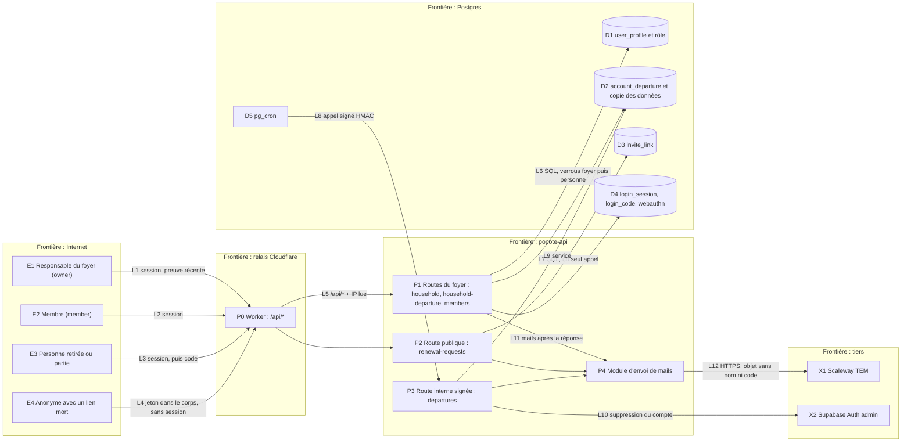

# Socle 0.4ter : le foyer, le départ et les mails

> **For agentic workers:** REQUIRED SUB-SKILL: Use superpowers:subagent-driven-development (recommended) or
> superpowers:executing-plans to implement this plan task-by-task. Steps use checkbox (`- [ ]`) syntax for
> tracking.

**Goal :** ajouter à `popote-api`, par-dessus la connexion sans mot de passe de 0.4bis, ce que le parcours « Entrer
dans Popote » (spec du 13/11, § 9, besoins R1 à R8) demande côté API : lire le foyer et le rôle de chacun, quitter le
foyer (compte gardé 30 jours), retirer l'autre personne, transférer le foyer quand son responsable part, effacer
les comptes sans foyer au bout de 30 jours, laisser une personne dont le lien est mort en redemander un, télécharger
ses données ; plus les mails au style « Jeu » (HTML et texte).

**Architecture :** tout le plan s'appuie sur ce que 0.4bis fusionnera (sessions, verrou de personne, preuve récente,
invitations par mail, effacement `efface_mes_donnees` éclaté en deux corps privés) et sur ce que le dépôt contient
déjà (règles de départ du budget dans `efface_mes_donnees`, 0145). **Trois choix structurent le plan, tous
vérifiés à la source (voir « Constats ») :** (1) une personne « sans foyer » **n'a plus de profil** : l'état existe
déjà dans le schéma et dans la RLS (`household_id` est `not null`, `current_household()` rend `null`) ; on ne
le rend pas nullable (171 politiques et 54 fonctions citent `current_household()`, 47 fonctions citent `user_profile`) ; (2) ce qu'elle garde 30 jours (son
prénom, la date d'effacement, **une copie de ses seules données** pour l'export) tient dans **une table neuve**,
`account_departure` ; (3) les effets d'un départ sur le budget **ne sont pas réécrits** : S14 (amendé) les range dans
`private.sort_du_foyer(personne)`, que supprimer son compte, quitter le foyer et retirer un membre appellent tous les
trois, avec un test qui prouve qu'ils laissent le foyer dans le même état.

**Tech Stack :** celui de 0.4bis (Python 3.13, FastAPI, Pydantic v2, psycopg 3, Postgres Supabase, `pg_cron`,
`pg_net`, Scaleway TEM) ; **aucune dépendance ajoutée** (le HTML des mails se construit avec la bibliothèque standard,
`html.escape`).

**Hors périmètre :** les écrans (plan front d'« Entrer », E1 à E8) ; `GET /api/v1/welcome` (**R9 : étape 0.5**, elle
lit le frigo et la semaine, domaines que 0.5 branche ; d'ici là l'écran de bienvenue n'a que le bloc des
objectifs, sans route) ; le renommage du foyer, le changement d'e-mail ; un foyer de plus de deux personnes (les
tests de base en gardent à trois, la règle de deux places est posée dans les fonctions d'invitation, pas dans le
schéma) ; l'export des **données du foyer** (recettes, frigo, budget commun : chaque domaine de 0.5 l'ajoute à
l'export, garde-fou : `tables_de_foyer()`) ; la fermeture de la base (0.7) ; le pré-remplissage ou la récupération
des données d'un ancien foyer dans un nouveau (voir question 2).

---

## Constats vérifiés dans `popote-api` (état de `origin/main` au 13/11/2026, `871d3f3`, migrations jusqu'à 0146)

Chaque constat a sa preuve ; ceux qui touchent une base ont été relus sur la pile locale (Postgres `127.0.0.1:54322`,
migrations jusqu'à 0146).

| N° | Constat | Preuve |
|---|---|---|
| C1 | **Aucune colonne de rôle ni de créateur** : `household` n'a ni `created_by` ni propriétaire ; `user_profile` n'a que `id`, `household_id`, `display_name`, `created_at`, `password_set`, `entre_le`. Le créateur d'un foyer ne se lit qu'à `user_profile.created_at` (le plus ancien membre). | `supabase/migrations/0001_class_c.sql:6-17` ; `0009_create_household.sql` et `0091_le_createur_choisit_son_prenom.sql:17-39` (le premier profil d'un foyer est celui de `create_household`) |
| C2 | **Une personne sans foyer, c'est une personne sans profil.** `user_profile.household_id` est `not null` (0001:15, relu en base : `is_nullable = NO`) et le restera. `current_household()` rend `null` sans profil (0004:7-15) ; toutes les politiques cadrées sur le foyer ne rendent alors rien (`user_profile_select`, 0005:60-61 ; 171 politiques de `public` citent `current_household()`, relu en base). `GET /api/v1/me` sait déjà rendre « sans profil » : foyer et prénom absents, la ligne existe toujours. | 0004, 0005:42-66, `src/popote_api/api/moi.py:39-44` (`LIT_MOI`, jointures `left join`), `schemas/moi.py:13-20` (`household: … \| None`) |
| C3 | **Le test de base de l'« orphelin » existe mais ne couvre que 4 tables en lecture** (`household`, `user_profile`, `nutrition_target`, `invitation`) ; aucune écriture, 51 tables de foyer au total (`tables_de_foyer()`, relu en base). | `tests/db/isolation.test.ts:108-114`, `tests/db/helpers/db.ts:44` (`makeOrphan`), `docs/schema.md:137` |
| C4 | **La règle d'un départ existe déjà, en SQL, et c'est la même fonction que supprimer son compte** : `efface_mes_donnees()` (0145, redéfinie à partir de `delete_my_account` de 0112). Avec un membre qui reste : les charges dont la personne est la seule participante partent (`retire_charge(…, true)` : lignes ni confirmées ni réglées des mois ouverts et leurs saisies, la charge si elle n'a pas d'histoire, sinon elle s'archive) ; ses saisies seule-porteuse partent **dans tous les mois, clôturés compris**, le montant confirmé reste ; `cloture_choix.reste_cents` passe à `null` (le choix et `versement_id` restent : fait comptable, sans clé étrangère) ; ses comptes `perso` partent avant son profil ; le profil part (en cascade : `nutrition_target`, `revenu`, `charge_participant`, `meal_slot`, `rappel_*`, `aide_signalement`, `idempotency_key`) ; **`depense_part`, `cloture_choix` et `versement_epargne` n'ont aucune clé étrangère vers `user_profile` (relu en base) : leurs lignes, dont les parts des mois gelés et tous les versements d'épargne, restent au foyer avec l'identifiant de la personne** (fait comptable, règle du budget), après un départ, un retrait comme après « supprimer mon compte » (voir la question 6) ; les barquettes passent à « n'importe qui » (`portion.for_user_id` en `set null`) ; les mois ouverts se repartagent (`refige_pour`), les années ouvertes se recalent (`recale_la_charge`) ; **les mois clôturés gardent leur `reste_cents`**. Seule dans le foyer : factures, lignes et foyer disparaissent. Ce n'est **pas** écrit dans la spec du socle : c'est la règle du budget (spec du budget du 01/10, § 4.3 « Les comptes perso de qui part », § « Le départ du dernier membre », « Le détail part, le total reste »), tenue par `tests/db/budget-depart.test.ts` (3 `describe`, 10 cas). | `0145_efface_mes_donnees.sql:141-237` (foyer) et `:239-257` (compte : clés du journal, sessions, événement) ; `0112_budget_depart.sql:81-188` ; `0111_budget_retire.sql:16-87` (`retire_charge` lit `current_household()`, pas `auth.uid()`) ; `0016_portion.sql:31` ; `0097_budget_tables.sql:67-80` ; liste des clés étrangères vers `user_profile` relue en base |
| C5 | **Les corps de 0145 mêlent deux choses** : sortir du foyer (141-237) et effacer l'accès du compte (239-257 : `delete from login_session`, `ferme_les_sessions_auth`, événement `compte_supprime`, clés du journal). S14 (0.4bis) prévoit de les déplacer **ensemble** dans `private.efface_les_donnees_du_foyer()` : quitter le foyer ne peut pas les réutiliser tels quels (la personne perdrait ses sessions, alors qu'elle doit rester connectée pour voir « sans foyer » et télécharger ses données). D'où l'amendement A6. | `0145:239-257` ; plan 0.4bis S14 |
| C6 | **`idempotency_key.person_id` référence `user_profile(id)`**, pas `auth.users`. Pour une personne sans profil : (a) tout `POST` qui exige une `Idempotency-Key` (ajouter une clé d'accès, `/me/passkeys`) échouerait sur la clé étrangère ; (b) `POST /me/household-departure` écrirait sa ligne d'idempotence **après** avoir supprimé le profil, donc son propre départ s'annulerait. | `0135_idempotence.sql:42`, `src/popote_api/security/idempotence.py:216` (écriture de la ligne en fin de route, même transaction) ; `src/popote_api/api/moi.py:197-206` (`DELETE /me` est sans clé pour cette raison) |
| C7 | **`authenticated` a le droit `UPDATE` sur toute la table `user_profile`** et la politique `user_profile_update` ne cadre que la ligne (`id = auth.uid()`) : une colonne `role` ajoutée serait **modifiable par son titulaire** (« je me nomme responsable »). La comparaison des droits de l'essai (`ops/aligne_droits.py:140-153`) ne lit que les droits de table (`relacl`), pas ceux de colonne : un `revoke update (role)` ne serait pas surveillé. Donc : un déclencheur. | relu en base (`information_schema.table_privileges`, `column_privileges`) ; `0005_policies.sql:64-67` |
| C8 | **Tâches planifiées aujourd'hui** : `pg_cron` dans la base, planifié par des migrations tolérantes (si l'extension manque, avertissement) : purges nocturnes (`idempotence-purge` 03:17, `invite-link-purge` 03:29, `login-session-purge` 03:53, etc.) qui appellent une **fonction SQL** ; les rappels (`rappels-par-mail`, toutes les heures) appellent par `pg_net` une **Edge Function** avec un secret du coffre (`vault`). **Aucune route `/internal/*` réelle n'existe encore** (le routeur et la signature HMAC existent, pas de route) ; la façon dont `pg_cron` la signerait est écrite, non essayée (« pas encore écrite : aucune route interne réelle n'existe », réserve sur le corps envoyé par `pg_net`). GitHub Actions ne fait que la sauvegarde, la restauration, le réveil de l'essai et la CI. | `0126_rappels.sql:557-582` et `:609-645` ; `0142_invitations_par_lien.sql:174-190` ; `src/popote_api/api/internes.py:98-104` ; `docs/exploitation.md:336-375` ; `.github/workflows/reveil-essai.yml` |
| C9 | **L'export des données n'existe pas côté API et n'est planifié qu'en 0.5.** `public.export_my_data()` existe en SQL pour l'appli actuelle (dernière définition 0127) ; elle exporte **tout le foyer** (dont les profils de l'autre membre) en lisant `current_household()` : pour une personne sans profil, elle rend un document vide. Le plan 0.4 classe la route en « route de 0.5, qui y ajoutera `login_session` et `security_event` ». L'écran « sans foyer » en dépend : **ce plan livre une route d'export limitée aux données personnelles (F10)**. | `0127_export_des_rappels.sql:13-91` ; plan 0.4, § Hors périmètre (« l'export des données (route de 0.5…) ») ; `docs/inventaire-surface.md:53` |
| C10 | **Aucun mécanisme de « quitter » dans l'appli actuelle** : l'aide intégrée le dit (« je n'ai pas trouvé d'écran pour … en quitter un sans supprimer son compte »). Et `create_household()` refuse une personne sans profil en production : la création de foyer y est **fermée** (`docs/dev.md:98` : `allow_household_creation = {"enabled": false}` depuis le 21/09/2026 ; `0070_un_seul_foyer.sql:28-42` la referme dès qu'un foyer existe ; la pile locale de test peut la montrer ouverte). Son `execute` reste à retirer à J+2 (0.7), sans urgence. | `docs/aide/foyer-creer.md:44` ; `0005_policies.sql:42-48` (le commentaire dit pourquoi la suppression du profil passe par une fonction) ; `docs/dev.md:98` ; `0070_un_seul_foyer.sql:28-42` |
| C11 | **Le CHECK de `invite_link` interdit de prolonger un lien** : `expires_at <= created_at + 7 jours` (contrainte `invite_link_check`, relue en base). Un « Renvoyer » qui rend vie à un lien échu (besoin R1/R8) exige de la relâcher (A4). Le `created_by` du lien passe à `null` quand le profil de l'hôte part. | `0142_invitations_par_lien.sql:44` (et `:36`, `:43` pour les clés étrangères en `set null`) |
| C12 | **Une erreur `40P01` (interblocage) devient `503 reessayer` + `Retry-After: 1`**, jamais `500`. L'ordre « foyer, puis personne » de 0.4bis est compromis par un détail de S6 : `session_valide` prend le verrou de personne (activité périmée de plus de 5 minutes) **avant** que la route prenne celui du foyer. Voir le risque accepté R-B. | `src/popote_api/erreurs_base.py:9,64-65` ; plan 0.4bis S6 |

| C13 | **Le catalogue de recettes est lisible et modifiable par une personne sans profil** : `recipe_read` et `recipe_update` testent `owner_household_id IS NULL OR …` (politiques relues en base) ; `recipe` est l'une des 51 tables de `tables_de_foyer()`. Sans profil, `current_household()` est nul, mais les lignes du catalogue (`owner_household_id` nul) passent. La revue adverse a relevé que `tg_class_b_guard` ne bloque que `confidence >= 0.8`. | relu en base (`pg_policy`) ; revue adverse du plan |
| C14 | **Les fonctions `security definer` exécutables par `authenticated` sont appelables par PostgREST** (schéma `public` exposé jusqu'à la fermeture, 0.7 ; `supabase/config.toml:13`) : la preuve récente n'est appliquée qu'en Python, et une fonction qui rend une adresse la rendrait à n'importe quelle session GoTrue. Même limite que `delete_my_account` aujourd'hui. | `supabase/config.toml:13` ; spec du socle § 5.2 |
| C15 | **Un garde-fou de rôle de la base est en `security invoker`**, pas `definer` : en `definer`, `current_user` vaut le propriétaire et la garde ne refuse jamais. La convention du dépôt : `if current_user <> 'authenticated' then return null` (verrou) ou refus de `authenticated` et `anon`. | `0095_budget_verrou.sql:30-48` (commentaire et `tg_verrou_instruction`), `0099`, `0101` |

**Ce que ces constats changent par rapport à la spec d'« Entrer » :** voir « Écarts à la spec, à relayer à la
session de conception ».

---

## Cadre : risque, hypothèses, décisions

**Risque : élevé.** Autorisation (qui est responsable, qui peut retirer qui), effacement et conservation de données
personnelles (revenus d'une personne gardés 30 jours après son départ), tâche planifiée qui supprime des comptes,
route publique qui écrit à un tiers (R1). Conséquences, selon `planning-a-change` : plan approuvé par le propriétaire **en
conversation, en une phrase**, avant tout code ; modèle de menaces ci-dessous ; retour arrière écrit pour chaque
migration ; revue adverse de chaque tâche F2 à F9 ; preuve sur l'essai (F11).

### Décisions déjà prises (13/11/2026, par le propriétaire, non rediscutées)

- **Retirer l'autre membre** : réservé à la personne qui a créé le foyer. L'autre peut seulement partir d'elle-même.
- **Quitter le foyer** : le compte est gardé **30 jours** (télécharger ses données, rejoindre un foyer par une nouvelle
  invitation), puis effacé ; rappel par mail à **J − 7**.
- **Supprimer son compte** : immédiat. Si la personne qui a créé le foyer part et qu'il reste quelqu'un, celle-ci garde
  le foyer et en devient responsable (mail « départ de l'autre »).
- **Lien d'invitation** : 7 jours. Invitation envoyée par mail (prénom + e-mail), prénom modifiable par l'invité.
- **Expéditeur** `Popote <bonjour@notre-popote.fr>` (Scaleway TEM). Le contrat de l'API peut encore rompre (la nouvelle
  appli n'est pas en ligne), par le mécanisme de S2 ; **ce plan n'a besoin d'aucune rupture** (routes et champs
  ajoutés seulement).

### Valeurs proposées par ce plan (justifiées, à relire avec le plan)

| Valeur | Choix | Pourquoi |
|---|---|---|
| Qui est `owner` | la personne qui a créé le foyer ; migration : **le plus ancien membre** (`created_at`, puis `id`) ; ensuite, **le premier profil d'un foyer est `owner`**, les suivants `member` (déclencheur, donc l'appli actuelle et ses Edge Functions continuent de marcher) | C1 ; la prod n'a qu'un foyer : à relire sur la copie de prod de la répétition (spec du socle § 11) |
| Transfert du rôle | **par la base** (déclencheur après suppression d'un profil `owner` : le plus ancien membre restant devient `owner`), pas par le code Python | « le foyer n'a jamais zéro responsable » est un invariant, pas une étape que chaque route doit penser à faire |
| Où va une personne qui part | **son profil est supprimé** ; `account_departure` garde son prénom, la date, la date d'effacement, l'identifiant de l'autre membre (son prénom se lit à la volée, il n'est jamais copié) et la copie de ses données | C2, C4 |
| Délai avant effacement | **30 jours** = `left_at + interval '720 hours'` (pas `'30 days'` : `timestamptz + '30 days'` dépend du fuseau de la session et fausserait de une heure le CHECK au changement d'heure), rappel quand il reste 7 jours ou moins | décision du propriétaire |
| Copie des données | `account_departure.archive` (jsonb ; au-delà de 4 Mio la fonction garde les repas des 24 derniers mois et écrit `truncated` : **elle ne refuse jamais un départ**), **seulement ses propres données** (profil, objectifs, revenus, comptes perso, charges perso, ses parts, ses saisies, ses repas, ses rappels, ses signalements), faite **dans la transaction du départ** ; effacée avec la ligne | sans elle, « télécharger mes données » après le départ rendrait un document vide (C4 : le profil emporte tout en cascade) |
| Places | **deux** (`private.places_du_foyer()`, fonction `immutable` créée par S12 en 0154, reprise par F2) ; refus `409 foyer_complet` à la création d'une invitation et à l'acceptation, lien non consommé | spec § 4.5 « Deux places en cuisine » ; pas de contrainte de schéma (les tests de base en gardent trois) |
| Prolongation d'un lien échu | **7 jours de grâce** après l'échéance (l'e-mail de l'invité est gardé jusque-là), pendant lesquels l'hôte peut « Renvoyer » ; un renvoi donne 7 jours de plus depuis l'envoi | sans l'e-mail, l'hôte ne peut plus renvoyer un lien échu ; question 4 |
| Demande de nouveau lien (R1) | limites : **10 par IP et 3 par lien et par 15 min** ; **un mail à l'hôte au plus par 24 h et par invitation** ; pas de mail pour un lien annulé, accepté ou inconnu | décision (sécurité du point 4) ; un lien annulé par l'hôte est un refus de l'hôte |
| Tâche quotidienne (R7) | une passe par jour à 04:11 UTC ; 20 comptes au plus par passe et par appel ; rappel à `scheduled_deletion_at − 7 jours` ; effacement à `scheduled_deletion_at` | C8 ; un foyer de deux personnes n'a jamais plus de quelques lignes |
| Preuve récente | 300 s, pour R3, R4, `DELETE /me` (S11) ; pas pour l'export ni R1 | spec § 5 |

### À poser au propriétaire (en chat, en mots simples ; la valeur du plan vaut tant qu'il n'a pas répondu)

1. Dans votre foyer actuel, c'est bien toi qui l'as créé, donc toi le responsable ? (valeur du plan : oui, le plus
   ancien membre ; vérifié sur la copie de la prod)
2. Quand une personne rejoint un autre foyer, repart-elle de zéro (ses objectifs, ses revenus, ses repas notés ne
   la suivent pas) ? (valeur du plan : oui ; ses données de l'ancien foyer restent téléchargeables jusqu'à
   l'effacement)
3. Les mails n'ont pas la marmite dessinée (une image se charge depuis Internet, donc dirait à Popote quand tu
   ouvres le mail) et leur titre ne porte ni prénom ni code (le fournisseur d'envoi garde les titres) : OK ?
   (valeur du plan : oui ; le titre de l'invitation devient « Une place t'attend en cuisine sur Popote »)
4. Quand un lien d'invitation a expiré, Sam peut encore le renvoyer pendant 7 jours ; après, il invite de
   nouveau : OK ? (valeur du plan : 7 jours)
5. « Télécharger mes données » donne d'abord les données **personnelles** (profil, objectifs, revenus, comptes et
   charges perso, repas, rappels), pas encore les recettes, le frigo ni le budget commun (chaque domaine de 0.5 les
   ajoutera) : OK ? (valeur du plan : oui)
6. Quand quelqu'un part ou est retiré, ses parts des mois déjà clôturés et ses versements d'épargne restent dans le
   budget du foyer, rattachés à un identifiant sans nom (c'est la règle du budget d'aujourd'hui, et cet identifiant ne
   veut plus rien dire une fois le compte effacé) : OK ? (valeur du plan : oui, on ne change pas la règle du budget ;
   ces lignes sont dans la copie de ses données)

### Hypothèses non vérifiées (à confirmer à la source avant la tâche concernée)

- **Scaleway TEM** : le champ `html` existe (relu dans la documentation « Sending an email using the API », avec `text`,
  `attachments` et `additional_headers`) ; la documentation ne dit pas si `html` ou `text` peuvent être envoyés seuls
  (on envoie toujours les deux) ni si une image en ligne (`Content-ID`) est acceptée (donc : aucune image) ni si la
  console active un suivi des ouvertures ou des clics (**à vérifier dans la console et à désactiver : F1**) ; taille
  maximale de l'API : 2 Mio, non extensible (page « capabilities and limits »).
- **`pg_net` et la signature** : le corps réellement envoyé par `net.http_post` doit être celui qui est signé
  (`docs/exploitation.md:365-375`) ; `appelle_les_rappels` envoie `'{}'::jsonb` (0126:578), donc le corps signé de la tâche
  quotidienne est **`{}`** (pas le corps vide) : prouvé sur l'essai en F8. En parallèle, un workflow planifié de GitHub
  Actions appelle la même route (idempotente) et rend visible un échec (voir F8).
- **Mails envoyés après la réponse** : l'hébergement s'endort après une demi-heure sans visite (spec d'« Entrer » § 1) ;
  qu'un mail en tâche d'arrière-plan parte quand la requête vient d'arriver est à **mesurer sur l'essai** (F11) ; d'ici
  là chaque mail qui compte (rappel, demande de nouveau lien) se réserve en deux temps (F8, F9).
- **Droits de colonne** : `ops/aligne_droits.py:149` ne compare que les droits de table (`relacl`) ; le plan n'en dépend
  pas (le garde-fou du rôle est un déclencheur, C15).
- **Redirection des réponses** (`bonjour@notre-popote.fr` vers la boîte du propriétaire) : réglage du domaine
  (le DNS est chez Cloudflare, D2 ; **Cloudflare Email Routing** est la piste, non essayée) : geste du propriétaire,
  regroupé en F11. L'API ne pose **aucun** `Reply-To` : cela publierait l'adresse du propriétaire dans chaque mail.
- **Rendu réel des mails** (Gmail, Apple Mail, Outlook, mode sombre) : non vérifiable sans boîte réelle ; F11
  regroupe l'essai du propriétaire.

## Critères d'acceptation (preuve : F11, sauf mention)

1. *Étant donné* un foyer de deux personnes (Sam a créé le foyer, Léa a été invitée), *quand* chacune lit
   `GET /api/v1/household`, *alors* elle voit les deux membres avec `owner` pour Sam et `member` pour Léa, `is_me` vrai
   pour elle seule, et `seats` à 2 ; `GET /api/v1/me` porte `role` et `household`. (F2)
2. *Étant donné* Léa avec une preuve de moins de 5 minutes, *quand* elle quitte le foyer, *alors* en une transaction
   elle n'a plus de profil, ses charges perso et ses lignes ouvertes ont quitté le budget, les mois clôturés gardent
   leur `reste_cents`, ses barquettes sont à tout le monde, son compte reste avec `scheduled_deletion_at` à 30 jours
   pile, ses sessions restent ouvertes, Sam est prévenu par mail après la réponse ; **le même foyer, laissé par
   « supprimer son compte » à la place, est dans le même état** (hors compte). (F3, F4)
3. *Étant donné* Sam et Léa, *quand* Sam retire Léa, *alors* toutes les sessions de Léa sont fermées dans la même
   transaction (une connexion de Léa en vol attend le verrou et ne survit pas), elle est prévenue par mail, et elle
   garde 30 jours ; *quand* Léa tente de retirer Sam, `403 reserve_au_createur`. (F5)
4. *Étant donné* Sam (`owner`) et Léa, *quand* Sam supprime son compte, *alors* Léa devient `owner`, le foyer est
   intact (recettes, frigo, mois clôturés), les charges communes sont à elle seule, elle reçoit le mail « départ de
   l'autre » ; seule dans le foyer, le foyer disparaît avec la personne. (F6)
5. *Étant donné* un compte sans foyer dont `scheduled_deletion_at` est dans 7 jours, *quand* la tâche quotidienne
   passe, *alors* un seul rappel part (pas deux) ; à `scheduled_deletion_at` le compte, sa copie de données et son
   compte Auth sont effacés ; **une personne revenue dans un foyer entre-temps n'est jamais effacée**. (F8, F7)
6. *Étant donné* un lien d'invitation échu, *quand* l'invitée appuie sur « Demander un nouveau lien », *alors* la
   réponse est `202` et identique que le lien soit connu, inconnu, accepté ou annulé (statut, corps, médiane de durée) ;
   l'hôte reçoit **un** mail au plus par 24 h et par invitation et sa liste montre `renewal_requested_at` ; un renvoi
   remet la demande à zéro. (F9)
7. *Négatif* : une personne sans foyer ne lit ni n'écrit rien du foyer (51 tables, lecture et écriture, session
   ouverte avant le départ comprise ; chaque route de foyer répond `403 aucun_foyer`) ; un `member` ne peut ni se
   donner le rôle `owner` ni retirer le responsable ; R3, R4 et `DELETE /me` sans preuve récente répondent
   `403 reauthentification_requise` ; aucun nom, adresse, jeton ni code dans les journaux, ni dans un objet de
   mail.

**Cibles non fonctionnelles** (mesure F11, essai, instance chaude, foyer semé sur deux ans) : `GET /household`
p95 < 150 ms ; R1 p95 < 250 ms (le mail part après la réponse) ; R3 et R4 p95 < 1 s (elles refont les mois ouverts,
comme `delete_my_account` aujourd'hui : la cible est mesurée avant d'être tenue, et la valeur relevée écrite dans
`docs/preuves-0.2.md`) ; une passe de la tâche quotidienne < 20 s pour 20 comptes (le délai de requête est de 25 s,
`limites.Delai`) ; chaque migration compatible avec l'appli en prod, dite explicitement ; **mail HTML < 100 Ko** ;
ASVS niveau 2 (spec § 7.6).

## Modèle de menaces

| Menace (STRIDE) | Flux (L1 à L12 du schéma) | Parade | Tâche |
|---|---|---|---|
| **E** Un membre se nomme `owner` (`UPDATE` de sa propre ligne, droit de table, C7) | L2 | déclencheur `BEFORE UPDATE OF role` **en `security invoker`** (C15) qui refuse `authenticated` et `anon` (`42501`) et laisse passer les fonctions privées (propriétaire) ; test qui épingle `42501` (sans lui, seul l'index unique parlerait, en `23505`) ; mutation : retirer le déclencheur | F2 |
| **E** Un membre retire le responsable, ou une personne retire quelqu'un d'un autre foyer | L1, L2 | rôle lu **sous le verrou du foyer**, dans la fonction SQL (pas dans Python seulement) ; `403 reserve_au_createur` testé **avant** la preuve récente ; identifiant d'un autre foyer : `404` sans différence | F5 |
| **T** Foyer sans responsable (suppression directe d'un profil, `auth.users` effacé à la main) | L6 | déclencheur `AFTER DELETE` qui promeut le plus ancien membre restant ; requête de contrôle dans les tests (chaque foyer non vide a exactement un `owner`) | F2 |
| **T** Une session de la personne retirée survit à son retrait (leçon 1 de T15b) | L3, L6 | un seul appel SQL : verrou du foyer, verrou de personne (même clé que `cree_session`), fermeture de **toutes** les sessions, des codes en attente et des sessions GoTrue ; course déterministe (B = connexion par code ou par clé attend le verrou ; A valide ; la session que B ouvre ensuite n'a aucun accès au foyer) | F5 |
| **I** Une personne sans foyer lit ou écrit le foyer | L3 | trois couches : (1) RLS (pas de profil, `current_household()` nul) ; (2) dépendance `PersonneDuFoyer` (`403 aucun_foyer`) sur toute route de foyer ; (3) tests de base sur les 51 tables, lecture et écriture, avec une session ouverte **avant** le départ ; la matrice d'autorisation gagne l'acteur « sans foyer » | F2, F3, F11 |
| **I** La copie des données (revenus, objectifs) d'une personne partie fuit | L6 | table à RLS forcée sans droit ; lue seulement par la route d'export de la **même** personne ; 4 Mio au plus ; effacée à l'acceptation d'une invitation, à la suppression, à l'effacement ; jamais journalisée ; sauvegardes : 30 jours de plus, dit | F3, F10 |
| **S/I** Énumération des liens par R1 (existence, état, hôte) | L4 | `202` constant ; **un seul** appel SQL au même nombre d'écritures pour lien connu et inconnu ; limites calculées sur la valeur envoyée (HMAC du jeton), pas sur l'existence ; `429` pour tous ; test de médianes | F9 |
| **D** Inondation de l'hôte (ou du quota TEM) par R1 | L4, L12 | un mail par 24 h et par invitation (colonne `renewal_mail_sent_at`, réservée avant l'envoi, libérée si l'envoi échoue) ; 10 par IP et 3 par lien par 15 min ; coupe-circuit global de S5 à l'envoi réel ; un lien annulé, accepté ou inconnu n'envoie rien | F9 |
| **I** Jeton en clair (base, journal, idempotence, mail du retrait) | L4 | R1 n'a pas d'`Idempotency-Key` (route publique, exemptée par écrit) ; le jeton n'est jamais stocké (empreinte) ; balayage de `caplog` ; **le HTML du mail d'invitation porte le lien comme le texte** : même exposition (TEM garde le contenu 36 h au plus) | F1, F9 |
| **T** Course entre l'effacement quotidien et l'acceptation d'une invitation | L8 | la fonction d'effacement relit, **sous le verrou de personne**, « pas de profil, ligne présente, échéance passée » ; l'acceptation efface la ligne par un déclencheur sur `user_profile` (donc par tout chemin qui crée un profil) ; course déterministe | F3, F7, F8 |
| **D** Le compte à effacer ne l'est pas (la tâche ne passe pas : pause de la base, `pg_cron` absent) | L8 | script manuel `ops/traite_les_departs.py` ; requête de contrôle des lignes en retard dans `docs/exploitation.md` ; rejouable : la route est idempotente par construction ; repli GitHub Actions si la preuve `pg_net` échoue | F8 |
| **T** Rejeu d'un appel signé de la tâche (300 s de fenêtre) | L8 | route sans effet de plus la seconde fois (état relu en base) ; `base.service()` ajouté à la liste fermée de `tests/unit/test_architecture.py` avec sa raison | F8 |
| **T/R** Pas de trace d'un retrait, d'un départ, d'un transfert | — | événements `foyer_quitte`, `membre_retire`, `role_transfere`, `depart_efface`, `renouvellement_demande` (identifiants et HMAC, jamais d'adresse ni de prénom) ; la liste `Evenement` Python égale le CHECK SQL | F3, F5, F8, F9 |
| **I** Prénom piégé dans un mail HTML (script, attribut, entité) | L12 | `html.escape` sur toute valeur insérée, **testé sur le rendu seul** avec des valeurs hostiles, en plus du filtre `prenom_affichable` ; objets de mail constants (aucun prénom) ; liens construits côté serveur, schéma `https` vérifié | F1 |
| **I** Un mail dit quand il a été ouvert (pixel, image distante, lien redirigé) | L12 | aucune balise ``, aucune URL distante, aucun lien traqué : test sur le HTML rendu ; « ouverte » veut dire « lien ouvert » (risque 8 de 0.4bis) | F1 |
| **D** Interblocage entre le verrou du foyer et celui de personne (activité périmée, C12) | L6 | accepté : `40P01` devient `503` + `Retry-After: 1`, rien n'est validé, la requête se rejoue ; testé (R-B) | F3, F5 |
| **E** Appel direct d'une fonction de départ par PostgREST (jusqu'à J+2, C14) : preuve récente contournée, adresse de l'autre lue | L2, L3 | les fonctions d'effet **ne rendent aucune adresse** : le contact d'un mail se lit **après la validation** par `public.contact_de(p_person)` (`popote_api` seul, `base.connexion()`) ; la preuve récente n'est opposable qu'à l'API jusqu'à la fermeture de la base (même limite que `delete_my_account`) : risque R-D | F3, F5, F6 |
| **T** Un lien créé par la personne qui part pendant son départ survit (`created_by` passe à `null`) | L2 | verrous dans l'ordre de S14 : foyer, **invitation du foyer** (`hashtext('invitation')`, celui de `cree_invitation`, 0142:88), personne ; révocation par la fonction commune `private.revoque_les_liens_de` ; course « création de lien pendant le départ » | F3, F5 |
| **T** Un compte en cours d'effacement est repris par une acceptation d'invitation (fenêtre entre la base et Auth) | L9, L10 | `compte_a_supprimer` est inscrite **dans la transaction d'effacement** ; `personne_peut_entrer` et `compte_pour_invitation` refusent une personne qui y figure ; course acceptation / appel à Auth | F7, F8 |
| **E** Le catalogue partagé de recettes modifié par une personne sans foyer (C13) | L2 | politiques d'écriture de `recipe` : `current_household() is not null` ajouté à `recipe_update` ; exceptions de lecture (catalogue) écrites dans le test d'isolation | F3 |
| **D** Un mail qui compte (rappel d'effacement, demande de lien) perdu quand le conteneur s'endort | L11 | réservation **en deux temps** (`reserved_at`, puis `sent_at` après l'acceptation par le fournisseur, réservation périmée au bout de 5 minutes) ; la route interne envoie **avant** de répondre ; mesure sur l'essai | F8, F9, F11 |
| Abus : le responsable retire l'autre par dépit | L1 | décision du propriétaire ; l'autre est prévenue par mail, garde 30 jours et ses données ; l'événement `membre_retire` en garde la trace | F5 |
| Abus : partir pour effacer les charges communes | L1 | seules les charges **perso** et les lignes ouvertes de la personne partent ; les communes restent, à 100 % pour l'autre (décision) | F3 |
| Abus : un lien révoqué, ou celui d'une personne partie, reste utilisable | L4 | les liens créés par la personne qui part sont révoqués **avant** la suppression du profil (`created_by` passe à `null` ensuite : leçon 3 de S14), e-mail et prénom de l'invité effacés | F3, F5 |

**Risques acceptés (à écrire dans `docs/securite.md` par F11) :**

- **R-A. Qui contrôle la boîte mail d'une personne partie, et dispose d'une session, peut télécharger la copie
  de ses données pendant 30 jours.** Même niveau que le risque 1 de 0.4bis : le code par mail est un secours partout.
- **R-B. Un interblocage rare entre une requête qui rafraîchit l'activité de sa session et un départ ou un retrait
  de la même personne** (C12) rend un `503` à rejouer. Pas de perte, pas d'état partiel. S6 peut le supprimer en
  écrivant l'activité dans sa propre transaction courte ; à évaluer à ce moment-là, pas ici.
- **R-C. L'export après le départ est une copie d'un instant** (celui du départ), pas l'état vivant.
- **R-D. Jusqu'à la fermeture de la base (J+2, 0.7), une session Supabase peut appeler directement les fonctions de départ** et contourner la
  preuve récente (appliquée par l'API) ; elle ne reçoit aucune adresse (C14). Même limite que `delete_my_account`.
- **R-E. Les mails d'information (retrait, départ de l'autre) sont « au mieux une fois »** : un conteneur tué entre la validation et
  l'envoi les perd ; la page « sans foyer » et `GET /household` disent la vérité. Seuls le rappel d'effacement et la demande de
  nouveau lien se réservent en deux temps.

## Données personnelles de 0.4ter

Le foyer de deux personnes est un usage domestique (RGPD art. 2.2.c, voir `0008_rgpd.sql:1-4`) : le plan applique
les règles comme bonne pratique, sans AIPD (aucun des critères de la CNIL : pas de grande échelle, pas de
données sensibles au sens de l'art. 9, pas de profilage, pas d'évaluation de personnes).

| Donnée | Finalité | Où | Conservation |
|---|---|---|---|
| Rôle `owner` / `member` | droits dans le foyer | `user_profile.role` | vie du profil (pas une donnée personnelle en soi) |
| Prénom de la personne partie, date de départ, date d'effacement, identifiant de l'autre membre, date du rappel, qui a retiré | page « sans foyer », effacement à J+30, rappel à J−7 | `account_departure` | **30 jours** (décision du propriétaire), effacée plus tôt à l'acceptation d'une invitation ou à la suppression du compte |
| **Copie des données personnelles** (profil, objectifs, revenus, comptes et charges perso, ses parts, ses saisies, repas, rappels, signalements) | droit d'accès et portabilité après un départ (le profil emporte les originaux) | `account_departure.archive` (jsonb) | **comme la ligne : 30 jours au plus** ; les sauvegardes chiffrées de la base la gardent 30 jours de plus (spec du socle § 5.4) : dit dans `docs/securite.md` |
| Demande de nouveau lien (date de la dernière demande, date du dernier mail à l'hôte) | prévenir l'hôte, limiter à un mail par 24 h | `invite_link` | avec la ligne (fin de vie + 30 jours) ; remises à nul par un renvoi ou une annulation |
| E-mail de l'invité, **gardé 7 jours après l'échéance** (grâce) au lieu de l'être jusqu'à l'échéance seulement | permettre à l'hôte de renvoyer un lien échu | `invite_link.invited_email` | échéance + 7 jours (A4) |
| Identifiant (UUID du compte) d'une personne partie dans `depense_part`, `cloture_choix`, `versement_epargne` | fait comptable du budget (C4) | tables du foyer | tant que le foyer existe ; **sans correspondance** (ni nom ni adresse) une fois le compte Auth effacé |
| Événements `foyer_quitte`, `membre_retire`, `role_transfere`, `depart_efface`, `renouvellement_demande` | preuve, détection | `security_event` | 1 an ; aucune adresse, aucun prénom |
| Clés de limite de R1 (HMAC de l'IP et du jeton) | limiter | `login_throttle` | 24 h après la dernière activité (purge de 0138) |
| Objet et destinataire des mails | livraison | Scaleway TEM | tant que le domaine d'envoi est actif ; **l'objet ne porte aucun prénom, aucun code, aucune date de départ** ; contenu effacé à la remise, au premier rebond dur ou après 36 h (sources de 0.4bis) |

## Règles d'exécution (valables pour chaque tâche)

Celles de 0.4bis s'appliquent telles quelles (TDD avec test négatif de chaque garde et épreuve de la mutation ; une
tâche = une branche = une demande de fusion en brouillon ≤ 400 lignes hors `uv.lock` et `openapi.json` ; gabarit à
quatre parties, `Closes #<issue>` ; commits Conventional en français, `Refs: #<issue>`, **aucune ligne de co-auteur** ;
worktree dédié, remote de l'équipe, jamais `gh` ; aucun accès à la prod ; secrets hors dépôt,
jamais affichés ; migrations appliquées **une à la fois, dans l'ordre**, jamais
modifiées une fois fusionnées ; « expand seulement » ; `verrouille_la_personne` ; courses déterministes ;
`Idempotency-Key` et ses exemptions écrites). Ajouts :

- **Skills à charger avant de coder :** ceux de 0.4bis, plus `protecting-personal-data` (F3, F5, F8, F10),
  `modeling-threats` (relire le tableau ci-dessus à chaque tâche qui y figure), `designing-http-apis` (F2, F4, F5,
  F9, F10).
- **Numéros de migration :** à partir de **0158** (0.4bis occupe 0147 à 0157). Renuméroter au rebase si une autre
  demande en a pris ; jamais deux fois le même numéro.
- **Une règle de départ, un seul corps.** Aucune tâche de ce plan ne réécrit un effet de départ sur le budget : ils
  vivent dans `private.sort_du_foyer(p_person)` (A6 de 0.4bis). Une tâche qui a besoin d'un effet de plus l'ajoute **là**
  et fait passer le test de parité (F3).
- **Une personne sans foyer est un acteur de test de plein droit** : chaque test d'intégration et chaque ligne de la
  matrice d'autorisation qui concerne une route de foyer a son cas « sans foyer » (`403 aucun_foyer`), et chaque route
  de compte (`/me`, appareils, clés, preuve, export, `DELETE /me`) a son cas « sans foyer » qui **marche**.
- **Aucune fonction exécutable par `authenticated` ne rend une adresse** (C14) : les fonctions d'effet rendent des identifiants,
  le contact d'un mail se lit **après la validation** par `public.contact_de(p_person)` (`popote_api` seul, `base.connexion()`,
  ajoutée à la liste fermée de `tests/unit/test_architecture.py` avec sa raison).
- **Les fonctions de départ rendent un résultat, elles ne lèvent pas** pour les refus du métier (`aucun_foyer`,
  `seule_dans_le_foyer`, `reserve_au_createur`, `membre_introuvable`, `retrait_de_soi`) : la transaction se valide
  sans rien changer, la route traduit en Problem Details. Une **erreur** de base annule tout (`503`).
- **Un mail ne part qu'après la validation de la transaction**, par `BackgroundTasks` et `envoie_sans_remonter`
  (S3) : la route lit le contact (`contact_de`) puis envoie. Les adresses lues pour un mail ne sont jamais dans la réponse
  HTTP. **Un mail qui doit partir une fois** (rappel d'effacement, demande de nouveau lien) se **réserve en deux temps** :
  `…_reserved_at` posé avant l'envoi, `…_sent_at` posé **après** l'acceptation par le fournisseur, une réservation de plus de
  5 minutes sans `sent_at` est reprenable (un conteneur tué ne perd pas le mail pour toujours). Les autres mails sont « au
  mieux une fois » (R-E).
- **Fini** = comme 0.4bis, plus : le test de parité (F3) vert, la matrice d'autorisation avec l'acteur « sans foyer »,
  `tests/db` vert avant et après chaque migration.

## Surface HTTP de 0.4ter

| Route | Qui | Réponses |
|---|---|---|
| `GET /api/v1/household` (**R2**) | session, foyer | `200 {id, name, seats, members: [{id, first_name, role, is_me}]}` (`ETag`, `no-store`) ; `403 aucun_foyer` |
| `GET /api/v1/me` (**R5**, ajouts compatibles) | session | `200 {…, household, role, scheduled_deletion_at, left_household_at, former_host_first_name}` : `role` (`owner`, `member` ou `null`), les trois autres `null` tant qu'on est dans un foyer |
| `POST /api/v1/me/household-departure` (**R3**) | session, foyer, preuve récente | `200 {left_at, scheduled_deletion_at}` ; `403 aucun_foyer`, `403 reauthentification_requise` ; `409 seule_dans_le_foyer` ; `503`. **Sans `Idempotency-Key`** (exemption écrite : C6) |
| `DELETE /api/v1/household/members/{member_id}` (**R4**) | session, `owner`, preuve récente | `204` ; `403 reserve_au_createur` (avant la preuve) ; `403 reauthentification_requise` ; `404 membre_introuvable` (inconnu **ou** d'un autre foyer) ; `409 retrait_de_soi` ; `403 aucun_foyer` ; `503` |
| `DELETE /api/v1/me` (**R6**, comportement) | session, preuve récente | `204` ; **inchangée côté contrat** ; transfert du rôle et mail « départ de l'autre » ; `503 suppression_incomplete` comme avant |
| `POST /api/v1/invitations/renewal-requests` `{token}` (**R1**) | **publique** | `202 {message}` **toujours** ; `422` (corps) ; `429 trop_de_requetes` + `Retry-After` ; **sans `Idempotency-Key`** (publique : exemption écrite) |
| `GET /api/v1/me/invitations` (**R8**) | session, foyer | champs ajoutés par S12 amendé : `renewal_requested_at`, statut `expired` (la spec écrit `/api/v1/invitations` : c'est la route de 0.4bis) |
| `GET /api/v1/me/export` | session | `200` JSON en pièce jointe (`Content-Disposition`, `no-store`) ; `401` ; marche **sans foyer** |
| `POST /internal/departures/processing` (**R7**) | **signée HMAC**, hors du relais et hors du contrat | `200 {reminders_sent, accounts_erased, remaining}` ; refus : `404` (comme toute route interne) |
| **R9** `GET /api/v1/welcome` | — | **étape 0.5** |

Types d'erreur nouveaux (`https://notre-popote.fr/problemes/<code>`) : `aucun_foyer` (403), `seule_dans_le_foyer` (409),
`reserve_au_createur` (403), `membre_introuvable` (404), `retrait_de_soi` (409), `foyer_complet` (409, posé par S12 et
S13 amendés). Réutilisés : `reauthentification_requise`, `trop_de_requetes`, `invitation_deja_en_attente`,
`quota_invitations`, `suppression_incomplete`. Un seul statut par `type` : `aucun_foyer` est `403` partout (c'est
aussi la valeur de S12) ; le plan front d'« Entrer » (E1) qui écrivait `404` sans foyer lit le `type`, pas le statut.

## Migrations de 0.4ter : compatibilité et retour arrière

| N° | Tâche | Objet | Compatible avec l'appli en prod parce que | Retour arrière |
|---|---|---|---|---|
| 0158 | F2 | `user_profile.role` (défaut `member`, CHECK), remplissage par le plus ancien membre, index unique partiel (un `owner` par foyer), déclencheurs : rôle à l'insertion (`definer`), garde de la modification (**`invoker`**), transfert à la suppression (`definer`) | colonne avec défaut ; `create_household` et les Edge Functions insèrent sans `role` et obtiennent `owner` puis `member` ; `delete_my_account` (qui appelle `efface_mes_donnees`) transfère par le déclencheur ; prouvé par `tests/db` (`invitation`, `isolation`, `budget-depart`) | `drop trigger` ×3, `drop index`, `drop column role` |
| 0159 | F3 | `account_departure` (RLS forcée, aucun droit) et ses lectures `ma_sortie()`, `mon_export()` ; `public.contact_de(p_person)` (`popote_api` seul) ; `recipe_update` : `current_household() is not null` pour le catalogue ; `idempotency_key.person_id` : clé étrangère vers `auth.users` au lieu de `user_profile` ; `private.personne_peut_entrer` redéfinie ; `private.export_de_la_personne` ; `public.quitte_le_foyer()` ; déclencheur « un profil créé efface la ligne de départ » ; `private.efface_le_compte` redéfinie (efface aussi la ligne) ; types d'événement et colonnes d'événement | tables et fonctions neuves ; **seul objet existant touché : la clé étrangère de `idempotency_key`**, relâchée (`not valid`, validation, retrait de l'ancienne) : l'appli en ligne n'écrit pas dans cette table (0135 date de 0.3) | rétablir la clé étrangère vers `user_profile` (après `delete from idempotency_key where person_id not in (select id from user_profile)`), `drop` des objets, CHECK d'avant |
| 0160 | F5 | `public.retire_un_membre(p_membre)` ; `private.ferme_toutes_les_sessions_de(p_person)` ; type `membre_retire` | fonctions neuves | `drop function` ×2, CHECK d'avant |
| 0161 | F6 | `public.efface_mes_donnees_avec_bilan()` (nouveau nom : `efface_mes_donnees()` garde sa signature, qui est celle d'`delete_my_account`) | fonction neuve ; `efface_mes_donnees()` l'appelle et jette le bilan | `drop function`, `efface_mes_donnees` d'avant |
| 0162 | F8 | `public.departs_a_traiter`, `public.reserve_le_rappel_de_depart`, `public.confirme_le_rappel_de_depart`, `public.efface_un_compte_expire` (service seul) ; table `depart_passe` ; `public.appelle_les_departs()` et sa planification `pg_cron` (tolérante) ; types `depart_efface`, `rappel_depart_envoye` | fonctions neuves ; la planification est posée seulement si `pg_cron` existe, et ne fait rien tant que les secrets du coffre manquent | `cron.unschedule('departs-quotidiens')`, `drop function` |
| 0163 | F9 | `public.demande_un_renouvellement` (publique, `popote_api` seul) ; scopes `renouvellement_ip` et `renouvellement_lien` ajoutés au CHECK de `login_throttle` ; type `renouvellement_demande` | objets neufs ; un CHECK élargi | `drop function`, CHECK d'avant |

(Les colonnes `renewal_requested_at` et `renewal_mail_sent_at`, l'e-mail gardé 7 jours de plus, la prolongation par
renvoi et le relâchement de `invite_link_check` sont dans la migration 0154 de S12, amendée : A4.)

## Ordre et voies

| Voie | Tâches, dans l'ordre | Dépend de |
|---|---|---|
| Dehors (sans base) | F1 mails au style « Jeu » (F1a gabarit et code, F1b les autres) | S3, S4 (champ `html`), S10b |
| Base (migrations, dans l'ordre des numéros) | F2 · F3 · F5 · F6 · F8 · F9 ; sans migration : F4 (après F3), F7 (après F3 et S13), F10 (après F3) | **S14 amendé (A6)** et S15 pour F2 à F9 ; S11 pour F3 à F6 ; S12 amendé pour F9 ; S13 pour F7 |
| Clôture | F11 preuve de bout en bout et clôture | toutes ; les gestes du propriétaire (F11) pour le vrai mail et la planification |

Parallèle possible : F1 dès que S4 est fusionné ; F9 pendant F5 (aucun fichier commun hors `main.py`). R9 n'est pas
dans ce plan.

---

### F1 : Les mails au style « Jeu » (HTML et texte)

**Pourquoi :** spec d'« Entrer » § 4.6 et § 7 (capture `.design/entrer/captures/11-mail.png`) ; 0.4bis ne livre que du
texte clair (S3, S4) et dit « gabarits HTML hors périmètre ». **Dépend de :** S3 (interface), S4 (envoi réel,
champ `html`), S10b (avis). **Coupe prévue :** le gabarit, le mail de code et l'invitation (F1a) ; les six
autres (F1b).

**Fichiers :** `src/popote_api/infra/mails_gabarit.py` (palette, mise en page, échappement : fonctions pures),
`infra/mails_textes.py` (étendu : `rendu(message) -> Rendu(objet, texte, html)` devient l'**unique** endroit où naissent
l'objet, le texte et le HTML), `infra/mails.py` (quatre messages nouveaux, leurs méthodes dans `EnvoiMail`,
`BoiteDeTest` (garde le message **et** son rendu), `MailAbsent`, `envoie_sans_remonter` étendu), `infra/mail_scaleway.py`
(envoie `text` **et** `html`), `config.py` (`public_base_url` existe : les liens en viennent), tests
`tests/unit/test_mails_html.py`, `tests/unit/snapshots/mails/<genre>.html` et `.txt`, `tests/unit/test_architecture.py`,
`docs/exploitation.md`.

- [ ] **Les huit mails**, avec leur objet. **Aucun prénom, aucun code, aucune date dans l'objet** (Scaleway garde
  l'objet tant que le domaine est actif ; 10 caractères au moins, exigence de TEM) :

  | Mail | Objet (constant) | Corps (texte de la spec § 4.6 et § 7, au mot près, sauf les écarts notés) | Bandeau |
  |---|---|---|---|
  | Code | « Ton code de connexion Popote » | « Voici ton code. Il marche 10 minutes. » code en très grand ; « Tu n'as rien demandé ? Ne fais rien, personne n'entre sans ce code. » (*écart : la spec § 7 met le code dans l'objet ; 0.4bis l'interdit*) | rose |
  | Invitation | « Une place t'attend en cuisine sur Popote » (*écart : la spec met le prénom de l'hôte*) | titre « {Prénom}, {Hôte} t'a gardé une place ! » ; texte de la spec ; bouton « Rejoindre {Hôte} » vers `<public_base_url>/invitation#<jeton>` ; note « Ce lien marche 7 jours, et rien que pour toi. » | soleil |
  | Avis de connexion (S10b) | « Quelqu'un vient d'entrer avec ton e-mail » | « C'était bien toi ? Connexion par code, {date} à {heure}, depuis {navigateur} sur {système}. » + la marche à suivre ; **un seul bouton « Voir mes appareils » vers `/compte`** (*écart : la spec § 7 met « Oui, c'était moi » et « Non, déconnecte cet appareil » ; un lien qui agit depuis un mail serait suivi par un antivirus de messagerie, risque 8 de 0.4bis ; on ne crée aucune route qui agisse sur un clic de mail*) | ciel |
  | Empreinte ajoutée, retirée | « Une empreinte a été ajoutée à ton compte » / « … retirée de ton compte » | même forme que l'avis | ciel |
  | Demande de nouveau lien | « Une invitation demande un nouveau lien » (*écart : la spec met le prénom*) | « {Prénom} demande un nouveau lien. Son lien d'invitation ne marche plus. » bouton « Renvoyer l'invitation » vers `/foyer` | soleil |
  | Retrait du foyer | « Ton accès au foyer Popote a pris fin » | « Tu n'es plus dans le foyer de {Hôte}. Tu as 30 jours pour télécharger ce qui est à toi. » bouton « Télécharger mes données » vers `/sans-foyer` | ciel |
  | Départ de l'autre | « Une personne a quitté ton foyer Popote » | « {Prénom} a quitté le foyer. Le foyer est à toi. Les charges communes passent à 100 % pour toi à partir de ce mois. » | ciel |
  | Rappel avant effacement | « Ton compte Popote s'efface dans 7 jours » | « Ton compte s'efface le {date}. Télécharge tes données, ou rejoins un foyer avec une nouvelle invitation. » bouton « Télécharger mes données » vers `/sans-foyer` | ciel |

- [ ] **Gabarit** : un tableau de 600 px au plus, tout le CSS **en ligne**, plus un seul bloc `<style>` dans l'en-tête
  qui ne sert qu'au mode sombre (`@media (prefers-color-scheme: dark)`) et à la largeur étroite : le mail reste
  lisible si le client l'ignore. `<!doctype html>`, `<html lang="fr">`, `<meta name="color-scheme" content="light dark">`
  et `<meta name="supported-color-schemes" content="light dark">`. Polices de repli seulement (`"Nunito", "Trebuchet MS",
  "Segoe UI", Arial, sans-serif` : pas de police servie). Palette **copiée** de `.design/systeme/jetons.css` (crème,
  encre, jaune, rose, ciel, tomate pâle ; le commit source est noté dans le fichier), **chaque cellule porte sa couleur de
  fond et sa couleur de texte** : un client qui inverse partiellement les couleurs (Gmail sur Android) ne laisse pas un
  texte sombre sur fond sombre. Un bandeau de couleur uni avec « Popote » en texte (pas de marmite : question 3). Un
  seul bouton (cellule à fond jaune, bord et ombre dure en encre, lien en texte), un lien en clair sous lui.
- [ ] **Version texte complète** de chaque mail, **sans aucune perte** (le code, la date, le lien en clair), lignes
  de 72 caractères au plus ; `Content-Type` texte et HTML envoyés **ensemble** (`text` et `html` de TEM).
- [ ] **Échappement** : toute valeur insérée dans le HTML (prénoms, appareil, date, lien) passe par `html.escape(…,
  quote=True)` dans **une seule fonction** du gabarit ; le lien d'un bouton est vérifié (`https://`, ou `http://localhost`
  en local) avant d'entrer dans un attribut. Le prénom vient d'un tiers (l'hôte tape celui de l'invité).
- [ ] **Aucun suivi** : aucune balise ``, aucun `url(`, `@import`, `srcset`, `<link>`, aucune URL distante hors le
  lien d'action (dont l'hôte est celui de `public_base_url`), aucun lien qui passe par un redirecteur. « Ouverte » reste
  « le lien a été ouvert » (risque 8 de 0.4bis).
- [ ] **Poids** : moins de 100 Ko octets (la cible réelle est de quelques Ko), et bien en dessous des 2 Mio de l'API de
  TEM.
- [ ] `docs/exploitation.md` : vérifier dans la console TEM que **le suivi des ouvertures et des clics est
  désactivé** pour le domaine ; où voir un mail ; pas de `Reply-To` (la redirection des réponses est un réglage du
  domaine : F11).
- Cas de test : **un rendu par mail comparé à un instantané** (fichiers dans `tests/unit/snapshots/mails/`,
  régénérés par une variable d'environnement, jamais par défaut) ; HTML bien formé (analyse par `html.parser`) ;
  `lang="fr"` ; aucun prénom, aucun code, aucun chiffre de date dans l'objet de **chacun** des huit mails ; objet ≥ 10
  caractères ; le code n'apparaît que dans le mail de code (texte et HTML) ; **échappement prouvé sur le rendu seul** avec
  ``, `">`, `&amp;`, `'`, un retour à la ligne et un prénom de 200 caractères :
  aucune balise ni attribut injecté, texte conservé lisible ; lien d'action `javascript:` ou `data:` refusé ; aucun
  suivi (recherche des motifs ci-dessus dans les huit rendus) ; poids < 100 Ko ; **contraste** : chaque paire texte
  et fond de la palette, en clair **et** en sombre, atteint 4,5:1 (calcul WCAG dans le test) ; version texte contient le
  lien et le code ; `repr` des messages sans adresse, code ni lien ; `BoiteDeTest` rend le même objet, texte et HTML que
  l'envoi réel ; charge utile TEM exacte avec `text` et `html` (`httpx.MockTransport`) ; test d'architecture : seul
  `mail_scaleway.py` parle à TEM.
- Mutations : retirer `html.escape` (le test d'échappement casse) ; mettre le code, ou un prénom, dans l'objet ; ajouter une
  `` ; ne pas envoyer le texte ; supprimer le contrôle du schéma du lien.
- **Retour arrière :** n'envoyer que `text` (le champ `html` omis) ; aucune migration.

### F2 (R2, R5) : Le rôle du foyer, lire le foyer et « moi » (migration 0158)

**Pourquoi :** spec d'« Entrer » § 4.5, § 4.10, § 9 R2 et R5 ; C1 (aucun rôle), C2, C7. **Dépend de :** S14 amendé
(le déclencheur de transfert sert `sort_du_foyer`), S15 (numéros).

**Fichiers :** `supabase/migrations/0158_role_du_foyer.sql`, `src/popote_api/api/foyer.py`, `schemas/foyer.py`,
`security/session.py` (`PersonneDuFoyer`), `errors.py` (`CODE_AUCUN_FOYER`), `api/moi.py` et `schemas/moi.py`
(`LIT_MOI` : `role`, `household`), `main.py`, `tests/integration/test_foyer.py`, `tests/db/role-du-foyer.test.ts`,
`tests/authz/test_matrice.py`, `docs/normes-api.md`, `docs/schema.md`, `docs/securite.md`.

- [ ] Migration, **en tête, le retour arrière** puis `set local lock_timeout` et `statement_timeout` : colonne
  `user_profile.role text not null default 'member' check (role in ('owner','member'))` ; remplissage : le profil le
  plus ancien (`created_at`, puis `id`) de chaque foyer devient `owner` ; index unique partiel
  `user_profile_un_owner_par_foyer (household_id) where role = 'owner'`. Le nombre de places (2) est `private.places_du_foyer()`, créée par S12 (0154, A4) : F2 la reprend, il n'y a qu'une source du chiffre.
- [ ] Trois déclencheurs : **avant insertion** (`security definer`, `search_path = ''`), le rôle est `owner` si le foyer
  n'a aucun profil, `member` sinon, **quoi qu'on ait écrit** ; **avant modification de `role`** : **`security invoker`**
  (`set search_path = public, pg_temp`), refus `42501` quand `current_user in ('authenticated', 'anon')` (C7 : `authenticated`
  garde `UPDATE` sur la table ; **C15 : en `definer`, `current_user` vaudrait le propriétaire et la garde ne refuserait
  jamais**, comme le dit le commentaire de `tg_verrou_instruction`, 0095:30-48) ; **après suppression** d'un profil `owner`
  (`security definer`), le plus ancien membre restant (`created_at`, `id`) devient `owner` : ce déclencheur passe **malgré**
  la garde, parce qu'il tourne sous le propriétaire. `revoke` et `grant` écrits ; aucune politique nouvelle.
- [ ] `PersonneDuFoyer` : dépendance FastAPI qui exige un profil (sinon `Probleme(403, aucun_foyer, "Tu n'es dans aucun
  foyer.")`) ; **toute route de foyer, de 0.4ter et de 0.5, la prend** (un test d'architecture énumère les routes et
  échoue si une route de foyer ne l'a pas : liste fermée des routes de compte qui ne l'ont pas, avec leur raison).
- [ ] `GET /api/v1/household` : sous la RLS de la personne (`user_profile` et `household` ne rendent que son foyer, comme
  `LIT_MOI`), `{id, name, seats: 2, members: [{id, first_name, role, is_me}]}` triés (`owner` d'abord) ; `first_name` vaut
  `null` si le prénom est vide ; `ETag` et `no-store`, comme `GET /me`.
- [ ] `GET /api/v1/me` : `role` (`owner`, `member`, `null`) ; `scheduled_deletion_at`, `left_household_at`,
  `former_host_first_name` (`null` tant qu'on est dans un foyer ; remplis par F3). Ajouts compatibles.
- Cas de test : foyer d'une personne, de deux ; `is_me` vrai pour une seule ligne ; `first_name` vide → `null` ; une
  personne d'un autre foyer ne lit rien (`GET` ne prend aucun identifiant) ; sans profil → `403 aucun_foyer` ; sans
  session → `401` ; **`member` qui exécute `update user_profile set role = 'owner'` sous `authenticated` → refusé avec le code `42501` (pas `23505` : le test épingle le code, sinon seul l'index unique parlerait), rien changé ; l'`owner` ne peut pas se rétrograder, ni le membre se promouvoir ensuite ; le déclencheur de promotion passe malgré la garde** ; deux `owner` refusés par l'index ; l'insertion d'un premier profil donne `owner`, du second `member`,
  même avec `role = 'owner'` écrit à la main ; **la suppression de l'`owner` (par `delete from user_profile`, par `delete
  from auth.users`, par `delete_my_account()` de l'appli actuelle) promeut le membre restant** ; la suppression du dernier
  profil emporte le foyer sans erreur ; **après chacune de ces suppressions, tout foyer non vide a exactement un
  `owner`** (requête de contrôle) ; remplissage : à égalité de `created_at`, le plus petit `id` ; `tests/db` vert avant et
  après (l'appli actuelle : `create_household`, `accept-invite`, `delete_my_account`) ; `ops/aligne_droits.py` sans écart ;
  contrat régénéré, additions seulement (`oasdiff` sans rupture).
- Mutations : retirer le déclencheur de garde du rôle (le test d'élévation casse) ; retirer celui du transfert ; poser
  `role = 'member'` par défaut sans le déclencheur d'insertion ; oublier `PersonneDuFoyer` sur la route.
- **Retour arrière :** retirer les routes et les champs ; `drop trigger` ×3, `drop index`, `drop column role`.

### F3 (R3) : Quitter le foyer, la base (migration 0159)

**Pourquoi :** décisions du 13/11 (compte gardé 30 jours) ; C2 à C6 ; spec § 9 R3. Cette tâche pose tout ce que le
départ et l'état « sans foyer » exigent de la base ; F4 n'ajoute que la route. **Dépend de :** F2, S6 (verrou de
personne), S11, S12 amendé (liens), S14 amendé (A6 : `private.sort_du_foyer`, `private.efface_le_compte`).

**Fichiers :** `supabase/migrations/0159_quitter_le_foyer.sql`, `src/popote_api/security/journal_securite.py`
(`foyer_quitte`, `role_transfere`), tests `tests/integration/test_quitter_le_foyer_sql.py`,
`tests/integration/test_parite_des_departs.py`, `tests/integration/test_course_depart.py`,
`tests/integration/test_export_de_la_personne.py`, `tests/db/sans-foyer.test.ts`, `tests/integration/test_surface.py`,
`docs/schema.md`, `docs/securite.md`.

- [ ] **`account_departure`** : `person_id uuid primary key references auth.users (id) on delete cascade`, `first_name
  text`, `left_at timestamptz not null`, `scheduled_deletion_at timestamptz not null` (CHECK : `= left_at + interval '720 hours'`,
  pas `'30 days'` : dépendant du fuseau de la session, un `UPDATE` quelconque réévaluerait la contrainte), `former_host_id uuid
  references public.user_profile (id) on delete set null` (indexé ; le prénom de l'autre se lit à la volée, jamais copié),
  `removed_by uuid references public.user_profile (id) on delete set null` (nul : elle est partie d'elle-même), `reminder_reserved_at`
  et `reminder_sent_at` (réservation en deux temps, F8), `archive jsonb not null` (**aucun CHECK de taille qui bloquerait un
  départ** : voir la copie ci-dessous). **RLS activée et forcée, aucun droit** pour
  personne ; on n'y accède que par des fonctions.
- [ ] **Clé étrangère d'`idempotency_key`** (C6) : `person_id` référence `auth.users (id) on delete cascade` ;
  `add constraint … not valid`, `validate`, retrait de l'ancienne. **C'est la seule contraction du plan** : elle se justifie parce que l'appli en ligne n'écrit pas dans
  `idempotency_key` (0135 date de 0.3 ; aucune occurrence dans `tests/db/front-fige`), **à reconfirmer sur l'état de l'essai et de
  la prod avant la fusion**. Conséquence : `private.efface_le_compte` (A6) **supprime désormais explicitement** les lignes d'idempotence de la personne (elles ne partent plus en cascade avec
  le profil) ; cette fonction est redéfinie ici (`create or replace`, même signature) et supprime aussi la ligne
  `account_departure` (la copie de données ne survit pas à un `DELETE /me` dont l'appel à Auth échoue).
- [ ] **`private.personne_peut_entrer(p_person)`** redéfinie (A1) : un profil **ou** une ligne `account_departure`, ni bannie ni supprimée, **et absente de `compte_a_supprimer`** (S14 : un compte dont les données sont parties et dont Auth reste à
  vider n'entre plus). Les trois chemins d'entrée (code, clé, acceptation) s'en servent déjà : une personne partie
  peut donc demander un code, se connecter par clé, et recevoir le mail d'avis.
- [ ] **`private.export_de_la_personne(p_person) returns jsonb`** : **ses seules données** : profil (`display_name`,
  `entre_le`, `created_at`), `nutrition_target`, `revenu`, comptes `perso`, charges où elle est la seule participante,
  `depense_part` et `saisie` (`saisi_par`) qui sont à elle, `meal_slot`, `rappel_reglage`, `rappel_envoye`,
  `aide_signalement`, `versement_epargne` et `cloture_choix` à son identifiant. **Garde-fou** : un test d'introspection
  (comme `tables_de_foyer()` et `rgpd.test.ts` pour `export_my_data`) échoue quand une colonne qui désigne une personne
  (`user_profile_id`, `titulaire_id`, `saisi_par`, `for_user_id`, `user_id`, `assignee_id`, `paye_par`, `modifie_par`,
  `cloture_par`, `by_user_id`, `person_id`, `created_by`, `accepted_by`) n'est ni dans l'export ni dans une **liste
  d'exceptions écrite avec sa raison** (par exemple `recipe.created_by` : la recette est au foyer ; `portion.for_user_id` :
  la barquette est au foyer). Pas d'adresse e-mail dans la copie (elle est dans Auth) ; l'export HTTP (F10) l'ajoute. **Taille** : si la copie dépasse 4 Mio, la fonction
  garde les repas (`meal_slot`) des 24 derniers mois et écrit `"truncated": ["meal_slot"]` : **un départ n'est jamais refusé pour sa taille**.
  Les lignes de `depense_part`, `cloture_choix` et `versement_epargne` qui portent son identifiant et **restent** au foyer (C4) sont dans la
  copie.
- [ ] **Deux lectures pour l'API** (`security definer`, `execute` à `authenticated` seul, cadrées sur `auth.uid()`, car
  la table n'a aucun droit) : `public.ma_sortie()` (date de départ, date d'effacement, prénom de l'autre lu à la volée dans
  son profil, `null` s'il a disparu) pour `GET /me` (F4), et `public.mon_export()` (son export : la copie du départ si elle est sans foyer, l'export vivant
  de `export_de_la_personne` sinon ; pour F10).
- [ ] **`public.contact_de(p_person)`** (`security definer`, `execute` à `popote_api` seul) : adresse et prénom d'une personne, pour
  un mail **après la validation** (C14 : aucune fonction exécutable par `authenticated` ne rend d'adresse).
- [ ] **`public.quitte_le_foyer()`** (`security definer`, `search_path = ''`, `execute` à `authenticated` seul, rend une
  ligne **sans adresse** : `issue` (`ok`, `aucun_foyer`, `seule_dans_le_foyer`), `scheduled_deletion_at`, `left_at`, `restant_id`,
  `partant_first_name`, `etait_owner`). Dans cet ordre, **un seul appel** :
  (1) lit le profil sans verrou ; absent → `aucun_foyer` ; (2) `public.verrou_du_foyer(foyer)` (0095:18), puis le **verrou d'invitation du foyer** (`pg_advisory_xact_lock(hashtext('invitation'),
  hashtext(foyer))`, celui de `cree_invitation`, 0142:88 : comme S14), puis `private.verrouille_la_personne(auth.uid())` :
  **foyer, invitation, personne, puis lignes** ; (3) relit le profil sous le verrou
  (R4 a pu le retirer entre-temps) ; (4) personne d'autre dans le foyer → `seule_dans_le_foyer` (la personne doit supprimer
  son compte) ; (5) copie ses données (`export_de_la_personne`) ; (6) **`private.revoque_les_liens_de(auth.uid())`** (fonction commune de S14, A6 : révoque ses liens en attente et efface
  prénom et e-mail de l'invité **avant** de supprimer le profil, C11 : `created_by` passerait à `null`) ; (7)
  **`private.sort_du_foyer(auth.uid())`** (les effets sur le budget : C4, jamais réécrits ici) ; (8) supprime ses lignes
  d'idempotence ; (9) insère `account_departure` (`scheduled_deletion_at = left_at + interval '720 hours'`, `former_host_id` = le
  membre restant, le propriétaire s'il y en a plusieurs) ; (10) écrit `foyer_quitte` (et `role_transfere` si elle était
  `owner`). **Elle ne touche ni aux sessions, ni aux codes, ni aux clés d'accès de la personne** : elle reste connectée.
- [ ] **Déclencheur sur `user_profile`** (après insertion) : `delete from public.account_departure where person_id =
  new.id` : un profil créé par **n'importe quel chemin** (acceptation d'une invitation, `create_household` de l'appli
  actuelle) annule l'effacement prévu et efface la copie. C'est ce qui garantit « une personne revenue dans un foyer n'est
  jamais effacée » sans que chaque chemin y pense.
- [ ] Types d'événement `foyer_quitte`, `role_transfere` ajoutés au CHECK de `security_event` et à `Evenement`.
- Cas de test : membre qui part ; `owner` qui part avec un membre (le rôle passe, `role_transfere`) ; personne seule →
  `seule_dans_le_foyer`, **rien n'est changé** ; sans profil → `aucun_foyer` ; la ligne : `scheduled_deletion_at` exactement
  à 720 heures de `left_at`, **y compris pour une session en `Europe/Paris` au changement d'heure** (un `UPDATE` de `reminder_reserved_at` ne casse pas le CHECK), `former_host_id` bon, copie non vide ; **ses sessions, codes et clés sont intacts** ; ses liens
  en attente sont révoqués, prénom et e-mail de l'invité effacés ; **parité des départs** (`test_parite_des_departs.py` :
  deux foyers semés à l'identique, le même scénario que `tests/db/budget-depart.test.ts` (charge perso avec et sans
  histoire, saisies dans un mois clôturé, versement, revenu du seul membre qui en avait un, comptes perso actifs et
  archivés) : sur le foyer A la personne **quitte**, sur le foyer B elle **supprime son compte** : **les mêmes lignes dans
  chaque table de foyer** (`tables_de_foyer()` : comptes par table et somme de contrôle, **y compris `depense_part`,
  `cloture_choix` et `versement_epargne`, qui gardent l'identifiant de la personne dans les deux cas**, C4), à la ligne
  `account_departure`, aux sessions et au journal près) ; la copie contient ses revenus, et **ni ceux de l'autre, ni son
  prénom** ; `tests/db/sans-foyer.test.ts` : **pour les 51 tables de `tables_de_foyer()`, une personne sans profil ne lit
  rien du foyer, ne peut ni insérer, ni modifier, ni supprimer** (généralise `isolation.test.ts:108-114`, qui n'en couvre que 4 en
  lecture) ; **exception écrite avec sa raison : le catalogue** (`recipe` à `owner_household_id` nul, C13) reste lisible, mais
  **n'est plus modifiable** : la migration ajoute `current_household() is not null` à `recipe_update` (le test d'isolation
  existant n'a pas de cas du catalogue) ; **y compris avec un client Supabase ouvert avant le départ** ; `create_household()` appelée par la personne
  partie : **refusée** (« création de foyer fermée », C10 ; le test ne rouvre le réglage que pour prouver, dans ce cas à part,
  que le déclencheur de la ligne de départ s'applique aussi à ce chemin) ; le plan note pour 0.7 de retirer son `execute` ; **course : la personne qui part est en train de créer un lien d'invitation** (`cree_invitation_par_mail` attend le verrou
  d'invitation, puis le profil a disparu : aucune création, ou un lien révoqué ; **jamais un lien valable sans hôte avec prénom et
  e-mail**) ; **deux départs en même
  temps** (course, S6) : un seul `ok`, l'autre `aucun_foyer` ou `seule_dans_le_foyer` ; **A part, B retiré par R4 au même
  moment** : serialisés par le verrou du foyer, un seul résultat ; une connexion par code de la personne qui part, en vol :
  elle attend le verrou, puis réussit (sa session existe, sans accès au foyer) ; erreur de base injectée au milieu
  (déclencheur qui lève sur `account_departure`) → **tout est annulé** : la personne est toujours dans le foyer, son
  profil et ses charges intacts ; `tests/db` (`rgpd`, `charges`, `budget-*`, `invitation`) vert avant et après ; surface :
  `anon` et `authenticated` sans droit sur `account_departure`, `execute` de `quitte_le_foyer` à `authenticated` seul.
- Mutations : oublier le transfert (déjà F2) ; ne pas poser la date ; ne pas copier les données ; copier aussi les
  données de l'autre ; supprimer les sessions de la personne ; sortir du foyer **sans** `sort_du_foyer` ; omettre le verrou d'invitation ; prendre le verrou de
  personne avant celui du foyer ; laisser `recipe_update` ouverte au catalogue sans profil ; poser le CHECK en `'30 days'` ; supprimer la ligne de départ **hors** du déclencheur seulement.
- **Retour arrière :** `drop function public.quitte_le_foyer`, `private.export_de_la_personne` ; `drop trigger` ; clé
  étrangère d'idempotence vers `user_profile` (après avoir supprimé les lignes dont la personne n'a pas de profil) ; `drop
  table account_departure` (la copie est perdue : la personne perd son export, rien d'autre) ; `private.efface_le_compte` et
  `personne_peut_entrer` d'avant ; CHECK d'avant.
- **Coupe prévue si > 400 lignes :** table, clé d'idempotence, export et garde-fou d'introspection (F3a) ; puis
  `quitte_le_foyer`, déclencheur, parité et courses (F3b).

### F4 (R3) : Quitter le foyer, la route et le mail

**Pourquoi :** spec § 4.10 « Quitter le foyer », § 9 R3. **Dépend de :** F1 (mail), F3.

**Fichiers :** `src/popote_api/api/foyer.py` (`POST /me/household-departure`), `schemas/foyer.py`, `api/moi.py`
(`GET /me` lit `public.ma_sortie()`, F3), `main.py`, tests `tests/integration/test_depart_http.py`, `tests/authz/test_matrice.py`,
`tests/unit/test_posts_idempotents.py` (exemption écrite), `docs/normes-api.md`.

- [ ] `POST /api/v1/me/household-departure` : dépendances, dans cet ordre, `PersonneDuFoyer` puis
  `EXIGE_UNE_REAUTHENTIFICATION` ; un seul appel `select * from public.quitte_le_foyer()` sous `base.personne()` ;
  traduction : `aucun_foyer` → `403`, `seule_dans_le_foyer` → `409` (texte à fournir par la session de conception ; la spec § 4.10 dit
  « Tu es seule dans le foyer : il disparaît avec toi. ») ; `200 {left_at,
  scheduled_deletion_at}`, `Cache-Control: no-store`. **Sans `Idempotency-Key`**, exemption écrite avec sa raison (C6 : la
  ligne d'idempotence référence le profil qui n'existe plus ; la route est sûre à rejouer : le second appel rend `403
  aucun_foyer`).
- [ ] **Le mail « départ de l'autre »** au membre restant, **après la validation**, par `BackgroundTasks` et
  `envoie_sans_remonter` ; **l'adresse du membre restant est lue après la validation par `public.contact_de(restant_id)`**
  (`popote_api` seul : la fonction de départ n'en rend aucune, C14) ; échec d'envoi : type d'erreur seul au journal, réponse inchangée ; **aucune adresse ni prénom
  dans la réponse HTTP**.
- [ ] `GET /api/v1/me` rend `scheduled_deletion_at`, `left_household_at` et `former_host_first_name` (prénom lu à la
  volée par une fonction `security definer`, `null` si l'autre a supprimé son compte entre-temps).
- Cas de test : succès (`member`, puis `owner`) ; **le cookie reste valable**, `GET /me` montre `household: null` et la date,
  `GET /household` → `403 aucun_foyer` ; la même session sur un deuxième appareil aussi ; personne seule → `409` ; sans preuve
  → `403 reauthentification_requise` (299 s passe, 301 s refuse) ; sans foyer → `403 aucun_foyer` (**avant** la preuve : un
  test fixe l'ordre) ; deux appels simultanés → un `200` ; le mail part **une fois**, après la validation, **pas du tout** si
  la transaction est annulée ; l'échec d'envoi ne change ni le statut ni le corps ; `caplog` sans prénom, adresse ;
  rejouer après le départ → `403` (le front, après une erreur réseau, relit `GET /me` avant de réessayer : écart 12) ; matrice d'autorisation : `moi`, `un autre foyer`, `sans foyer`, `sans session` ;
  contrat (additions).
- Mutations : envoyer le mail avant la validation ; inverser l'ordre des dépendances ; omettre la preuve récente.
- **Retour arrière :** retirer la route et les champs de `GET /me`.

### F5 (R4) : Retirer l'autre personne (migration 0160)

**Pourquoi :** décision du 13/11 (réservé à la personne qui a créé le foyer) ; spec § 4.10 « Retirer », § 9 R4 ;
leçon 1 de T15b (une connexion en vol ne survit pas). **Dépend de :** F3 (`sort_du_foyer`, `account_departure`), F1 (mail).

**Fichiers :** `supabase/migrations/0160_retirer_un_membre.sql`, `src/popote_api/api/foyer.py` (`DELETE
/household/members/{member_id}`), `security/journal_securite.py` (`membre_retire`), tests
`tests/integration/test_retirer_un_membre.py`, `tests/integration/test_course_retrait.py`,
`tests/integration/test_parite_des_departs.py` (étendu), `tests/authz/test_matrice.py`, `docs/securite.md`.

- [ ] **`private.ferme_toutes_les_sessions_de(p_person)`** (nouveau nom ; l'architecture de S6 y reconnaît l'écriture de
  `login_session.revoked_at` : **elle prend `verrouille_la_personne(p_person)` en premier**) : révoque **toutes** les
  sessions de la personne, ses codes de connexion en attente, et ferme les sessions de GoTrue
  (`private.ferme_les_sessions_auth`, 0141:37). Elle ne supprime ni clé d'accès ni compte.
- [ ] **`public.retire_un_membre(p_membre uuid)`** (`security definer`, `search_path = ''`, `execute` à `authenticated`
  seul ; rend `issue` : `ok`, `aucun_foyer`, `reserve_au_createur`, `membre_introuvable`, `retrait_de_soi`, et pour `ok` :
  `scheduled_deletion_at` ; **aucune adresse** : le mail lit `contact_de(p_membre)` et `contact_de(appelant)` après la validation). Dans cet ordre : (1) foyer de
  l'appelant sans verrou, absent → `aucun_foyer` ; (2) **verrou du foyer**, **verrou d'invitation du foyer** (celui de `cree_invitation`, comme S14), puis **verrou de personne du retiré** ; (3) relit
  **sous le verrou** le rôle de l'appelant : pas `owner` → `reserve_au_createur` ; (4) `p_membre = auth.uid()` →
  `retrait_de_soi` ; (5) `p_membre` n'est pas dans **ce** foyer → `membre_introuvable` (même issue pour un identifiant
  inconnu et pour celui d'un autre foyer) ; (6) copie ses données ; (7) `private.revoque_les_liens_de(p_membre)` (fonction commune de S14) ; (8)
  `private.ferme_toutes_les_sessions_de(p_membre)` ; (9) `private.sort_du_foyer(p_membre)` ; (10) insère
  `account_departure` (`removed_by` = l'appelant, `former_host_id` = l'appelant, `scheduled_deletion_at` = + 30 jours) ;
  (11) `membre_retire`. Tout dans **la même transaction** que la fermeture des sessions : c'est ce qui rend « une
  connexion en vol ne survit pas ».
- [ ] **Risque de réutilisation (C4, C5)** : `sort_du_foyer` a été écrit pour tourner sous l'identité de la personne qui
  part ; ici `auth.uid()` est le **responsable**. `retire_charge` lit `current_household()` (le même foyer : sans
  conséquence) mais **chaque garde de la base qui lit `auth.uid()` plutôt que `current_user` refuserait un effacement
  fait par un autre**. Le test de parité (F3) rejoue donc **les mêmes scénarios de `budget-depart.test.ts` par le chemin
  R4** (appelant = `owner`, retiré = `member`), sur trois chemins (supprimer, quitter, retirer) : mêmes lignes dans
  chaque table de foyer. S'il casse, la correction est dans la garde fautive (ou dans `sort_du_foyer`), **jamais** un
  `set_config('request.jwt.claims', …)` pour se faire passer pour la personne retirée.
- [ ] `DELETE /api/v1/household/members/{member_id}` : dépendances dans cet ordre : `PersonneDuFoyer`, **contrôle du
  rôle** (un `member` reçoit `403 reserve_au_createur` **sans** qu'on lui demande une preuve), puis
  `EXIGE_UNE_REAUTHENTIFICATION` ; `204` ; traduction des issues ; mail « retrait du foyer » à la personne retirée après
  la validation (objet sans prénom, corps « Tu n'es plus dans le foyer de {Prénom} »).
- Cas de test : l'`owner` retire le membre (`204`, sessions fermées, `account_departure` posée, mail) ; **le membre essaie de
  retirer l'`owner` → `403 reserve_au_createur`, même sans preuve** ; l'`owner` se retire lui-même → `409 retrait_de_soi` ;
  identifiant d'un autre foyer et identifiant inconnu → `404 membre_introuvable`, **même corps** ; sans preuve
  → `403 reauthentification_requise` ; la personne retirée est déconnectée à sa requête suivante (`401`), **toutes** ses
  sessions, et ses codes en attente révoqués ; **elle peut ensuite demander un code, se reconnecter, et ne lit rien du
  foyer** ; **course (S6)** : A = retrait (tient le verrou, ne valide pas), B = connexion par code puis par clé de la
  personne retirée : B attend (`pg_stat_activity`), A valide, B ouvre une session **postérieure** au retrait et **sans accès
  au foyer** ; **A = l'`owner` quitte le foyer (F3) pendant que B = le membre tente de retirer l'`owner`** : un seul
  résultat, jamais deux `owner` ni zéro ; `owner` qui retire alors qu'une requête de la personne retirée rafraîchit sa
  session périmée → au pire `503 reessayer`, rien de validé à moitié (C12) ; liens de la personne retirée révoqués ; mail
  une fois après la validation ; parité sur les trois chemins ; matrice (`moi`, `autre foyer`, `sans foyer`, `sans session`).
- Mutations : oublier le contrôle du rôle ; contrôler le rôle **hors** du verrou ; ne pas fermer les sessions ; fermer les
  sessions **hors** de la transaction ; accepter l'identifiant d'un autre foyer ; renvoyer un statut différent pour
  un identifiant inconnu ; ne pas révoquer les liens.
- **Retour arrière :** retirer la route ; `drop function public.retire_un_membre`, `private.ferme_toutes_les_sessions_de`.

### F6 (R6) : Supprimer son compte : le transfert et le mail « départ de l'autre » (migration 0161)

**Pourquoi :** décision du 13/11 (le membre restant garde le foyer) ; § 9 R6. Le transfert **est déjà fait par la
base** (F2, déclencheur `AFTER DELETE`) : cette tâche ne le réécrit pas, elle livre le mail et prouve le parcours.
**Dépend de :** F1, F2, F3, S14 amendé.

**Fichiers :** `supabase/migrations/0161_bilan_de_la_suppression.sql`, `src/popote_api/api/moi.py` (`DELETE /me`),
tests `tests/integration/test_suppression_route.py` (étendu), `tests/integration/test_suppression_foyer.py`.

- [ ] `public.efface_mes_donnees_avec_bilan()` (**nom nouveau** ; `efface_mes_donnees()` garde sa signature : l'appli
  actuelle l'appelle par `delete_my_account`) : mêmes verrous et mêmes effets que S14 amendé, et rend, **sans adresse**, `restant_id`,
  `partant_first_name`, `seule` (le mail lit `contact_de(restant_id)` après la validation) ; `efface_mes_donnees()` l'appelle et jette le
  bilan.
- [ ] `DELETE /api/v1/me` appelle la fonction avec bilan, et **après la validation** envoie le mail « départ de l'autre »
  s'il reste quelqu'un (quel que soit le rôle de la personne qui part : le texte « le foyer est à toi » vaut pour
  les deux). Seule dans le foyer : pas de mail, le foyer disparaît, les invitations en attente sont révoquées (S14).
  Une personne **sans foyer** (compte gardé 30 jours) qui supprime son compte : la ligne `account_departure` et la copie
  partent avec elle (F3).
- Cas de test : l'`owner` supprime avec un membre : le membre devient `owner`, foyer intact (recettes, frigo, mois clôturés
  gardent leurs chiffres), charges communes entières sur le membre, mail une fois ; le `member` supprime : l'`owner` reste,
  mail ; seule : foyer, factures, lignes disparaissent, liens révoqués, pas de mail ; **deux suppressions simultanées des
  deux membres** : aucune erreur `500`, foyer disparu, aucune ligne orpheline (comptes par table) ; une personne sans foyer
  supprime : plus aucune ligne `account_departure`, plus d'idempotence, plus de clé ; `503 suppression_incomplete` (Auth en
  panne) laisse la personne **sans copie de données** ; le mail n'est jamais envoyé si la transaction échoue ; contrat
  inchangé.
- Mutations : envoyer le mail avant la validation ; oublier de supprimer `account_departure` dans le chemin
  « sans foyer ».
- **Retour arrière :** `delete from` rien ; `drop function public.efface_mes_donnees_avec_bilan` ; `DELETE /me` d'avant.

### F7 : Accepter une invitation quand on est sans foyer (recoupement S13)

**Pourquoi :** spec § 4.7 et § 4.10 (« J'ai une nouvelle invitation ») ; décision du 13/11 (rejoindre un foyer par une
nouvelle invitation). Aucun code neuf côté acceptation : une personne sans profil est **déjà** une « reprise » de S13 ;
la ligne de départ tombe par le déclencheur de F3 ; reste à **prouver** le parcours et à poser « foyer complet ».
**Dépend de :** F3, S13 amendé (A5), S12 amendé (A4).

**Fichiers :** tests `tests/integration/test_acceptation_sans_foyer.py`,
`tests/integration/test_course_acceptation_effacement.py`, `docs/securite.md`.

- [ ] Prouver, par l'API, le parcours de la personne partie qui accepte une invitation envoyée **à son adresse** (par
  l'ancien foyer ou par un autre) : reprise (S13, étape 7), profil créé **dans le foyer du lien**, rôle `member`, la ligne
  `account_departure` et sa copie **ont disparu**, `scheduled_deletion_at` n'existe plus, la tâche quotidienne ne la
  touche pas.
- [ ] Prouver `409 foyer_complet` (deux membres déjà) **avant** la consommation du lien, avec le code d'invitation de
  secours aussi ; `409 compte_existant` pour une personne qui **a** un profil (le front choisit « Tu fais déjà partie
  d'un foyer » en lisant `GET /me`).
- Cas de test : acceptation par la personne partie, **cookie encore ouvert** (la session présentée est révoquée, B22) et
  **sans cookie** ; foyer d'accueil à un membre (elle devient la deuxième) ; foyer d'accueil complet → `409
  foyer_complet`, lien valable, ligne de départ intacte ; **course 1** : A = effacement quotidien (tient le verrou de
  personne), B = acceptation : A valide d'abord → B est refusée (`503 reessayer`, voir la course 2), jamais `500` ; B valide
  d'abord → A ne trouve plus de ligne et n'efface rien ; **course 2, la fenêtre entre la base et Auth** : A = effacement SQL
  validé (la personne est inscrite dans `compte_a_supprimer` **dans la même transaction**), l'appel à Auth pas encore fait ;
  B = acceptation du lien de cette adresse : **refusée** (`503` + `Retry-After`, `compte_pour_invitation` et
  `personne_peut_entrer` refusent une personne de `compte_a_supprimer`), **jamais** « reprise puis effacée par Auth » ; une
  fois Auth vidé, la même acceptation crée un compte neuf ; processus tué entre le SQL et Auth : la ligne de
  `compte_a_supprimer` reste, la route de S14 termine ; la copie de données n'est lisible par personne après
  l'acceptation ; ses anciennes données ne lui sont pas rendues (question 2) ; **elle rejoint le même foyer que celui qu'elle a
  quitté dans les 30 jours** : ses anciennes lignes de `depense_part`, `cloture_choix` et `versement_epargne` (sans clé
  étrangère, C4) portent le même identifiant : elles lui sont de nouveau rattachées (`reste_cents` reste nul) ; cas à
  observer, résultat écrit dans le test ; le prénom de l'invitation prime sur l'ancien (S13, question 5).
- Mutations : accepter un lien pour un foyer complet ; effacer la ligne de départ avant le profil ; ne pas inscrire `compte_a_supprimer` dans la transaction d'effacement.
- **Retour arrière :** aucun (tests seulement).

### F8 (R7) : La tâche quotidienne : rappel à J − 7, effacement à J + 30 (migration 0162)

**Pourquoi :** décision du 13/11 (compte gardé 30 jours, rappel à J − 7) ; § 9 R7 ; RGPD art. 17 (sans délai injustifié) ;
C8 (première vraie route interne). **Dépend de :** F3, S14 amendé (`compte_a_supprimer`, `ops/finit_les_suppressions.py`),
F1 (mail du rappel).

**Fichiers :** `supabase/migrations/0162_departs_quotidiens.sql`, `src/popote_api/api/internes_departs.py`,
`security/departs.py`, `infra/auth_admin.py` (déjà : `supprime_compte`), `main.py`, `ops/traite_les_departs.py`,
`tests/unit/test_architecture.py` (`base.service()` : la liste fermée gagne ce module), tests
`tests/integration/test_departs_sql.py`, `tests/integration/test_departs_http.py`, `tests/integration/test_course_depart_effacement.py`,
`docs/exploitation.md` (§ internes : première route réelle, planification, requête de contrôle), `docs/securite.md`.

- [ ] **Fonctions de service** (`security definer`, `search_path = ''`, `execute` à `service_role` et `popote_internal` seuls,
  `revoke` du reste) : `public.departs_a_traiter(p_limite int)` (rend des identifiants, **jamais** d'adresse : deux listes,
  « à rappeler » = `reminder_sent_at is null and scheduled_deletion_at - 7 jours <= now() and scheduled_deletion_at > now()`,
  « à effacer » = `scheduled_deletion_at <= now()`) ; `public.reserve_le_rappel_de_depart(p_person)`
  (**en deux temps**, comme la règle d'exécution : pose `reminder_reserved_at` sous le verrou de personne quand
  `reminder_sent_at` est nul et que la réservation est absente ou vieille de plus de 5 minutes, rend adresse, prénom, date) ;
  `public.confirme_le_rappel_de_depart(p_person)` (pose `reminder_sent_at` **après** l'acceptation par le fournisseur : un
  processus tué entre les deux laisse un rappel reprenable à la passe suivante, jamais « envoyé » à tort) ;
  `public.efface_un_compte_expire(p_person)` : **verrou de personne, puis relit** « aucune ligne de profil, ligne
  `account_departure` présente, échéance passée » ; sinon ne fait rien et le dit ; sinon `private.efface_le_compte(p_person)`
  (A6 : sessions, codes, clés, idempotence, ligne de départ, clés du journal) **et inscrit la personne dans
  `compte_a_supprimer` dans la même transaction** (il ne reste qu'Auth à vider, et une personne de cette table n'entre ni par
  code, ni par clé, ni par invitation : A1) ; événement `depart_efface`.
- [ ] **`POST /internal/departures/processing`** (signée HMAC, hors du relais, hors du contrat, **sans corps**) : une passe
  de **20 comptes au plus** (rappels d'abord, puis effacements) ; pour chaque effacement : la fonction SQL, **puis**
  `auth_admin.supprime_compte` (un `404` d'Auth vaut succès) ; si Auth échoue, la personne est inscrite dans
  `compte_a_supprimer` (S14) et la passe continue : le reste se termine par la route de S14. Réponse `200 {reminders_sent,
  accounts_erased, remaining, overdue}` (des nombres, **aucun** identifiant ni adresse). **Idempotente par construction** (état relu
  en base ; un second appel ne fait rien de plus), comme le demande `internes.py:1-30`. Limites : délai interne plus court
  que 25 s ; **les rappels sont envoyés avant de répondre** (le conteneur peut s'endormir juste après la réponse ; le délai de `pg_net` est de
  60 s) avec un budget de 15 s par passe, le reste attendant la passe suivante ; la réponse porte aussi `overdue` (nombre de
  comptes dont l'échéance date de plus de 2 jours).
- [ ] **Planification.** Fonction `public.appelle_les_departs()` calquée sur `appelle_les_rappels()` (0126:557-582) :
  `net.http_post` vers `/internal/departures/processing` avec le **corps fixe `{}`** (celui que `appelle_les_rappels` envoie, 0126:578 : `sha256('')` ne conviendrait pas, `docs/exploitation.md:365-375`)
  et l'en-tête `X-Popote-Signature` calculé en SQL sur ce corps (formule de `docs/exploitation.md:352-363`), la route lisant ce
  corps `{}` et l'ignorant, secret `popote_internal_secret` et adresse lus au coffre (`vault`), enregistrement
  d'un échec (extensions ou secret absents) sans lever ; **`pg_net` répond de façon asynchrone** (« appelée » ne veut pas dire « acceptée ») : la
  fonction note l'identifiant de la requête, et la passe suivante lit `net._http_response` (statut, durée) dans la table
  `depart_passe` (RLS forcée, aucun droit, 120 jours) ; `cron.schedule('departs-quotidiens', '11 4 * * *', …)` posée par
  la migration **seulement si `pg_cron` existe** (avertissement sinon, comme 0126:609-645) ; **le secret et l'adresse sont
  posés à la main, une fois** (geste du propriétaire, regroupé avec 0.7 : F11). **Preuve sur l'essai** (dépend de
  le propriétaire, hors PR) : la signature calculée par la base est acceptée par l'API avec **le corps exact que `pg_net` envoie**
  (réserve de `docs/exploitation.md:365-375`). **En doublon, toujours** : un workflow GitHub Actions planifié dans `popote-api`
  (`departs.yml`, 05:07 UTC, `ops/signe_interne.py`, secret d'environnement `POPOTE_INTERNAL_SECRET`) appelle la même route
  (idempotente : un second appel ne fait rien de plus) et **fait échouer le run** si le statut n'est pas `200` ou si `overdue`
  dépasse 0 (GitHub prévient par mail) : un `404`, un conteneur endormi ou une base en pause ne restent plus silencieux, et
  si `pg_net` ne tient pas la preuve, ce workflow devient la planification. **Tant que ni l'un ni l'autre n'est posé**,
  `ops/traite_les_departs.py` lance la passe à la main et `docs/exploitation.md` dit à qui et quand (au plus tard à chaque
  répétition de la bascule).
- [ ] **Contrôle des lignes en retard** : quotidien (`overdue` de la réponse, vu par le workflow ci-dessus) ; la requête
  (`scheduled_deletion_at < now() - interval '2 days'`) est aussi écrite dans `docs/exploitation.md` pour la restauration
  mensuelle.
- Cas de test : à J − 8 (rien), J − 7 (un rappel), J − 7 puis le lendemain (**pas de second rappel**), J (effacement), J + 1
  (déjà fait : rien) ; **processus tué entre la réservation et l'envoi** (réservation de plus de 5 minutes, jamais confirmée) → la passe
  suivante renvoie, **une réservation de moins de 5 minutes n'est pas reprise** ; échec d'envoi → pas de `reminder_sent_at` ;
  **signature calculée en SQL sur le corps `{}` acceptée** ; `overdue` juste ; **compte revenu
  dans un foyer entre-temps** (la ligne est tombée par le déclencheur) → ni rappel ni effacement ; après l'effacement : plus
  aucune ligne de `account_departure`, `login_*`, `webauthn_*`, `idempotency_key` de la personne, compte Auth supprimé
  (espion) ; Auth en panne → ligne `compte_a_supprimer`, la route de S14 la termine ; plus de 20 comptes → `remaining`
  juste, deux passes les finissent ; **course (S6)** : voir F7 ; signature : sans signature, signature périmée, signature d'un
  autre chemin → `404` ; **rejeu dans les 300 s → même état, aucun deuxième mail** ; `caplog` sans adresse, prénom ; mail du
  rappel : texte exact, objet constant ; liste fermée de `base.service()` à jour ; surface : `execute` à `service_role` seul.
- Mutations : ne pas relire l'état sous le verrou ; envoyer le rappel avant de le réserver ; poser `reminder_sent_at` avant
  l'envoi ; ne pas inscrire `compte_a_supprimer` dans la transaction ; signer le corps vide ; effacer avant l'échéance (un jour d'avance) ; appeler Auth avant la base.
- **Retour arrière :** `cron.unschedule('departs-quotidiens')`, `drop function` des fonctions et `drop table depart_passe`, retirer la route et le workflow ;
  `ops/traite_les_departs.py` reste.
- **Coupe prévue :** les fonctions SQL et leurs tests (F8a) ; la route, le script et la planification (F8b).

### F9 (R1, R8) : Redemander un lien d'invitation (migration 0163)

**Pourquoi :** spec § 4.7 (« Ce lien a expiré »), § 4.5 (« Demande de nouveau lien »), § 9 R1 et R8 ; point de sécurité 4.
**Dépend de :** S12 amendé (colonnes `renewal_*`, statut `expired`, liste, renvoi), S13 (inspection, limites
`invitation_*`), S5 (`prend_un_envoi`, coupe-circuit), F1 (mail). **R8 est livré par S12 amendé** (A4) : cette tâche
l'éprouve de bout en bout.

**Fichiers :** `supabase/migrations/0163_demande_de_nouveau_lien.sql`, `src/popote_api/api/invitations_publiques.py`
(+ `POST /invitations/renewal-requests`), `schemas/invitations.py`, `security/invitations.py`,
`security/empreintes.py` (clé de limite du jeton), `routes_publiques.py`, `main.py`, `config.py` (limites),
`security/journal_securite.py` (`renouvellement_demande`), tests `tests/integration/test_renouvellement_de_lien.py`,
`tests/unit/test_posts_idempotents.py`, `tests/integration/test_surface.py`, `docs/normes-api.md`, `docs/securite.md`.

- [ ] **`public.demande_un_renouvellement(p_hash, p_ip_key, p_lien_key, …)`** (`popote_api` seul, **un seul appel**) : (1)
  prend les créneaux `renouvellement_ip` (10 par 15 min) puis `renouvellement_lien` (3 par 15 min) — **les clés viennent de
  la valeur envoyée** (HMAC de l'IP, HMAC du jeton), jamais de l'existence du lien ; un refus rend l'attente ; (2) cherche
  le lien par l'empreinte du jeton ; (3) **éligible** = connu, ni accepté, ni annulé, hôte toujours là (`created_by` non
  nul), **échéance + 7 jours > maintenant** (la grâce de A4 : au-delà, l'e-mail est effacé et l'hôte ne voit plus l'invitation) ; (4) si éligible : pose `renewal_requested_at = now()` ; **réserve** le mail **en deux temps** si `renewal_mail_sent_at`
  est nul ou vieux de plus de 24 h **et** que `renewal_mail_reserved_at` est nul ou vieux de plus de 5 minutes (pose
  `renewal_mail_reserved_at`, écrit `renouvellement_demande`) et rend l'hôte (adresse, prénom) et le
  prénom de l'invité ; (5) **pour un lien inconnu ou non éligible, une écriture factice de même forme** sur la ligne de
  limite (pas un `where false` : un vrai `update`), aucun événement (une IP ne remplit pas le journal : leçon de S5) ;
  rend toujours une ligne de même forme. `public.confirme_le_renouvellement(p_id)` pose `renewal_mail_sent_at` **après**
  l'acceptation par le fournisseur (un processus tué ne perd pas le mail pour 24 h).
- [ ] `POST /api/v1/invitations/renewal-requests` `{token}` (publique, entrée fermée `extra="forbid"`, `token` de 256
  caractères au plus ; **aucune `Idempotency-Key`**, exemption écrite : publique, et rejouer une réponse garderait un
  jeton) : validation → clés → fonction → **`202 {message}` toujours** (« Si ce lien existe, la personne qui t'a invité
  le sait. ») ; `429 trop_de_requetes` + `Retry-After` ; `Origin` étranger → `403` sans créneau consommé ; erreur de base →
  `503`. Le mail part **après la réponse**, **seulement** si la fonction l'a réservé ; un échec d'envoi laisse la réservation
  expirer (5 minutes) et ne change pas la réponse.
- [ ] Ajouter `renewal-requests` à `ROUTES_PUBLIQUES` avec sa raison ; scopes `renouvellement_ip` et `renouvellement_lien` au
  CHECK de `login_throttle` et au test de dérive (S5) ; `renouvellement_demande` à `Evenement`.
- Cas de test : lien échu, valable non accepté → `202`, `renewal_requested_at` posé, **un** mail à l'hôte ; **la même
  demande deux fois en une heure → un seul mail** ; 24 h plus tard (horloge) → un deuxième ; lien accepté, annulé, inconnu, mal
  formé, 256 caractères → **même statut, même corps, mêmes en-têtes, aucun mail** ; **médiane de durée comparable** entre
  connu et inconnu (même méthode que S5) ; l'ordre : une IP bloquée n'use pas le créneau du lien ; **11 demandes d'une IP →
  la 11e `429` pour tous les jetons** (connus ou non) ; 4 demandes du même jeton → `429` pour tous ; un renvoi par l'hôte
  (`POST …/deliveries`), un lien de secours ou une annulation remettent `renewal_requested_at` à nul et **ne remettent pas à
  zéro** la fenêtre de 24 h des mails ; la liste de l'hôte (`GET /me/invitations`) rend `renewal_requested_at` et le statut
  `expired` pendant la grâce de 7 jours ; après la grâce, le lien et son e-mail ont disparu (S12) ; hôte supprimé → `202`,
  aucun mail ; **l'hôte reçoit le bon mail** (texte exact, prénom filtré, objet constant, lien vers `/foyer`) ; le jeton
  n'est dans aucune colonne, aucun `caplog`, aucune table d'idempotence ; `Origin` étranger → `403` sans créneau ; surface :
  `anon`, `authenticated` sans droit ; exemption d'idempotence écrite.
- Cas de test ajoutés : **lien échu depuis plus de 7 jours** (e-mail effacé) → `202`, aucun mail, aucun événement ;
  processus tué entre la réservation et l'envoi → reprise après 5 minutes, pas avant ; le `410` de l'inspection d'un lien
  **échu pendant la grâce** porte `host_first_name` (A4), l'inspection d'un lien inconnu reste `404` **sans** prénom.
- Mutations : poser `renewal_mail_sent_at` avant l'envoi ; ignorer la grâce ; écrire un événement et envoyer pour un lien inconnu ; compter les créneaux seulement pour un lien connu ;
  envoyer sans réserver ; oublier la fenêtre de 24 h ; envoyer pour un lien annulé ; remettre à zéro la fenêtre de 24 h
  au renvoi.
- **Retour arrière :** `drop function` ×2, retirer la route, CHECK d'avant ; les colonnes de S12 restent (inoffensives).

### F10 : Télécharger ses données : `GET /api/v1/me/export`

**Pourquoi :** C9 : droit d'accès (spec du socle § 7.7), l'écran « sans foyer » et `/compte` en dépendent ; 0.4 plaçait la
route en 0.5. Cette tâche en livre **la part personnelle** ; 0.5 y ajoute les données du foyer, domaine par domaine.
**Dépend de :** F3.

**Fichiers :** `src/popote_api/api/export.py`, `schemas/export.py`, `main.py`, (la fonction `public.mon_export()` est
dans la migration 0159, F3), tests `tests/integration/test_export_http.py`,
`tests/authz/test_matrice.py`, `docs/normes-api.md`, `docs/securite.md`.

- [ ] `GET /api/v1/me/export` : **personne avec foyer** → `private.export_de_la_personne(auth.uid())` (profil et ses
  données) ; **personne sans foyer** → la **copie faite au départ** (`account_departure.archive`, F3) ; dans les deux
  cas l'adresse de connexion ajoutée, `exported_at`, la version du format ; `Content-Type: application/json`,
  `Content-Disposition: attachment; filename="popote-mes-donnees.json"`, `Cache-Control: no-store` ; 4 Mio au plus ;
  événement **aucun** (une lecture ne s'écrit pas : spec § 3.6) ; limite de débit de lecture existante.
- [ ] Le contrat dit que **ce n'est pas l'export du foyer** (champ `scope: "person"`) ; 0.5 le fera évoluer par ajouts.
- Cas de test : une personne avec foyer reçoit **ses** données, **ni celles de l'autre, ni son prénom, ni son adresse** ;
  sans foyer : la copie du départ, identique à ce que le départ a figé ; deux personnes d'un même foyer : chacune reçoit la
  sienne ; sans session → `401` ; document de 4 Mio refusé à l'écriture (CHECK de F3), jamais tronqué ; en-têtes exacts ;
  l'export d'une personne partie et revenue dans un foyer est l'export vivant ; `caplog` sans contenu ; matrice
  (`moi`, `un autre foyer` ne reçoit rien de moi, `sans foyer`, `sans session`).
- Mutations : renvoyer l'export du foyer entier ; lire la copie d'une autre personne ; omettre `no-store`.
- **Retour arrière :** retirer la route.

### F11 : La preuve de bout en bout et la clôture de 0.4ter

**Pourquoi :** § 9.4 et § 10 du socle ; critères 1 à 7. **Dépend de :** F1 à F10, et les gestes du propriétaire.

**Fichiers :** `tests/integration/test_parcours_foyer.py` (en mémoire, `BoiteDeTest`), `ops/parcours_foyer.py` (essai,
`--a-blanc`, comptes fictifs, nettoyage garanti), `docs/preuves-0.2.md`, `docs/securite.md`, `docs/exploitation.md`,
`docs/ETAT.md` ; (popote-web) la PR qui reporte les lignes dans `2026-11-12-socle-design.md`.

- [ ] Parcours en mémoire, **deux personnes** (Sam, Léa) : invitation par mail → acceptation → `GET /household` → Léa
  quitte (preuve par code) → `/me` sans foyer, export de la copie → rappel (horloge avancée) → Sam réinvite Léa → elle
  accepte (effacement annulé) → Sam la retire (preuve) → sessions fermées → Léa se reconnecte par code, ne lit rien →
  Sam supprime son compte (foyer seul : disparaît) ; **un second parcours** : Sam supprime son compte avec Léa dans le foyer
  (elle devient responsable, mail) ; **un troisième** : le lien expire, l'invitée demande un nouveau lien, Sam renvoie,
  elle accepte.
- [ ] **Matrice d'autorisation** : l'acteur « sans foyer » ajouté à toutes les routes de `/api/v1` (rend `403
  aucun_foyer` sur les routes de foyer, **marche** sur les routes de compte) ; liste fermée des routes de compte écrite.
- [ ] Sur l'essai (`ops/parcours_foyer.py`) : un **vrai mail HTML** vers l'adresse du propriétaire pour l'invitation, le retrait et
  le rappel ; **tâche quotidienne** appelée par la planification choisie en F8 (preuve de la signature) ; mesures de p95
  contre les cibles ; `security_event` sans adresse ni prénom ; journaux du conteneur propres ; **aucun compte, foyer,
  copie de données ni lien de test après la course**, même après un échec provoqué.
- [ ] Mutations de F2 à F9 rejouées ; chacune casse un test.
- [ ] Revue adverse des deux dépôts sur tout 0.4ter (agent Sonnet, effort élevé, lecture seule ; Codex CLI en lecture
  seule en plus). Consigne : retrouver un moyen de lire ou d'écrire le foyer sans profil, de se faire `owner`, de retirer
  le responsable, de garder une session après un retrait, de faire écrire un mail à un tiers sans limite, de ne pas
  effacer un compte à J + 30, d'effacer un compte revenu dans un foyer, une donnée de l'autre dans une copie, un nom ou un
  code dans un objet de mail.
- [ ] Contrat : `openapi.json` régénéré, **additions seulement** ; Schemathesis vert sur les nouvelles routes ;
  exemptions d'`Idempotency-Key` (R1, R3) écrites dans `docs/normes-api.md`.
- [ ] Docs de `popote-api` : `docs/securite.md` (le départ, la copie de données et sa durée, les risques R-A à R-E, la
  tâche quotidienne), `docs/normes-api.md` (routes, erreurs), `docs/exploitation.md` (tâche quotidienne, requête de
  contrôle, redirection des réponses, console TEM sans suivi), `docs/schema.md`, `docs/inventaire-surface.md`,
  `docs/ETAT.md` (court).
- [ ] **Spec :** une PR de `popote-web` reporte dans `2026-11-12-socle-design.md` : les rôles (§ 4 ou § 5), la règle d'un
  départ (§ 5), la conservation de 30 jours et de la copie (§ 7.7), la tâche quotidienne (§ 5.2 ou § 10).
- [ ] **Gestes du propriétaire, regroupés (ne bloquent pas le code)** : poser le secret et l'adresse de la tâche quotidienne dans le
  coffre (ou autoriser le repli GitHub Actions) ; régler la redirection des réponses de `bonjour@notre-popote.fr` vers sa
  boîte (Cloudflare Email Routing ou ce qu'il préfère) ; lire, **en clair et en mode sombre, dans Gmail, Apple Mail et
  Outlook**, les huit mails de l'essai et dire s'ils sont lisibles ; vérifier avec lui, sur la copie de la prod de la
  répétition, qui est `owner` de son foyer.
- [ ] Mémoire de l'agent mise à jour ; une phrase au propriétaire.

---

## Écarts à la spec d'« Entrer », à relayer à la session de conception

1. **R5** : la spec demande `household`, `role`, `scheduled_deletion_at` ; l'écran « sans foyer » a besoin aussi de
   « depuis le {date} » et du prénom de l'autre (« le foyer de {Hôte} ») : `GET /me` rend en plus `left_household_at` et
   `former_host_first_name`.
2. **Objets des mails** sans prénom, sans code, sans date (spec § 4.6 et § 7) : Scaleway garde l'objet tant que le domaine est
   actif (S4 de 0.4bis). La liste des huit objets est dans F1.
3. **Avis de connexion et d'empreinte** : un seul bouton « Voir mes appareils » (ouvre `/compte`) à la place de « Oui, c'était
   moi » et « Non, déconnecte cet appareil » : un clic de mail qui agit serait suivi par les antivirus de messagerie.
4. **La marmite** n'est pas dans les mails (aucune image distante : elle dirait quand le mail est ouvert) ; la capture
   `11-mail.png` montre une image ; le bandeau est en couleur unie avec « Popote » en texte.
5. **Statut `expired`** dans la liste des invitations de l'hôte (pendant les 7 jours de grâce) en plus de `sent`, `opened`,
   `accepted`, et `renewal_requested_at` (R8).
6. **`409 foyer_complet`** (deux places) à la création d'une invitation et à l'acceptation : la spec ne le nomme pas.
7. **`403 aucun_foyer`** et non `404` quand la personne n'a pas de foyer (une seule valeur par `type`).
8. **Route de R8** : `GET /api/v1/me/invitations` (celle de 0.4bis), pas `/api/v1/invitations`.
9. **Un lien annulé par l'hôte n'écrit pas à l'hôte** quand l'invitée le rouvre (le plan front d'« Entrer » listait « expiré,
   révoqué » parmi les cas qui envoient un mail).
10. **L'export** (« Télécharger mes données ») ne contient d'abord que les données personnelles (question 5), **sans** les sessions
    (`login_session`) ni le journal de sécurité (`security_event`) que le plan 0.4 annonçait pour 0.5, et **sans** les photos de saisie en
    stockage (ni effacées au départ : 0.5, quand elles passent par l'API) alors que la spec § 4.10 dit « tout ce qui est à toi disparaît ».
11. **Le prénom de l'hôte sur l'écran « lien mort »** (spec § 4.7 : « {Hôte} reçoit ta demande ») : l'inspection d'un lien échu rend
    `410` avec `host_first_name` pendant la grâce de 7 jours (A4) ; pour un lien inconnu, `404` sans prénom (l'écran dit « Ce lien est
    incomplet »).
12. **Rejouer R3 ou R4 après une erreur réseau** : si la première requête a abouti, la seconde rend `403 aucun_foyer` ou `404
    membre_introuvable` ; le front relit `GET /me` avant de réessayer ou d'afficher une erreur.
13. **`seats`** vaut `max(2, nombre de membres)` : l'appli actuelle (Edge Function `accept-invite`) n'applique pas la règle de deux
    places ; l'API la pose pour les invitations qu'elle crée.
14. **Une personne connectée sans profil et sans ligne de départ** (session survivante, orpheline de S13) : `GET /me` rend
    `household: null`, `scheduled_deletion_at: null` ; l'écran « sans foyer » s'ouvre sans échéance (« compte sans foyer »), avec
    « j'ai une invitation » et « supprimer mon compte ».

## Sources vérifiées

Dépôt `popote-api`, `origin/main` `871d3f3` : les fichiers et lignes de « Constats » ; la pile locale
(`127.0.0.1:54322`, migrations jusqu'à 0146) pour `is_nullable`, les 51 tables de `tables_de_foyer()`, les 171
politiques citant `current_household()`, les clés étrangères vers `user_profile`, les droits de table et de colonne de
`user_profile`, le nom de la contrainte (`invite_link_check`) ; la spec du budget du 01/10
(dépôt `batchcooking`, `docs/superpowers/specs/2026-10-01-ecran-budget-design.md`, § « Le départ du dernier membre », « Les
comptes perso de qui part », « Le détail part, le total reste »).

Plans et spec : `docs/superpowers/plans/2026-11-13-socle-0-4bis-connexion-sans-mot-de-passe.md` (S3, S4, S5, S6, S10b, S11,
S12, S13, S14, S15 et ses amendements), `docs/superpowers/plans/2026-11-12-socle-0-4.md` (lignes 27-28 et 131, export de
0.5), `docs/superpowers/specs/2026-11-12-socle-design.md` (§ 3.2, § 3.3, § 3.6, § 3.10, § 4, § 5.1 à 5.4, § 7.7, § 10,
§ 11), spec et plan front d'« Entrer » du 13/11.

1. **Scaleway Transactional Email, envoi par l'API** (champs `from`, `to`, `subject` de 10 caractères au moins, `text`, `html`,
   `attachments`, `additional_headers`) : https://github.com/scaleway/docs-content/blob/main/pages/transactional-email/api-cli/send-emails-with-api.mdx
   (relu le 13/11/2026). **Limites** (API : 2 Mio, non extensible ; 10 000 mails par mois par défaut ; pas de quota
   horaire) : https://github.com/scaleway/docs-content/blob/main/pages/transactional-email/reference-content/tem-capabilities-and-limits.mdx
   (relu le 13/11/2026 ; la page ne dit rien du suivi des ouvertures ni des images en ligne).
2. **RFC 9457** (Problem Details), **RFC 9110** (403, 404, 409), **RFC 6585** (429, `Retry-After`) : comme le socle
   (§ 13).
3. **WCAG 2.2, critère 1.4.3** (contraste 4,5:1) : https://www.w3.org/TR/WCAG22/#contrast-minimum (test de contraste de F1).
4. **RGPD** art. 2.2.c (usage domestique, cité par `0008_rgpd.sql`), art. 5(1)(c)(e), 15, 17, 20, 25, 32 :
   https://eur-lex.europa.eu/eli/reg/2016/679/oj ; CNIL, guide du développeur et durées de conservation (comme 0.4bis).
5. **OWASP ASVS 5.0.0** chapitres V6 (authentification) et V8 (autorisation), **OWASP API Security Top 10 2023**
   (API1, API5, API6) : comme 0.4bis.
